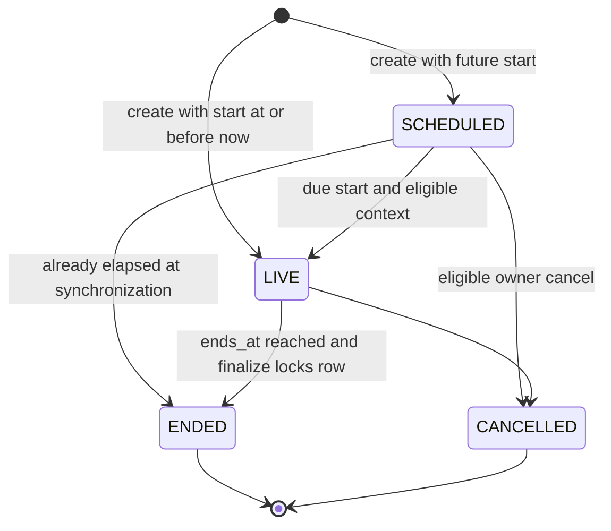
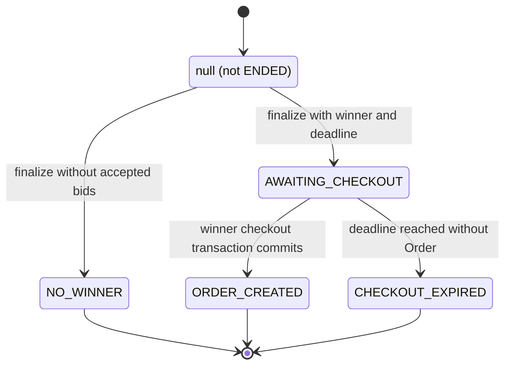
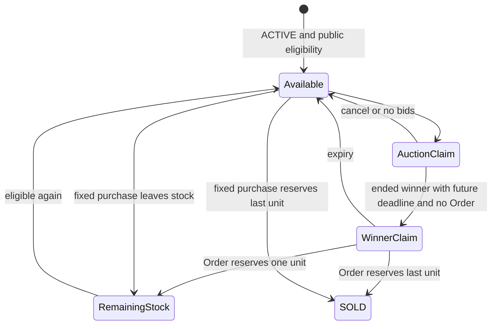

# Auction lifecycle and settlement

Sources: [AuctionService](../backend/app/Services/AuctionService.php), [Auction model](../backend/app/Models/Auction.php), [AuctionCheckoutService](../backend/app/Services/AuctionCheckoutService.php), [FixedPriceEligibility](../backend/app/Services/FixedPriceEligibility.php), [sync command](../backend/app/Console/Commands/SyncAuctions.php). These are distinct state dimensions.

## Persisted lifecycle

Creation requires active/available owned Product/Shop, positive supported decimal start/increment and future end after start. Scheduled activation rechecks visibility/ownership; unavailable activations defer. An elapsed SCHEDULED auction can finalize directly without admitting a late bid. Cancel is idempotent if already CANCELLED; accepted bids or elapsed end forbid cancellation. Finalization is idempotent for terminal lifecycle states and picks the highest accepted bid, earliest ID on ties; accepted increasing bids already serialize.

Server now must satisfy `starts_at <= now < ends_at` and status LIVE for a bid. First bid ≥ start_price, subsequent ≥ current_price + bid_increment, always recalculated after row lock. Browser countdown/animation cannot activate/finalize authoritatively.

## Derived settlement, not a column

Settlement is a **computed value, not a database column and not an enum**: `Auction::settlementState()` derives it on every read from `status`, `winner_user_id`, `winner_order_id` and `winner_checkout_expires_at`. The only values the API returns are:

| API value | Derivation |
| --- | --- |
| `null` | Lifecycle is not ENDED |
| `NO_WINNER` | ENDED and winner_user_id is null |
| `AWAITING_CHECKOUT` | ENDED winner, no winner_order_id, future winner_checkout_expires_at |
| `ORDER_CREATED` | ENDED winner and winner_order_id set |
| `CHECKOUT_EXPIRED` | ENDED winner, no Order, deadline not future |

Earlier planning text used other names for the same ideas; they do not exist in code, the API or the database.

Diagram displays actual settlement API values; NOT_ENDED is only the diagram alias for `null` before ENDED. Expiry is time-derived, not a scheduler update to a stored enum. Default claim window is `AUCTION_WINNER_CHECKOUT_HOURS=24`, starting at actual finalization. The one reminder threshold is `AUCTION_CHECKOUT_REMINDER_MINUTES=60`; reminder locks/rechecks no Order and unexpired deadline and persists its sent timestamp. No reminder after checkout.

Only ACTIVE winner, not Seller, may checkout. Service revalidates ENDED/result/product/shop/bid/address/stock under locks, uses **winning bid price**, reserves **one unit**, and creates ordinary Order/ShopOrder/OrderItem plus COD or ZaloPay attempt. Unique auction-linked item and winner Order references plus payload checks make retries return the existing Order. Conflicting retry payload gets 409. Once Order exists, its cancellation/payment outcome does not reopen settlement or grant another winner attempt.

No winner fallback, penalties/deposits or forced payment. Expiry releases fixed-price claim; creating a new auction requires normal availability checks.

## Product interaction

Available/AuctionClaim/WinnerClaim/RemainingStock are conceptual eligibility states, not Product enum values. Auction ending alone does **not** change Product to SOLD. Fixed-price Cart/Checkout and new Auction creation reject SCHEDULED/LIVE and unexpired unconsumed winner claims; current public cards/details link to Arena. After Order creation, remaining ACTIVE stock can sell normally. Moderation/deletion/owner/category activity independently overrides public/purchase eligibility. Valid Order cancellation restores stock once under existing rules; it does not erase Auction history.

### Seller changes while an auction holds the product

A product is *held* while `FixedPriceEligibility::claims()` matches it: a SCHEDULED or LIVE auction, or an ENDED auction whose winner has no Order yet and whose checkout deadline is still in the future. While held, every Seller write on the product returns **409 "Sản phẩm đang được giữ cho đấu giá."** and changes nothing:

- `hide`, `submit`, `withdraw`, `revise` and soft delete;
- any update of name, description, price, category, condition or stock;
- image upload, delete, reorder and set-primary.

The check runs inside the transaction after `ProductLocks::lock`, so the lock order stays users → shop → categories → product → auction, the same order used by bidding, auction start and winner checkout. Seller list/detail resources expose `auction_locked` so the UI disables these controls and links to the auction.

**Deliberate exceptions.** Product videos (upload, metadata, hide/show, delete) remain available: they never change the product status and adding a review clip during an auction is legitimate. Admin moderation is unchanged in this wave: an Admin can still hide a held product, which does not cancel the auction. Admin auction cancellation and automatic handling of that case are planned for D5.

The hold ends by itself when the auction is cancelled, ends without a winner, the winner creates the Order, or the checkout deadline passes.
