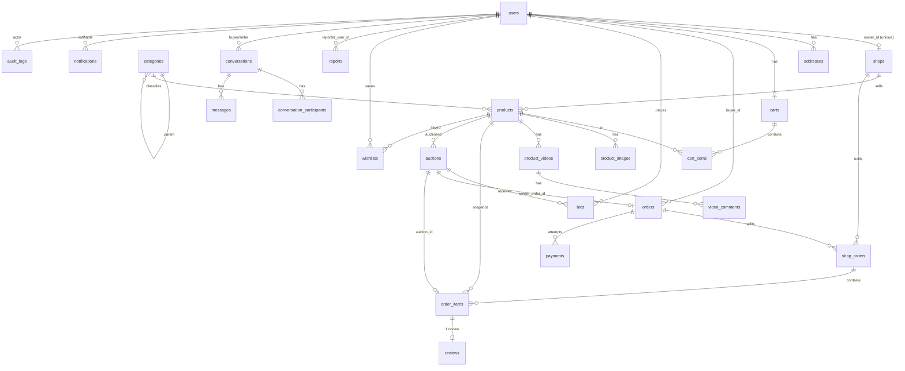

# PROJECT AUDIT — PART 1/3 (mục 0–4)

- Ngày audit: 2026-10-12. Chế độ: chỉ đọc. Phạm vi: `backend/` (Laravel) + `frontend/` (Vue) trong `secondhand-marketplace/`.
- Đường dẫn bằng chứng tính từ gốc repo `secondhand-marketplace/`. Số dòng là số dòng thật của file trong working tree tại thời điểm audit.
- Ký hiệu: ✅ ĐÃ XÁC MINH (thấy trong code / output lệnh) · ⚠️ SUY LUẬN · ❓ KHÔNG TÌM THẤY.

## Mục lục

| Phần | Mục |
| --- | --- |
| PART1 (file này) | 0 Tóm tắt điều hành · 1 Môi trường & phiên bản · 2 Cây thư mục · 3 Database schema · 4 Models & Enums |
| PART2 (`PROJECT_AUDIT_PART2.md`) | 5 API routes · 6 Backend theo module · 7 State machines |
| PART3 (`PROJECT_AUDIT_PART3.md`) | 8 Frontend · 9 Security review · 10 Testing · 11 Đối chiếu mô tả dự án · 12 Trạng thái D4 · 13 Code smell & rủi ro · 14 Câu hỏi mở |

## Những gì đã chạy / không chạy

| Lệnh | Kết quả |
| --- | --- |
| `git status`, `git log --oneline -30`, `git branch` | ✅ đã chạy |
| `php artisan --version`, `route:list --json`, `migrate:status`, `schedule:list`, `event:list` | ✅ đã chạy bằng PHP 8.4.25 (Herd). `php` không có trong PATH của Git Bash; PHP của XAMPP là 8.0.30 và bị `vendor/composer/platform_check.php` từ chối (yêu cầu ≥ 8.4.1) |
| `composer show --direct` | ⚠️ output bị lẫn mã escape; phiên bản lấy từ `backend/composer.lock` |
| `npm ls --depth=0` | ✅ đã chạy |
| `npx vitest run` | ✅ 33 file, 413 test, tất cả pass (42,6 s) |
| `npx oxlint .` và `npx eslint .` | ✅ exit 0, không có cảnh báo. **Không** chạy `npm run lint` vì script đó có `--fix` (`frontend/package.json` scripts `lint:oxlint`, `lint:eslint`) và sẽ sửa source |
| `npm run build` | ✅ build thành công (ghi vào `frontend/dist/`, thư mục đã bị gitignore) |
| `php artisan test` / `phpunit` | ❌ **KHÔNG chạy**. Cấu hình đã xác minh là trỏ DB test riêng (xem mục 10), nhưng test dùng `RefreshDatabase`/`DatabaseMigrations` (ghi vào MySQL) nên tôi giữ nguyên tắc "không ghi DB". Số test được đếm bằng grep |
| Mọi lệnh ghi DB (`migrate`, `db:seed`, `tinker`…) | ❌ không chạy |

---

## 0. Tóm tắt điều hành

- Trạng thái: code đủ cho mọi module trong mô tả (kể cả D4). Frontend: 413/413 test pass, lint sạch, build OK. Backend: 380 test method trong 39 file, **không chạy lại** trong audit này.
- **Rủi ro 1 — gần như toàn bộ phần mở rộng chưa commit.** Repo chỉ có 1 commit (`4faed97`); `git status --short` có 342 dòng (auction, video, messaging, wishlist, report, D4, realtime… đều là untracked/modified).
- **Rủi ro 2 — sửa/ẩn/xóa sản phẩm khi đang đấu giá không bị chặn.** Chỉ đổi `stock_quantity` mới bị khóa (`backend/app/Services/ProductService.php:63-64`); `hide`, `delete`, sửa nội dung, đổi ảnh vẫn chạy được và đưa sản phẩm khỏi trạng thái ACTIVE → người thắng không checkout được (`backend/app/Services/AuctionCheckoutService.php:53`).
- **Rủi ro 3 — khóa toàn bảng `categories` ở mọi thao tác ghi** (bid, giỏ hàng, checkout, sửa sản phẩm, bình luận video): `Category::orderBy('id')->lockForUpdate()->get()` (`backend/app/Services/OrderLocks.php:29`, `ProductLocks.php:19`, `AuctionService.php:47`, `CartService.php:119`, `VideoCommentService.php:43`). Mọi giao dịch ghi bị tuần tự hóa.
- **Rủi ro 4 — đấu giá và ZaloPay phụ thuộc scheduler.** Phiên chỉ chuyển LIVE/ENDED qua `auctions:sync` (`backend/routes/console.php:13`); không có luồng hoàn tiền (`REFUNDED` không bao giờ được gán), `reconciliation_required` không có route/UI xử lý.
- **Rủi ro 5 — cập nhật tồn kho nhanh đẩy sản phẩm ACTIVE về PENDING** (`backend/app/Services/ProductService.php:68`): mỗi lần người bán nhập thêm hàng, sản phẩm rời khỏi sàn cho tới khi admin duyệt lại.
- Lệch mô tả: tên trạng thái settlement trong code là `NO_WINNER / AWAITING_CHECKOUT / ORDER_CREATED / CHECKOUT_EXPIRED` (`backend/app/Models/Auction.php:24-36`), không phải `NONE / PENDING_CHECKOUT / ORDER_CREATED / EXPIRED`; trạng thái này được **tính toán**, không lưu DB và không có enum.
- Lệch mô tả: `Order` không có cột trạng thái; trạng thái tổng được suy ra từ các `ShopOrder` (`backend/app/Services/OrderSummary.php:15-28`).
- Lệch mô tả: D4 **đã có** đầy đủ (route, service, view, 15 test backend) — xem mục 12 (PART3).
- Lệch mô tả: `DemoUserSeeder` gán mật khẩu là literal trong source (`backend/database/seeders/DemoUserSeeder.php:24`); chỉ `FinalDemoSeeder` đọc `DEMO_PASSWORD`.
- Lệch nhỏ: `routes/channels.php` chỉ đăng ký `user.{userId}`; `auction.{id}` và `video.{id}` là kênh public không cần auth. Enum `PaymentMethod` còn `VNPAY` không dùng.
- Localization: không còn raw enum trong template, trừ `cancellation_reason` hiển thị tiền tố `OUT_OF_STOCK:`/`DAMAGED:`/`UNFULFILLABLE:` (`frontend/src/views/OrderView.vue:151`).

---

## 1. Môi trường & phiên bản

### Runtime & thư viện

| Thành phần | Phiên bản | Nguồn |
| --- | --- | --- |
| PHP (đã dùng để chạy artisan) | 8.4.25 | ✅ `php -r 'echo PHP_VERSION'` (Herd) |
| PHP yêu cầu | `^8.3` (composer.json); vendor yêu cầu ≥ 8.4.1 | ✅ `backend/composer.json`, `backend/vendor/composer/platform_check.php:22` |
| Laravel Framework | 13.33.0 | ✅ `php artisan --version`, composer.lock |
| laravel/sanctum | 4.3.3 | ✅ composer.lock |
| laravel/reverb | 1.12.0 | ✅ composer.lock |
| pusher/pusher-php-server | 7.3.0 | ✅ composer.lock |
| laravel/tinker | 3.0.2 | ✅ composer.lock |
| nesbot/carbon | 3.14.0 | ✅ composer.lock |
| phpunit/phpunit (dev) | 12.5.36 | ✅ composer.lock |
| laravel/boost 2.10.0, pint 1.32.1, pail 1.2.7, pao 1.1.5, mockery 1.6.15, collision 8.9.5, faker 1.24.1 (dev) | — | ✅ composer.lock |
| Node / npm | 24.16.0 / 11.13.0 (engines: `^22.18.0 \|\| >=24.12.0`) | ✅ `node --version`, `frontend/package.json` |
| vue | 3.5.43 | ✅ `npm ls` |
| vite / @vitejs/plugin-vue | 8.3.1 / 6.0.9 | ✅ |
| pinia | 4.0.3 | ✅ |
| vue-router | 5.3.1 | ✅ |
| axios | 1.20.0 | ✅ |
| laravel-echo / pusher-js | 2.6.1 / 8.6.0 | ✅ |
| chart.js | 4.5.1 | ✅ |
| bootstrap / gsap | 5.3.8 / 3.15.0 | ✅ |
| vitest / @vue/test-utils / jsdom | 5.0.2 / 2.5.1 / 30.1.1 | ✅ |
| eslint / oxlint / prettier | 10.11.0 / 1.82.0 / 3.9.6 | ✅ |
| MySQL server | ❓ không kiểm tra phiên bản | — |

### Git

- Branch: `master` (duy nhất). ✅
- Thay đổi chưa commit: **có**, 342 dòng trong `git status --short` (M/D/??). Thư mục untracked chỉ tính 1 dòng nên số file thực lớn hơn. ✅
- Lịch sử (toàn bộ, chỉ có 1 commit): `4faed97 Complete secondhand marketplace MVP`. ✅
- Nhóm file đã bị xóa khỏi working tree so với commit: Docker (`compose.yaml`, `backend/Dockerfile`, `backend/docker/*`, `docker/nginx/*`, `docker/verification/*`, `frontend/Dockerfile`, `.env.production.example`). ✅
- `.gitignore` gốc bỏ qua `.env`, `.env.*` (trừ `.env.example`, `.env.testing.example`), `vendor/`, `node_modules/`, `frontend/dist/`, `*.log`, `.runtime/`, `auth.json`. ✅

### Tên biến môi trường

Biến riêng của dự án đọc trong `backend/config/*.php` (không ghi giá trị):

| Nhóm | Biến | File |
| --- | --- | --- |
| ZaloPay | `ZALOPAY_APP_ID`, `ZALOPAY_KEY1`, `ZALOPAY_KEY2`, `ZALOPAY_CREATE_URL`, `ZALOPAY_QUERY_URL`, `ZALOPAY_RETURN_URL`, `ZALOPAY_CALLBACK_URL`, `ZALOPAY_EXPIRE_SECONDS` | `backend/config/zalopay.php:4-11` |
| Reverb | `REVERB_APP_ID`, `REVERB_APP_KEY`, `REVERB_APP_SECRET`, `REVERB_HOST`, `REVERB_PORT`, `REVERB_SCHEME`, `REVERB_SERVER_HOST`, `REVERB_SERVER_PORT`, `REVERB_ALLOWED_ORIGINS` (+ các biến `REVERB_APP_*`, `REVERB_SCALING_*` mặc định) | `backend/config/broadcasting.php:6-7`, `backend/config/reverb.php` |
| Broadcast | `BROADCAST_CONNECTION` | `backend/config/broadcasting.php:4` |
| SPA/CORS | `FRONTEND_URLS`, `SANCTUM_STATEFUL_DOMAINS`, `SANCTUM_TOKEN_PREFIX`, `SESSION_DOMAIN`, `SESSION_SECURE_COOKIE`, `SESSION_SAME_SITE`, `SESSION_HTTP_ONLY`, `TRUSTED_PROXIES` | `backend/config/cors.php:6`, `sanctum.php:20,62`, `session.php:159-202`, `trustedproxy.php:4` |
| Auth | `PASSWORD_RESET_URL` | `backend/config/auth.php:18` |
| Đấu giá | `AUCTION_CHECKOUT_REMINDER_MINUTES`, `AUCTION_WINNER_CHECKOUT_HOURS` | `backend/config/auctions.php:3` |
| Video | `PRODUCT_VIDEO_MAX_KB` | `backend/config/product-videos.php:3` |
| D4 | `SELLER_LOW_STOCK_THRESHOLD`, `SELLER_AUCTION_ENDING_SOON_MINUTES` | `backend/config/seller-inventory.php:4-5` |
| Demo | `DEMO_PASSWORD` | `backend/config/demo.php:4` |
| Laravel chuẩn | `APP_*`, `DB_*`, `SESSION_*`, `CACHE_*`, `QUEUE_CONNECTION`, `MAIL_*`, `LOG_*`, `FILESYSTEM_DISK`, `AWS_*`, `REDIS_*`, `MEMCACHED_*` | `backend/config/{app,database,session,cache,queue,mail,logging,filesystems}.php` |

- Frontend (`frontend/.env`, chỉ tên): `VITE_API_BASE_URL`, `VITE_BACKEND_PROXY_TARGET`, `VITE_REVERB_APP_KEY`, `VITE_REVERB_HOST`, `VITE_REVERB_PORT`, `VITE_REVERB_SCHEME`. ✅
- Biến có trong `config` nhưng **không** có trong `backend/.env` hiện tại: `AUCTION_*`, `PRODUCT_VIDEO_MAX_KB`, `SELLER_*` (dùng giá trị mặc định). ✅
- Giá trị không nhạy cảm đang dùng ở local: `APP_ENV=local`, `APP_DEBUG=true`, `DB_CONNECTION=mysql`, `BROADCAST_CONNECTION=reverb`, `QUEUE_CONNECTION=sync`, `SESSION_DRIVER=file`, `CACHE_STORE=file`. ✅
- Timezone ứng dụng cố định `UTC` (`backend/config/app.php:68`). ✅

### Scheduler & event (output lệnh)

- `schedule:list`: `zalopay:reconcile --limit=100` và `auctions:sync --limit=100`, đều mỗi phút, `withoutOverlapping()` (`backend/routes/console.php:11,13`). ✅
- `event:list`: chỉ có listener mặc định của framework/pail/pao; **không có listener ứng dụng**. 8 class trong `backend/app/Events/` đều là broadcast event. ✅

---

## 2. Cây thư mục

```text
secondhand-marketplace/
├─ README.md, .gitignore
├─ .runtime/                  (gitignored; log, ảnh chụp, script kiểm thử cũ, file cookie)
├─ docs/                      (57 file .md; + docs/audit/ do audit này tạo)
├─ backend/
│  ├─ app/
│  │  ├─ Console/Commands/    ReconcileZaloPay.php, SyncAuctions.php
│  │  ├─ Enums/               17 enum
│  │  ├─ Events/              8 broadcast event
│  │  ├─ Exceptions/          CheckoutPlanChanged.php
│  │  ├─ Http/
│  │  │  ├─ Controllers/Api/V1/   31 controller + Auth/AuthController, Auth/PasswordResetController
│  │  │  ├─ Middleware/           EnsureActiveAccount, EnsureAdmin, EnsureSpaSession, ValidateBroadcastSubscription
│  │  │  ├─ Requests/Auth/        4 FormRequest
│  │  │  ├─ Requests/Domain/      63 FormRequest
│  │  │  └─ Resources/            30 resource
│  │  ├─ Models/              23 model
│  │  ├─ Policies/            15 policy
│  │  ├─ Providers/           AppServiceProvider.php
│  │  └─ Services/            33 service
│  ├─ bootstrap/              app.php, providers.php
│  ├─ config/                 app, auth, auctions, broadcasting, cache, cors, database, demo, filesystems,
│  │                          logging, mail, product-videos, queue, reverb, sanctum, seller-inventory,
│  │                          services, session, trustedproxy, zalopay
│  ├─ database/
│  │  ├─ factories/           22 factory
│  │  ├─ migrations/          27 migration
│  │  └─ seeders/             DatabaseSeeder, CategorySeeder, DemoUserSeeder, DemoMarketplaceSeeder, FinalDemoSeeder
│  ├─ resources/
│  │  ├─ css/, js/            (scaffold mặc định)
│  │  ├─ views/welcome.blade.php   (không route nào trả về)
│  │  └─ demo-marketplace/    catalog.json, images/, README.md, render_assets.py
│  ├─ routes/                 api.php, channels.php, console.php, web.php
│  ├─ tests/
│  │  ├─ Feature/             38 file test
│  │  ├─ Unit/                ExampleTest.php
│  │  ├─ Fixtures/            product-review.mp4, product-review.webm
│  │  ├─ Support/             checkout-worker.php, auction-worker.php, report-worker.php
│  │  └─ TestCase.php
│  ├─ dev/uploads.ini, serve.ps1, phpunit.xml, composer.json
└─ frontend/
   ├─ index.html, vite.config.js, vitest.config.js, eslint.config.js, package.json
   └─ src/
      ├─ main.js, App.vue
      ├─ api/                 23 module (axios.js + *.api.js + catalogOptions.js)
      ├─ router/              index.js, authGuard.js
      ├─ stores/              auth.js, cart.js, wishlist.js, counter.js
      ├─ composables/         13 file (auctionEcho, useAuctionRealtime, useUserRealtime, useVideoComments,
      │                       useMessaging, useNotifications, useAuctionCountdown, auctionTimeSync, …)
      ├─ utils/               labels.js, validationLabels.js, discoveryQuery.js, reportPresentation.js
      ├─ layouts/             DefaultLayout.vue
      ├─ components/          26 file gốc + account/ admin/ auction/ chat/ home/ notifications/ seller/ ui/
      ├─ views/               38 view
      ├─ styles/              admin.css, auction.css, buyer.css, notifications.css (+2 file)
      └─ __tests__/           33 file spec
```

- Không có thư mục `services/` ở frontend; lớp gọi API là `frontend/src/api/`. ✅

---

## 3. Database schema

Quy ước: `ts6` = `dateTime(…, 6)`; mọi FK là `foreignId` → `unsignedBigInteger`. Mọi migration ở `backend/database/migrations/`.

### 3.1 Trạng thái migration (`php artisan migrate:status`, DB dev)

| # | Migration | Batch | Trạng thái |
| --- | --- | --- | --- |
| 1 | `0001_01_01_000000_create_users_table` | 1 | Ran |
| 2 | `0001_01_01_000001_create_cache_table` | 1 | Ran |
| 3 | `0001_01_01_000002_create_jobs_table` | 1 | Ran |
| 4 | `2026_09_25_182012_create_personal_access_tokens_table` | 1 | Ran |
| 5 | `2026_09_26_080336_create_addresses_table` | 1 | Ran |
| 6 | `2026_09_26_080337_create_shops_table` | 1 | Ran |
| 7 | `2026_09_26_080338_create_categories_table` | 1 | Ran |
| 8 | `2026_09_26_080339_create_products_table` | 1 | Ran |
| 9 | `2026_09_26_080340_create_product_images_table` | 1 | Ran |
| 10 | `2026_09_26_080341_create_carts_table` | 1 | Ran |
| 11 | `2026_09_26_080342_create_cart_items_table` | 1 | Ran |
| 12 | `2026_09_26_080343_create_orders_table` | 1 | Ran |
| 13 | `2026_09_26_080344_create_shop_orders_table` | 1 | Ran |
| 14 | `2026_09_26_080345_create_order_items_table` | 1 | Ran |
| 15 | `2026_09_26_080346_create_payments_table` | 1 | Ran |
| 16 | `2026_09_26_080347_create_reviews_table` | 1 | Ran |
| 17 | `2026_09_26_080348_create_audit_logs_table` | 1 | Ran |
| 18 | `2026_09_30_070530_add_zalopay_payment_attempts` | 2 | Ran |
| 19 | `2026_10_07_085854_create_messaging_tables` | 3 | Ran |
| 20 | `2026_10_07_152208_create_auctions_and_bids_tables` | 4 | Ran |
| 21 | `2026_10_08_065953_add_winner_settlement_to_auctions_and_order_items` | 5 | Ran |
| 22 | `2026_10_08_085059_create_notifications_table` | 6 | Ran |
| 23 | `2026_10_08_085102_add_checkout_reminder_timestamp_to_auctions` | 6 | Ran |
| 24 | `2026_10_08_161224_create_product_videos_table` | 7 | Ran |
| 25 | `2026_10_08_182727_create_video_comments_table` | 8 | Ran |
| 26 | `2026_10_09_161815_create_wishlists_table` | 9 | Ran |
| 27 | `2026_10_09_170316_create_reports_table` | 10 | Ran |

Không có migration pending. ✅

### 3.2 Bảng nghiệp vụ

**users** (`0001_01_01_000000…:15-33`)

| Cột | Kiểu | Null | Default | Ghi chú |
| --- | --- | --- | --- | --- |
| id | bigint PK | | | |
| name | varchar(100) | | | |
| email | varchar(254) | | | UNIQUE |
| email_verified_at | timestamp | ✓ | | |
| password | varchar | | | |
| phone | varchar(20) | ✓ | | |
| avatar_path | varchar(512) | ✓ | | |
| role | varchar(16) | | `USER` | CHECK IN (USER, ADMIN) |
| status | varchar(16) | | `ACTIVE` | CHECK IN (ACTIVE, SUSPENDED) |
| deleted_at | ts6 | ✓ | | soft delete |
| remember_token, created_at ts6, updated_at ts6 | | | | INDEX (status, created_at, id) |

Kèm `password_reset_tokens` (email PK, token, created_at) và `sessions` (id PK, user_id index, ip_address, user_agent, payload, last_activity index).

**addresses** (`…080336…:11-25`): id; user_id FK→users CASCADE delete; recipient_name(100); phone(20); address_line(255); ward(100); district(100) null; province(100); country_code char(2) default `VN`; is_default bool default false; ts6. INDEX (user_id, is_default, id).

**shops** (`…080337…:12-26`): id; owner_id FK→users RESTRICT, **UNIQUE**; name(150); slug(180) UNIQUE; description text null; logo_path(512) null; status(16) default `PENDING`, CHECK IN (PENDING, ACTIVE, SUSPENDED, REJECTED); moderation_reason(1000) null; deleted_at ts6; ts6. INDEX (status, created_at, id).

**categories** (`…080338…:12-23`): id; parent_id FK→categories RESTRICT, null; name(100); slug(150) UNIQUE; description text null; status(16) default `ACTIVE`, CHECK IN (ACTIVE, INACTIVE); ts6. INDEX (parent_id, status, id).

**products** (`…080339…:12-35`)

| Cột | Kiểu | Null | Default | Ghi chú |
| --- | --- | --- | --- | --- |
| id | bigint PK | | | |
| shop_id | FK→shops | | | RESTRICT |
| category_id | FK→categories | | | RESTRICT |
| name | varchar(200) | | | |
| slug | varchar(240) | | | UNIQUE |
| description | text | | | |
| price | decimal(15,2) | | | CHECK price > 0 |
| stock_quantity | unsigned int | | 0 | |
| condition | varchar(16) | | | CHECK IN (LIKE_NEW, GOOD, FAIR, POOR) |
| status | varchar(16) | | `DRAFT` | CHECK IN (DRAFT, PENDING, ACTIVE, SOLD, HIDDEN, REJECTED) |
| moderation_reason | varchar(1000) | ✓ | | |
| published_at | ts6 | ✓ | | |
| deleted_at | ts6 | ✓ | | soft delete |

INDEX: (status, deleted_at, created_at, id); (category_id, status, deleted_at, created_at, id); (shop_id, status, deleted_at, created_at, id); (status, deleted_at, price, id).

**product_images** (`…080340…:11-20`): id; product_id FK→products CASCADE; image_path(512); alt_text(255) null; is_primary bool default false; sort_order unsigned smallint default 0; ts6. INDEX (product_id, sort_order, id).

**carts** (`…080341…`): id; user_id FK→users CASCADE, UNIQUE; ts6.

**cart_items** (`…080342…:12-21`): id; cart_id FK→carts CASCADE; product_id FK→products CASCADE; quantity unsigned smallint, CHECK BETWEEN 1 AND 99; ts6. UNIQUE (cart_id, product_id).

**orders** (`…080343…:12-38`, sửa bởi `…070530…:13`)

| Cột | Kiểu | Null | Default | Ghi chú |
| --- | --- | --- | --- | --- |
| id | PK | | | |
| buyer_id | FK→users | | | RESTRICT |
| order_code | varchar(32) | | | UNIQUE |
| checkout_key | char(36) | | | idempotency key |
| request_hash | char(64) | | | SHA-256 của payload |
| shipping_recipient_name(100), shipping_phone(20), shipping_address_line(255), shipping_ward(100), shipping_province(100) | varchar | | | snapshot địa chỉ |
| shipping_district | varchar(100) | ✓ | | |
| shipping_country_code | char(2) | | `VN` | |
| subtotal, total_amount | decimal(15,2) | | | |
| shipping_fee, discount_amount | decimal(15,2) | | 0 | |
| currency | char(3) | | `VND` | |
| payment_method | varchar(16) | | `COD` | CHECK IN (COD, VNPAY, ZALOPAY) |

UNIQUE (buyer_id, checkout_key). INDEX (buyer_id, created_at, id), (created_at, id). CHECK: mọi số tiền ≥ 0 và `total_amount = subtotal + shipping_fee - discount_amount`. **Không có cột status.**

**shop_orders** (`…080344…:12-36`): id; order_id FK→orders RESTRICT; shop_id FK→shops RESTRICT; status(16) default `PENDING`, CHECK IN (PENDING, CONFIRMED, PROCESSING, SHIPPING, COMPLETED, CANCELLED); subtotal, total_amount decimal(15,2); shipping_fee, discount_amount decimal(15,2) default 0; confirmed_at, processing_at, shipping_at, completed_at, cancelled_at, stock_restored_at ts6 null; cancellation_reason(1000) null; ts6. UNIQUE (order_id, shop_id). INDEX (shop_id, status, created_at, id), (shop_id, status, completed_at), (status, created_at, id). CHECK số tiền như `orders`.

**order_items** (`…080345…:12-26`, `…065953…:17-18`): id; shop_order_id FK→shop_orders RESTRICT; product_id FK→products RESTRICT; product_name(200); product_image(512); product_price decimal(15,2); quantity unsigned smallint CHECK 1–99; subtotal decimal(15,2); auction_id FK→auctions RESTRICT, null, **UNIQUE**; ts6. UNIQUE (shop_order_id, product_id). CHECK `product_price > 0 AND subtotal = product_price * quantity`.

**payments** (`…080346…:12-35`, `…070530…:13-24`)

| Cột | Kiểu | Null | Default | Ghi chú |
| --- | --- | --- | --- | --- |
| id | PK | | | |
| order_id | FK→orders | | | RESTRICT |
| attempt_number | unsigned int | | | CHECK ≥ 1 |
| method | varchar(16) | | `COD` | CHECK IN (COD, VNPAY, ZALOPAY) |
| amount | decimal(15,2) | | | CHECK > 0 |
| currency | char(3) | | `VND` | |
| status | varchar(16) | | `PENDING` | CHECK IN (PENDING, PAID, FAILED, CANCELLED, REFUNDED) |
| transaction_reference | varchar(64) | | | UNIQUE |
| gateway_transaction_id | varchar(100) | ✓ | | |
| paid_at, failed_at, gateway_requested_at, expires_at | ts6 | ✓ | | |
| failure_code | varchar(100) | ✓ | | |
| request_key | uuid | ✓ | | idempotency của retry |
| order_url | text | ✓ | | |
| preferred_payment_method | json | ✓ | | |
| gateway_app_id | unsigned int | ✓ | | |
| gateway_app_time | unsigned bigint | ✓ | | |
| reconciliation_required | bool | | false | |

UNIQUE: (order_id, attempt_number); (method, gateway_transaction_id); (order_id, request_key). INDEX (order_id, created_at, id), (status, created_at, id).

**reviews** (`…080347…:12-26`): id; user_id FK→users RESTRICT; product_id FK→products RESTRICT; order_item_id FK→order_items RESTRICT, **UNIQUE**; rating unsigned tinyint CHECK 1–5; comment text null; status(16) default `PUBLISHED`, CHECK IN (PUBLISHED, HIDDEN); moderation_reason(1000) null; ts6. INDEX (product_id, status, created_at, id).

**audit_logs** (`…080348…:11-23`): id; actor_id FK→users RESTRICT null; entity_type(40); entity_id unsigned bigint; action(80); from_status(32) null; to_status(32) null; reason(1000) null; request_id char(36) null; created_at ts6. INDEX (entity_type, entity_id, created_at, id), (actor_id, created_at).

**conversations** (`…085854…:12-22`): id; buyer_id, seller_id FK→users RESTRICT; product_id FK→products RESTRICT null; context_key(80) UNIQUE; last_message_at datetime null; timestamps. INDEX (last_message_at, id). CHECK `buyer_id <> seller_id`.

**conversation_participants** (`…:23-31`): id; conversation_id FK CASCADE; user_id FK RESTRICT; last_read_message_id unsigned bigint default 0; timestamps. UNIQUE (conversation_id, user_id). INDEX (user_id, conversation_id).

**messages** (`…:32-40`): id; conversation_id FK CASCADE; sender_id FK→users RESTRICT; body varchar(1000); timestamps. INDEX (conversation_id, id), (conversation_id, sender_id, id).

**auctions** (`…152208…:12-46`, `…065953…:12-16`, `…085102…:11-13`)

| Cột | Kiểu | Null | Ghi chú |
| --- | --- | --- | --- |
| id | PK | | |
| product_id | FK→products | | RESTRICT |
| seller_id | FK→users | | RESTRICT |
| start_price, current_price, bid_increment | decimal(15,2) | | CHECK start_price > 0, current_price ≥ start_price, bid_increment > 0 |
| starts_at, ends_at | ts6 | | CHECK ends_at > starts_at |
| status | varchar(16) | | không default; CHECK IN (SCHEDULED, LIVE, ENDED, CANCELLED) |
| winner_user_id | FK→users | ✓ | RESTRICT |
| winning_bid_id | unsigned bigint | ✓ | FK kép (id, winning_bid_id) → bids(auction_id, id) |
| active_product_id | unsigned bigint, **stored generated** | ✓ | `CASE WHEN status IN ('SCHEDULED','LIVE') THEN product_id END`, **UNIQUE** → mỗi sản phẩm tối đa 1 phiên chưa kết thúc |
| winner_checkout_expires_at | timestamp(6) | ✓ | INDEX |
| winner_order_id | FK→orders | ✓ | RESTRICT, UNIQUE |
| settled_at, winner_checkout_reminded_at | timestamp(6) | ✓ | |

INDEX: (status, starts_at, id); (status, ends_at, id); (seller_id, created_at, id); `auctions_due_reminder_index` (status, winner_order_id, winner_checkout_reminded_at, winner_checkout_expires_at). CHECK `auctions_winner_check`: winner và winning bid cùng null, hoặc status = ENDED và cả hai khác null.

**bids** (`…152208…:30-38`): id; auction_id FK→auctions RESTRICT; user_id FK→users RESTRICT; amount decimal(15,2) CHECK > 0; timestamps(6). UNIQUE (auction_id, id). INDEX (auction_id, amount, id), (user_id, created_at, id).

**notifications** (`…085059…:14-22`): id uuid PK; type varchar; dedup_key char(64) **UNIQUE**; notifiable_type + notifiable_id (morphs, index); data text; read_at null; timestamps. INDEX `notifications_owner_unread_index` (notifiable_type, notifiable_id, read_at, created_at).

**product_videos** (`…161224…:12-31`): id; product_id FK→products RESTRICT; uploaded_by FK→users RESTRICT; title(200) null; description text null; path varchar UNIQUE; mime_type(32); file_size unsigned bigint; duration_seconds unsigned int null; poster_path null; sort_order unsigned int default 0; is_primary bool default false; status(16) default `READY`, CHECK IN (PROCESSING, READY, HIDDEN, FAILED); primary_product_id stored generated (`status='READY' AND is_primary=1 → product_id`) UNIQUE; timestamps. INDEX (product_id, status, sort_order, id). CHECK `is_primary = 0 OR status = 'READY'`.

**video_comments** (`…182727…:12-22`): id; product_video_id FK→product_videos CASCADE; user_id FK→users RESTRICT; body text; status(16) default `PUBLISHED`, CHECK IN (PUBLISHED, HIDDEN); timestamps. INDEX (product_video_id, created_at), (product_video_id, status, id).

**wishlists** (`…161815…:11-17`): id; user_id FK→users CASCADE; product_id FK→products CASCADE; created_at timestamp(6) useCurrent. **UNIQUE (user_id, product_id)**. INDEX (user_id, created_at, id).

**reports** (`…170316…:11-29`): id; reporter_user_id FK→users SET NULL, null; target_type(20); target_id unsigned bigint (không FK, đa hình thủ công); target_name(255); reason(30); description text null; status(20) default `PENDING`; handled_by FK→users SET NULL, null; handled_at null; admin_note text null; timestamps; open_slot tinyint **virtual generated** (`status IN ('PENDING','IN_REVIEW') → 1`). UNIQUE `reports_one_open_per_reporter` (reporter_user_id, target_type, target_id, open_slot). INDEX (target_type, target_id), (status, created_at, id), (reporter_user_id, created_at, id), (created_at). **Không có CHECK** cho `status`/`reason`/`target_type` (khác các bảng khác).

Bảng hạ tầng: `cache`, `cache_locks`, `jobs`, `job_batches`, `failed_jobs`, `personal_access_tokens` (tồn tại nhưng `User` không dùng `HasApiTokens` — ✅ grep không thấy).

### 3.3 ERD (quan hệ chính)



---

## 4. Models & Enums

### 4.1 Models (`backend/app/Models/`)

Không model nào định nghĩa scope (`scope*`) hay accessor (`Attribute`/`get*Attribute`). ✅ Hầu hết đặt `$dateFormat = 'Y-m-d H:i:s.u'`.

| Model | Bảng | Mass assignment | Casts chính | Quan hệ |
| --- | --- | --- | --- | --- |
| `User` (:14) | users | fillable: name, email, password, phone, avatar_path (**không** có role/status); hidden: password, remember_token; SoftDeletes, Notifiable | role→`UserRole`, status→`UserStatus`, password→hashed | addresses, shop (hasOne owner_id), cart, orders (buyer_id), reviews, auditLogs |
| `Address` (:9) | addresses | fillable: user_id, recipient_name, phone, address_line, ward, district, province, country_code, is_default | is_default→bool | user |
| `Shop` (:12) | shops | fillable: owner_id, name, slug, description, logo_path, status, moderation_reason; SoftDeletes | status→`ShopStatus` | owner, products, shopOrders |
| `Category` (:11) | categories | fillable: parent_id, name, slug, description, status | status→`CategoryStatus` | parent, children, products |
| `Product` (:15) | products | fillable: shop_id, category_id, name, slug, description, price, stock_quantity, condition, status, moderation_reason, published_at; SoftDeletes | price→decimal:2, stock_quantity→int, condition→`ProductCondition`, status→`ProductStatus` | shop, category, images, videos, wishlistEntries, cartItems, orderItems, reviews, `auctionClaim` (hasOne Auction lọc theo `FixedPriceEligibility::claims()`, :59-61) |
| `ProductImage` (:9) | product_images | fillable: product_id, image_path, alt_text, is_primary, sort_order | bool/int | product |
| `ProductVideo` (:10) | product_videos | `guarded = ['*']` | status→`ProductVideoStatus`, is_primary→bool | product, uploader |
| `VideoComment` (:10) | video_comments | `guarded = ['*']` | status→`VideoCommentStatus` | video, user (withTrashed) |
| `Cart` (:10) / `CartItem` (:9) | carts / cart_items | fillable: user_id / cart_id, product_id, quantity | quantity→int | user, items / cart, product |
| `Order` (:11) | orders | fillable: 17 cột (buyer_id, order_code, checkout_key, request_hash, shipping_*, tiền, currency, payment_method) | tiền→decimal:2, payment_method→`PaymentMethod` | buyer (withTrashed), shopOrders, payments |
| `ShopOrder` (:11) | shop_orders | fillable: order_id, shop_id, status, tiền, 6 mốc thời gian, cancellation_reason | status→`ShopOrderStatus`, mốc→datetime | order, shop (withTrashed), orderItems |
| `OrderItem` (:10) | order_items | fillable: auction_id, shop_order_id, product_id, product_name, product_image, product_price, quantity, subtotal | decimal:2 | auction, shopOrder, product (withTrashed), review (hasOne) |
| `Payment` (:11) | payments | fillable: 19 cột | method→`PaymentMethod`, status→`PaymentStatus`, amount→decimal:2, preferred_payment_method→array | order |
| `Review` (:10) | reviews | fillable: user_id, product_id, order_item_id, rating, comment, status, moderation_reason | status→`ReviewStatus` | user, product (withTrashed), orderItem |
| `Auction` (:11) | auctions | `guarded = ['*']` | status→`AuctionStatus`, giá→decimal:2, thời gian→immutable_datetime | product (withTrashed), seller, bids, winner, winningBid, winnerOrder; method `settlementState()` (:24-36) |
| `Bid` (:9) | bids | `guarded = ['*']` | amount→decimal:2 | auction, user (withTrashed) |
| `Conversation` (:11) | conversations | guarded: id, buyer_id, seller_id, product_id, context_key, last_message_at | last_message_at→datetime | product, participants, messages, latestMessage |
| `ConversationParticipant` (:8) | conversation_participants | guarded: id, conversation_id, user_id, last_read_message_id | int | user, conversation |
| `Message` (:9) | messages | guarded: id, conversation_id, sender_id, body | — | conversation |
| `Wishlist` (:8) | wishlists | fillable: user_id, product_id; `UPDATED_AT = null` | — | (không khai báo quan hệ) |
| `Report` (:12) | reports | `guarded = ['*']` | target_type→`ReportTargetType`, reason→`ReportReason`, status→`ReportStatus` | reporter, handler (withTrashed) |
| `AuditLog` (:9) | audit_logs | fillable: 9 cột; `UPDATED_AT = null` | — | actor (withTrashed) |

- ❓ Không có model `Notification` riêng: thông báo dùng `Illuminate\Notifications\DatabaseNotification` qua trait `Notifiable` (`backend/app/Services/AuctionNotificationService.php:19-27`).
- Model `guarded = ['*']` luôn được ghi bằng `forceFill()` trong service.

### 4.2 Enum & hằng trạng thái

| Miền | Giá trị thực tế | Nơi định nghĩa |
| --- | --- | --- |
| User role | `USER`, `ADMIN` | `backend/app/Enums/UserRole.php:7-8` |
| User status | `ACTIVE`, `SUSPENDED` | `Enums/UserStatus.php:7-8` |
| Shop | `PENDING`, `ACTIVE`, `SUSPENDED`, `REJECTED` | `Enums/ShopStatus.php:7-10` |
| Category | `ACTIVE`, `INACTIVE` | `Enums/CategoryStatus.php:7-8` |
| Product status | `DRAFT`, `PENDING`, `ACTIVE`, `SOLD`, `HIDDEN`, `REJECTED` | `Enums/ProductStatus.php:7-12` |
| Product condition | `LIKE_NEW`, `GOOD`, `FAIR`, `POOR` | `Enums/ProductCondition.php:7-10` |
| Order (tổng, **suy ra**) | `PENDING`, `IN_PROGRESS`, `COMPLETED`, `PARTIALLY_COMPLETED`, `CANCELLED` | `Enums/OrderStatus.php:7-11`; chỉ dùng để validate bộ lọc, giá trị tính ở `Services/OrderSummary.php:15-28` |
| ShopOrder | `PENDING`, `CONFIRMED`, `PROCESSING`, `SHIPPING`, `COMPLETED`, `CANCELLED` | `Enums/ShopOrderStatus.php:7-12` |
| Payment method | `COD`, `ZALOPAY`, `VNPAY` (VNPAY không có luồng nào dùng) | `Enums/PaymentMethod.php:7-9` |
| Payment status | `PENDING`, `PAID`, `FAILED`, `CANCELLED`, `REFUNDED` (REFUNDED không được gán ở đâu) | `Enums/PaymentStatus.php:7-11` |
| Auction | `SCHEDULED`, `LIVE`, `ENDED`, `CANCELLED` | `Enums/AuctionStatus.php:7-10` |
| Settlement (**không có enum, tính toán**) | `null` (chưa ENDED), `NO_WINNER`, `AWAITING_CHECKOUT`, `ORDER_CREATED`, `CHECKOUT_EXPIRED` | `Models/Auction.php:24-36` |
| Review | `PUBLISHED`, `HIDDEN` | `Enums/ReviewStatus.php:7-8` |
| Report target | `PRODUCT`, `SHOP`, `VIDEO_COMMENT` | `Enums/ReportTargetType.php:7-9` |
| Report reason (8) | `SCAM`, `COUNTERFEIT`, `MISLEADING`, `PROHIBITED_CONTENT`, `SPAM`, `HARASSMENT`, `INAPPROPRIATE_CONTENT`, `OTHER` | `Enums/ReportReason.php:7-14` |
| Report status (4) | `PENDING`, `IN_REVIEW`, `RESOLVED`, `DISMISSED` | `Enums/ReportStatus.php:7-10` |
| Video | `PROCESSING`, `READY`, `HIDDEN`, `FAILED` (upload gán thẳng READY; PROCESSING/FAILED không có luồng gán) | `Enums/ProductVideoStatus.php:7-10`, `Services/ProductVideoService.php:70` |
| Video comment | `PUBLISHED`, `HIDDEN` | `Enums/VideoCommentStatus.php:7-8` |
| Notification type (**chuỗi literal, không enum**) | `OUTBID`, `AUCTION_WON`, `AUCTION_ENDED`, `AUCTION_CANCELLED`, `AUCTION_ORDER_CREATED`, `WINNER_CHECKOUT_EXPIRING`, `REPORT_RESULT` | `Services/AuctionNotificationService.php:41,49,51,53,60,66,79`; `Services/ReportService.php:78` |
| Lý do hủy đơn của seller | `OUT_OF_STOCK`, `DAMAGED`, `UNFULFILLABLE` | `Http/Requests/Domain/UpdateShopOrderRequest.php:15` |
| Lý do giỏ hàng không khả dụng | `OWN_SHOP`, `PRODUCT_UNAVAILABLE`, `AUCTION_RESERVED`, `INSUFFICIENT_STOCK` | `Services/CartService.php:75-80` |
| Trạng thái tồn kho (D4) | `OUT_OF_STOCK`, `LOW_STOCK`, `NORMAL` | `Http/Resources/ManagedProductResource.php:15` |
| Kênh ZaloPay | `international_card`, `domestic_card`, `account`, `zalopay_wallet`, `vietqr` | `Services/ZaloPayGateway.php:11` |
| Mã lỗi thanh toán | `CREATE_REJECTED`, `NOT_SENT_EXPIRED`, `GATEWAY_EXPIRED` | `Services/ZaloPayService.php:60,97,115` |

Ghi chú đặt tên: enum cũ dùng case IN_HOA (`ProductStatus::ACTIVE`), enum mới dùng PascalCase (`ReportStatus::Pending`, `ProductVideoStatus::Ready`). ✅

---

Tiếp tục ở `PROJECT_AUDIT_PART2.md` (mục 5–7).
