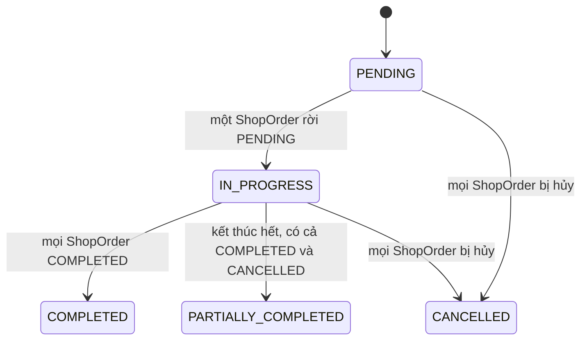
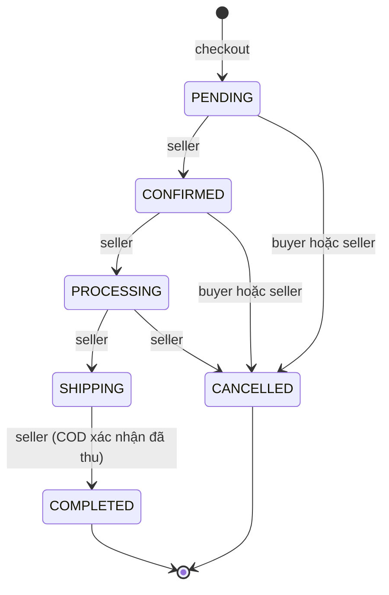
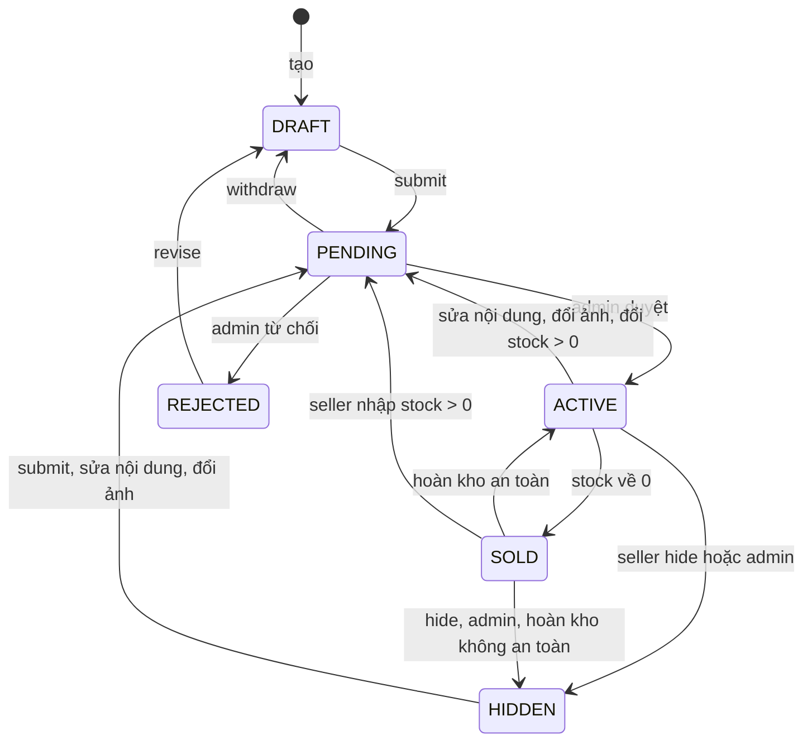
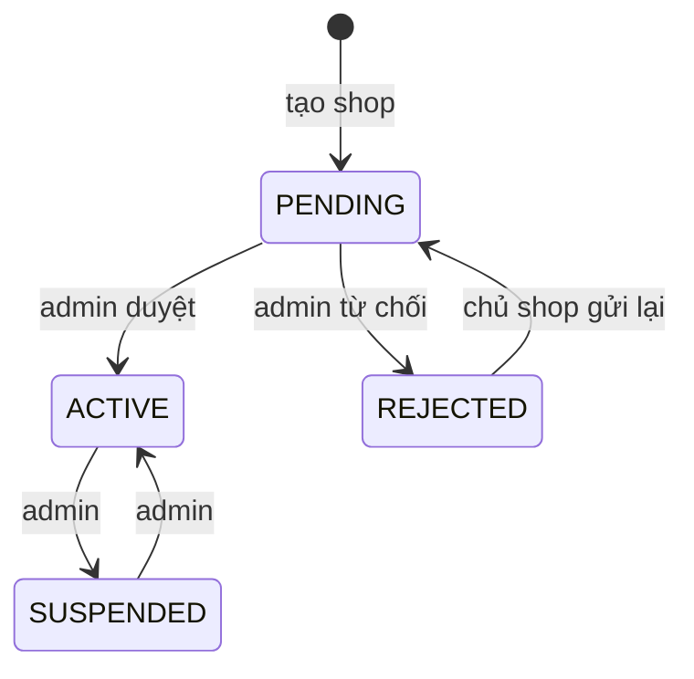
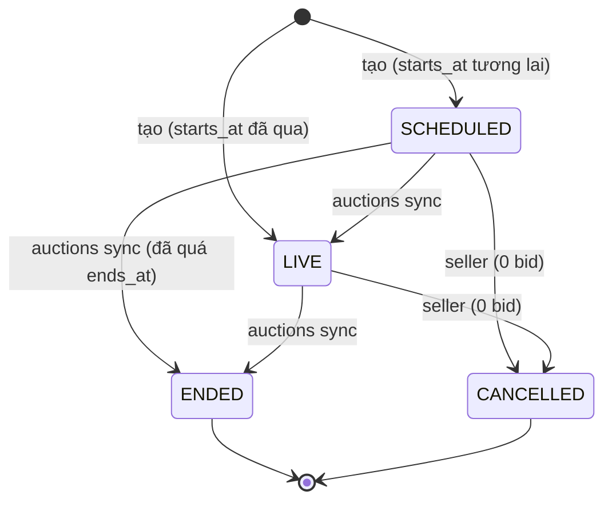
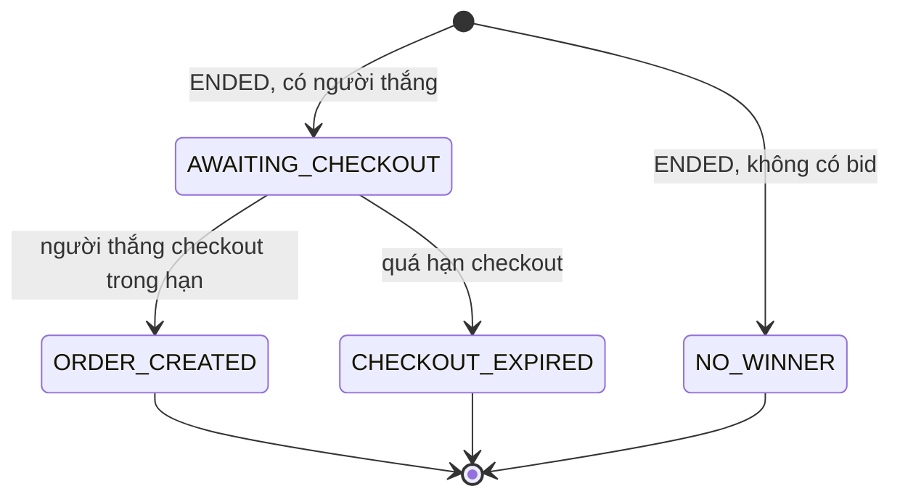
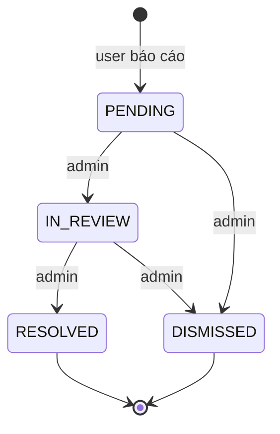

# PROJECT AUDIT — PART 2/3 (mục 5–7)

- Tiếp theo `PROJECT_AUDIT_PART1.md` (mục 0–4, có mục lục và bảng "đã chạy / không chạy"). Phần cuối: `PROJECT_AUDIT_PART3.md` (mục 8–14).
- Đường dẫn bằng chứng tính từ gốc repo `secondhand-marketplace/`. Trong mục 6, đường dẫn rút gọn (`Services/…`, `Http/…`, `Models/…`) nằm dưới `backend/app/`; `tests/…` nằm dưới `backend/`.
- Ký hiệu: ✅ ĐÃ XÁC MINH · ⚠️ SUY LUẬN · ❓ KHÔNG TÌM THẤY.

---

## 5. API routes

Nguồn: `php artisan route:list --json` (127 route) đối chiếu `backend/routes/api.php`. Prefix chung `api/v1` (`backend/bootstrap/app.php:19`).

Ký hiệu middleware:

- **PUB** = `api` + `throttle:public-read` (120/phút/IP). Không cần đăng nhập.
- **AUTH** = `api` + `auth:sanctum` + `EnsureActiveAccount` + `EnsureSpaSession` + `throttle:domain` (60 lần ghi/phút/user; GET không giới hạn — `backend/app/Providers/AppServiceProvider.php:58`).
- **ADMIN** = AUTH + `EnsureAdmin`.
- Cột "Policy/gate": nơi gọi `Gate::authorize`/`can()`; "FR" = trong `authorize()` của FormRequest; "svc" = trong service (sau khi khóa row).

### Auth & hệ thống

| Method | URI | Controller@method | Middleware | Policy/gate |
| --- | --- | --- | --- | --- |
| GET | `/health` | Closure (`api.php:41`) | `api` (public, không throttle) | — |
| POST | `/auth/register` | Auth\AuthController@register | `EnsureSpaSession`, `throttle:register` (5/giờ/IP) | — |
| POST | `/auth/login` | Auth\AuthController@login | `EnsureSpaSession`, `throttle:login` (5/phút theo email+IP, 20/phút/IP) | — |
| POST | `/auth/forgot-password` | Auth\PasswordResetController@forgot | `EnsureSpaSession`, `throttle:forgot-password` (3/phút) | — |
| POST | `/auth/reset-password` | Auth\PasswordResetController@reset | `EnsureSpaSession`, `throttle:reset-password` (5/phút) | — |
| GET | `/auth/me` | Auth\AuthController@me | `auth:sanctum`, `EnsureActiveAccount` | — |
| POST | `/auth/logout` | Auth\AuthController@logout | `auth:sanctum`, `EnsureSpaSession` | — |
| GET/POST | `/broadcasting/auth` | BroadcastController@authenticate | AUTH + `ValidateBroadcastSubscription` | `routes/channels.php:7` |
| GET | `/sanctum/csrf-cookie` (ngoài prefix) | CsrfCookieController@show | `web` | — |
| GET | `/`, `/up` | Closure | `web` / — | — |
| GET, PUT | `/storage/{path}` | Closure (framework, do disk `local` có `serve => true`) | — | URL ký (⚠️ hành vi framework) |
| POST | `/_boost/browser-logs` | Closure (laravel/boost, dev) | — | — |

### Hồ sơ & địa chỉ (AUTH)

| Method | URI | Controller@method | Policy/gate |
| --- | --- | --- | --- |
| GET | `/profile` | ProfileController@show | — (chính chủ) |
| PATCH | `/profile` | ProfileController@update | kiểm tra ACTIVE sau khi khóa row (`ProfileController.php:23-24`) |
| GET | `/addresses` | AddressController@index | `AddressPolicy::viewAny` |
| POST | `/addresses` | AddressController@store | `AddressPolicy::create` |
| GET | `/addresses/{address}` | AddressController@show | `AddressPolicy::view` |
| PUT/PATCH | `/addresses/{address}` | AddressController@update | FR `update` + svc |
| DELETE | `/addresses/{address}` | AddressController@destroy | `AddressPolicy::delete` + svc |
| PATCH | `/addresses/{address}/default` | AddressController@setDefault | `AddressPolicy::setDefault` |

### Shop & danh mục

| Method | URI | Controller@method | Middleware | Policy/gate |
| --- | --- | --- | --- | --- |
| GET | `/shops` | PublicShopController@index | PUB | — |
| GET | `/shops/{slug}` | PublicShopController@show | PUB | — |
| POST | `/shops` | SellerShopController@store | AUTH | `ShopPolicy::create` |
| GET | `/seller/shop` | SellerShopController@show | AUTH | `ShopPolicy::view` |
| PATCH | `/seller/shop` | SellerShopController@update | AUTH | `ShopPolicy::update` |
| POST | `/seller/shop/submit` | SellerShopController@submit | AUTH | `ShopPolicy::submit` |
| GET | `/categories` | PublicCategoryController@index | PUB | — |
| GET | `/categories/{slug}` | PublicCategoryController@show | PUB | — |
| GET | `/admin/shops` | AdminShopController@index | ADMIN | `ShopPolicy::viewAny` |
| GET | `/admin/shops/{shop}` (withTrashed) | AdminShopController@show | ADMIN | `ShopPolicy::viewAdmin` |
| PATCH | `/admin/shops/{shop}/status` | AdminShopController@updateStatus | ADMIN | FR `moderate` + svc |
| GET | `/admin/categories` | AdminCategoryController@index | ADMIN | `CategoryPolicy::viewAny` |
| POST | `/admin/categories` | AdminCategoryController@store | ADMIN | `CategoryPolicy::create` |
| PATCH | `/admin/categories/{category}` | AdminCategoryController@update | ADMIN | `CategoryPolicy::update` |
| DELETE | `/admin/categories/{category}` | AdminCategoryController@destroy | ADMIN | `CategoryPolicy::delete` |

### Sản phẩm, ảnh, video, tìm kiếm

| Method | URI | Controller@method | Middleware | Policy/gate |
| --- | --- | --- | --- | --- |
| GET | `/products` | PublicProductController@index | PUB | — |
| GET | `/products/suggestions` | PublicProductController@suggestions | PUB | — |
| GET | `/products/{slug}` | PublicProductController@show | PUB | — |
| GET | `/products/{slug}/reviews` | ReviewController@index | PUB | — |
| GET | `/products/{slug}/videos` | ProductVideoController@publicIndex | PUB | — |
| GET | `/videos` | ProductVideoController@discovery | PUB | — |
| GET | `/videos/{video}` | ProductVideoController@discoveryShow | PUB | — |
| GET | `/videos/{video}/comments` | VideoCommentController@index | PUB | — |
| POST | `/videos/{video}/comments` | VideoCommentController@store | AUTH + `throttle:video-comment` (10/phút) | FR `VideoCommentPolicy::create` + svc |
| PATCH | `/video-comments/{comment}` | VideoCommentController@update | AUTH | FR `VideoCommentPolicy::hide` + svc |
| GET | `/seller/products` | SellerProductController@index | AUTH | `ProductPolicy::viewAny` |
| POST | `/seller/products` | SellerProductController@store | AUTH | FR `create` + svc |
| GET | `/seller/products/{product}` | SellerProductController@show | AUTH | `ProductPolicy::view` |
| PUT/PATCH | `/seller/products/{product}` | SellerProductController@update | AUTH | FR `update` + svc (`ProductLocks::lock`) |
| DELETE | `/seller/products/{product}` | SellerProductController@destroy | AUTH | `ProductPolicy::delete` + svc |
| POST | `/seller/products/{product}/{submit\|hide\|withdraw\|revise}` | SellerProductController@… | AUTH | svc (`ProductLocks::lock`) |
| POST | `/seller/products/{product}/images` | ProductImageController@store | AUTH + `throttle:upload` (20/phút) | FR `update` + svc |
| PATCH | `/seller/products/{product}/images/reorder` | ProductImageController@reorder | AUTH | svc |
| PATCH | `/seller/products/{product}/images/{image}` | ProductImageController@update | AUTH | svc + `ProductImagePolicy::update` |
| DELETE | `/seller/products/{product}/images/{image}` | ProductImageController@destroy | AUTH | svc + `ProductImagePolicy::delete` |
| GET | `/seller/products/{product}/videos` | ProductVideoController@index | AUTH | `ProductPolicy::view` |
| POST | `/seller/products/{product}/videos` | ProductVideoController@store | AUTH + `throttle:upload` | FR `update` + svc |
| PATCH | `/seller/products/{product}/videos/{video}` | ProductVideoController@update | AUTH | FR `update` + svc |
| DELETE | `/seller/products/{product}/videos/{video}` | ProductVideoController@destroy | AUTH | svc + `ProductVideoPolicy::delete` |
| GET | `/admin/products` | AdminProductController@index | ADMIN | `ProductPolicy::viewAdmin` |
| GET | `/admin/products/{product}` (withTrashed) | AdminProductController@show | ADMIN | `ProductPolicy::viewAdmin` |
| PATCH | `/admin/products/{product}/status` | AdminProductController@updateStatus | ADMIN | FR `moderate` + svc |

### Giỏ hàng, checkout, đơn hàng, thanh toán

| Method | URI | Controller@method | Middleware | Policy/gate |
| --- | --- | --- | --- | --- |
| GET | `/cart` | CartController@show | AUTH | chính chủ |
| DELETE | `/cart` | CartController@clear | AUTH | chính chủ |
| POST | `/cart/items` | CartController@store | AUTH | svc |
| PATCH | `/cart/items/{item}` | CartController@update | AUTH | FR `CartItemPolicy::update` + svc |
| DELETE | `/cart/items/{item}` | CartController@destroy | AUTH | svc `CartItemPolicy::delete` |
| POST | `/checkout` | CheckoutController (invokable) | AUTH + `throttle:payment` (12/phút) | svc (khóa tài khoản) |
| GET | `/orders` | OrderController@index | AUTH | lọc `buyer_id` |
| GET | `/orders/{order}` | OrderController@show | AUTH | `OrderPolicy::view` |
| GET | `/orders/{order}/payments` | OrderController@payments | AUTH | `OrderPolicy::view` |
| POST | `/orders/{order}/shop-orders/{shopOrder}/cancel` | OrderController@cancel | AUTH | `OrderPolicy::view` + kiểm tra thuộc order + `ShopOrderPolicy::cancel` (svc) |
| POST | `/orders/{order}/payments/zalopay` | ZaloPayController@retry | AUTH + `throttle:payment` | svc `OrderPolicy::view` |
| POST | `/orders/{order}/payments/zalopay/query` | ZaloPayController@sync | AUTH + `throttle:payment` | `OrderPolicy::view` |
| POST | `/payments/zalopay/callback` | ZaloPayController@callback | PUB (không CSRF: `bootstrap/app.php:29`) | HMAC key2 |
| GET | `/seller/orders` | SellerOrderController@index | AUTH | lọc theo shop của user |
| GET | `/seller/orders/{shopOrder}` | SellerOrderController@show | AUTH | `ShopOrderPolicy::view` |
| PATCH | `/seller/orders/{shopOrder}/status` | SellerOrderController@updateStatus | AUTH | svc `ShopOrderPolicy::update` |
| GET | `/admin/orders` | AdminOrderController@index | ADMIN | `OrderPolicy::viewAdmin` |
| GET | `/admin/orders/{order}` | AdminOrderController@show | ADMIN | `OrderPolicy::viewAdmin` |

### Review

| Method | URI | Controller@method | Middleware | Policy/gate |
| --- | --- | --- | --- | --- |
| GET | `/products/{slug}/review-eligibility` | ReviewController@eligibility | AUTH | lọc theo buyer |
| POST | `/order-items/{orderItem}/review` | ReviewController@store | AUTH | `ReviewPolicy::create` (svc, 2 lần) |
| PATCH | `/reviews/{review}` | ReviewController@update | AUTH | `ReviewPolicy::update` (svc) |
| GET | `/admin/reviews` | AdminReviewController@index | ADMIN | `ReviewPolicy::viewAdmin` |
| GET | `/admin/reviews/{review}` | AdminReviewController@show | ADMIN | `ReviewPolicy::viewAdmin` |
| PATCH | `/admin/reviews/{review}/status` | AdminReviewController@updateStatus | ADMIN | FR `moderate` + svc |

### Seller dashboard & D4

| Method | URI | Controller@method | Middleware | Policy/gate |
| --- | --- | --- | --- | --- |
| GET | `/seller/dashboard` | SellerDashboardController@show | AUTH | svc `ShopPolicy::view` |
| GET | `/seller/dashboard/revenue` | SellerDashboardController@revenue | AUTH | svc `ShopPolicy::view` |
| GET | `/seller/inventory` | SellerInventoryController@index | AUTH | svc `ShopPolicy::view` |
| GET | `/seller/action-center` | SellerInventoryController@summary | AUTH | svc `ShopPolicy::view` |

### Admin khác

| Method | URI | Controller@method | Middleware | Policy/gate |
| --- | --- | --- | --- | --- |
| GET | `/admin/dashboard` | AdminDashboardController | ADMIN | `UserPolicy::viewAny` |
| GET | `/admin/users` | AdminUserController@index | ADMIN | `UserPolicy::viewAny` |
| GET | `/admin/users/{user}` (withTrashed) | AdminUserController@show | ADMIN | `UserPolicy::viewAny` |
| PATCH | `/admin/users/{user}/status` (withTrashed) | AdminUserController@updateStatus | ADMIN | FR `moderate` + svc |

### Đấu giá

| Method | URI | Controller@method | Middleware | Policy/gate |
| --- | --- | --- | --- | --- |
| GET | `/auctions` | AuctionController@index | PUB | — |
| GET | `/auctions/{auction}` | AuctionController@show | PUB | — |
| GET | `/auctions/{auction}/bids` | AuctionController@bids | PUB | — |
| POST | `/auctions/{auction}/bids` | AuctionController@placeBid | AUTH + `throttle:auction-bid` (20/phút) | FR `AuctionPolicy::bid` + svc |
| GET | `/auctions/{auction}/checkout` | AuctionCheckoutController@show | AUTH | `AuctionPolicy::checkout` |
| POST | `/auctions/{auction}/checkout` | AuctionCheckoutController@store | AUTH + `throttle:payment` | svc `AuctionPolicy::checkout` (2 lần) |
| GET | `/seller/auctions` | AuctionController@sellerIndex | AUTH | `AuctionPolicy::viewAny` + lọc seller_id |
| POST | `/seller/auctions` | AuctionController@store | AUTH | FR `create` + svc |
| GET | `/seller/auctions/{auction}` | AuctionController@sellerShow | AUTH | `AuctionPolicy::view` |
| POST | `/seller/auctions/{auction}/cancel` | AuctionController@cancel | AUTH | svc `AuctionPolicy::cancel` |

### Tin nhắn, thông báo, wishlist, báo cáo (AUTH)

| Method | URI | Controller@method | Thêm | Policy/gate |
| --- | --- | --- | --- | --- |
| GET | `/conversations` | ConversationController@index | | `ConversationPolicy::create` + lọc participant |
| POST | `/conversations` | ConversationController@store | `throttle:messaging` (20/phút) | svc `create` |
| GET | `/conversations/{conversation}/messages` | ConversationController@messages | | `ConversationPolicy::view` |
| POST | `/conversations/{conversation}/messages` | ConversationController@send | `throttle:messaging` | FR `send` + svc |
| POST | `/conversations/{conversation}/read` | ConversationController@read | | FR `view` + svc |
| GET | `/notifications` | NotificationController@index | | lọc theo `user->notifications()` |
| GET | `/notifications/unread-count` | NotificationController@count | | như trên |
| POST | `/notifications/read-all` | NotificationController@readAll | | như trên |
| POST | `/notifications/{notification}/read` (uuid) | NotificationController@read | | `firstOrFail` trong phạm vi user |
| GET | `/wishlist` | WishlistController@index | | lọc user_id |
| POST | `/products/{product}/wishlist` | WishlistController@store | | lọc user_id |
| DELETE | `/products/{product}/wishlist` | WishlistController@destroy | | lọc user_id |
| POST | `/reports` | ReportController@store | `throttle:reports` (5/phút, 30/giờ) | svc `ReportPolicy::create` |
| GET | `/my-reports` | ReportController@index | | lọc reporter_user_id |
| GET | `/my-reports/{report}` | ReportController@show | | 404 nếu không phải chủ + `ReportPolicy::view` |
| GET | `/admin/reports` | ReportController@index | ADMIN | `ReportPolicy::viewAdmin` |
| GET | `/admin/reports/{report}` | ReportController@show | ADMIN | `ReportPolicy::viewAdmin` |
| PATCH | `/admin/reports/{report}/status` | ReportController@updateStatus | ADMIN | svc `ReportPolicy::moderate` |

❓ Không có route nào cho: admin quản lý video/bình luận video (ngoài `PATCH /video-comments/{comment}`), admin xử lý `reconciliation_required`, hoàn tiền, xóa shop, quick-sell riêng, xóa tài khoản.

---

## 6. Backend theo module

Mẫu chung (✅ lặp lại ở hầu hết service): `DB::transaction(..., 3)`; khóa `users` theo thứ tự id → `shops` → toàn bộ `categories` → `products` → row nghiệp vụ; gọi lại `Gate::forUser($lockedActor)->authorize()` sau khi khóa; ghi `audit_logs` qua `AuditService::record` (`backend/app/Services/AuditService.php:11-14`).

### Auth

- File: `Http/Controllers/Api/V1/Auth/AuthController.php`, `PasswordResetController.php`; `Http/Requests/Auth/*`; `Http/Middleware/EnsureSpaSession.php`, `EnsureActiveAccount.php`.
- Luồng: SPA cookie session (guard `web`), không cấp token. Register gán cứng `role = USER`, `status = ACTIVE` rồi đăng nhập luôn (`AuthController.php:24-33`). Login thêm điều kiện `status = ACTIVE` vào credentials (`:42`), regenerate session (`:46`). Logout invalidate + regenerate token (`:58-60`).
- Rule: mật khẩu tối thiểu 12 ký tự, có chữ và số, ≤ 72 byte (`RegisterRequest.php:29-34`); các field `role`, `status`, `email_verified_at`, `remember_token` bị `prohibited` (`:36-37`). Email chuẩn hóa lowercase/trim.
- Reset mật khẩu: phản hồi giống nhau dù email có tồn tại hay không (`PasswordResetController.php:30`); reset chạy trong transaction có `lockForUpdate` trên dòng token (`:36-47`); token hết hạn 60 phút (`config/auth.php:101`).
- Authorization: `EnsureSpaSession` trả 419 nếu request không phải first-party có session (`EnsureSpaSession.php:13`).
- ❓ Không có xác minh email (cột `email_verified_at` tồn tại nhưng không route nào dùng; `User` không implement `MustVerifyEmail`).
- Test: `tests/Feature/AuthTest.php` (16), `PasswordResetTest.php` (11), `SecurityPhase13Test.php` (4).

### Profile / Address

- File: `ProfileController.php`, `AddressController.php`, `Services/AddressService.php`, `Policies/AddressPolicy.php`.
- Profile: chỉ sửa `name`, `phone` (`UpdateProfileRequest.php:9`); khóa row user rồi update (`ProfileController.php:22-28`).
- Address: mọi thao tác ghi khóa row user trước (`AddressService.php:13-18`); khi `is_default = true` thì bỏ default ở các địa chỉ khác trong cùng transaction (`:34-35`, `:50-51`); `normalizeDefault()` luôn bảo đảm đúng một địa chỉ mặc định, kể cả sau khi xóa (`:21-28`, `:72`).
- Chỉ nhận `country_code = VN` (`StoreAddressRequest.php:11`).
- Test: `ProfileAddressTest.php` (7).

### Shop

- File: `SellerShopController.php`, `AdminShopController.php`, `PublicShopController.php`, `Services/ShopService.php`, `Policies/ShopPolicy.php`.
- Tạo shop: khóa user, từ chối nếu đã có shop kể cả shop đã soft-delete (`ShopService.php:30`), trạng thái khởi tạo `PENDING` (`:31`); DB có UNIQUE `owner_id`.
- Shop public = `ACTIVE` và chủ shop `ACTIVE` (`:18-20`).
- Chủ shop không sửa được khi `SUSPENDED` (`ShopPolicy.php:25`); admin không tự duyệt shop của mình (`:45`).
- Kích hoạt lại yêu cầu chủ shop đang ACTIVE (`ShopService.php:78-80`).
- Test: `ShopManagementTest.php` (10).

### Category

- File: `AdminCategoryController.php`, `PublicCategoryController.php`, `Services/CategoryService.php`, `Policies/CategoryPolicy.php`.
- Lưu: khóa **toàn bộ** cây (`CategoryService.php:50`), dựng map parent rồi `validateTree()` — từ chối cycle, độ sâu > 3, parent không tồn tại (`:29-40`).
- Xóa: chặn khi có con hoặc có sản phẩm (kể cả soft-deleted) → 409 (`:79`); bắt thêm lỗi FK 1451 (`:83-86`).
- Danh mục public = ACTIVE và mọi tổ tiên ACTIVE, tối đa 3 cấp (`:18-27`).
- Mọi thao tác admin yêu cầu `reason` (`StoreCategoryRequest.php:12`).
- Test: `CategoryManagementTest.php` (7).

### Product + Image

- File: `SellerProductController.php`, `AdminProductController.php`, `PublicProductController.php`, `ProductImageController.php`, `Services/ProductService.php`, `ProductImageService.php`, `ProductLocks.php`, `ProductQuery.php`, `Policies/ProductPolicy.php`.
- Sản phẩm public: `status = ACTIVE`, `stock_quantity > 0`, shop public, danh mục public (`ProductQuery.php:15-20`).
- Tạo: luôn `DRAFT`; cần shop `PENDING` hoặc `ACTIVE` (`ProductPolicy.php:25`). Giá nhận dạng chuỗi decimal (`Services/DecimalPrice.php:14`), chuẩn hóa bằng `bcadd` (`ProductService.php:31`).
- Sửa: đổi `stock_quantity` bắt buộc kèm `expected_updated_at` khớp chính xác `updated_at` (optimistic lock; `UpdateProductRequest.php:20`, `ProductService.php:46-47`) và bị chặn khi sản phẩm đang có claim đấu giá (`:63-64`).
- Gửi duyệt yêu cầu: shop + chủ ACTIVE, danh mục hợp lệ, stock ≥ 1, đúng 1 ảnh chính (`ProductService.php:78-93`).
- Ảnh: tối đa 8 ảnh/sản phẩm (`ProductImageService.php:110`), JPEG/PNG/WebP ≤ 5 MiB, ≤ 20 megapixel (`UploadProductImagesRequest.php:16,27`); ảnh được **giải mã và mã hóa lại bằng GD** trước khi lưu, tên file UUID (`ProductImageService.php:31-54`). Đổi ảnh trên sản phẩm ACTIVE/HIDDEN → PENDING (`:91-92`).
- Xóa: soft delete, không kiểm tra đơn hàng hay đấu giá (`ProductService.php:137-143`).
- Test: `ProductManagementTest.php` (11), `ProductCatalogTest.php` (7), `ProductImagesTest.php` (8).

### Quick Sell

- ❓ **Không có code backend riêng.** Không có route, controller hay service nào tên quick-sell/quick-listing.
- ✅ Là tính năng frontend: `frontend/src/components/seller/QuickListingDialog.vue` bọc `SellerProductEditor.vue` ở chế độ `embedded`, mở bằng query `?quick-listing=1` (`frontend/src/layouts/DefaultLayout.vue:36,56,236`), dùng lại các API sản phẩm/ảnh/video thông thường.
- Test: `frontend/src/__tests__/QuickListing.spec.js` (12).

### Cart

- File: `CartController.php`, `Services/CartService.php`, `Policies/CartItemPolicy.php`.
- Ghi (`CartService.php:107-141`): khóa buyer + chủ shop → cart → shop → categories → product → cart item; chặn mua hàng shop mình (403, `:118`); sản phẩm phải public (`:125`); không có claim đấu giá (`:126`); số lượng sau cộng dồn 1–99 (`:128-129`); không vượt tồn kho (409, `:131`).
- Đọc: tính lại `subtotal` bằng `bcmul` theo giá hiện tại và gắn lý do không khả dụng (`:72-84`). `GET /cart` cũng mở transaction, khóa row user và tự tạo cart nếu chưa có (`:29-31`, `:37-40`).
- Test: `CartTest.php` (15); `frontend/src/__tests__/CartPhase7.spec.js` (18).

### Checkout (multi-shop, idempotency, oversell)

- File: `CheckoutController.php`, `Services/CheckoutService.php`, `OrderCreator.php`, `OrderLocks.php`, `OrderSummary.php`, `Http/Requests/Domain/CheckoutRequest.php`.
- Idempotency: header `Idempotency-Key` bắt buộc là UUID (`CheckoutRequest.php:20-21`); hash SHA-256 của `{address_id, payment_method, preferred_payment_method}` (`CheckoutService.php:25-30`); cùng key + cùng hash trả lại đơn cũ (HTTP 200), khác hash → 409 (`:39-43`); DB có UNIQUE `(buyer_id, checkout_key)`.
- Khóa: `OrderLocks::transaction` (3 lần thử; deadlock/lock-timeout 1205/1213 → 409, `OrderLocks.php:50-58`); khóa users → cart → order cũ → address → cart items → shops → categories → products (`CheckoutService.php:35-61`). Nếu tập chủ shop thay đổi giữa lúc lập kế hoạch và lúc khóa thì ném `CheckoutPlanChanged` và thử lại tối đa 3 lần (`:31,56-58,88-92`).
- Chống oversell: kiểm tra `stock_quantity >= quantity` trên row đã khóa (`:71`), trừ kho trong cùng transaction, về 0 thì chuyển `SOLD` (`OrderCreator.php:33-36`).
- Tiền: đọc lại `price` từ DB, `bcmul`/`bcadd` scale 2, trần 9 999 999 999 999,99 (`CheckoutService.php:75-77`, `OrderSummary.php:76-80`). Client không gửi giá.
- Multi-shop: gom item theo `shop_id` (`CheckoutService.php:76`), mỗi shop một `ShopOrder` PENDING (`OrderCreator.php:27-29`). `shipping_fee` và `discount_amount` luôn `0.00` (`:26,29`).
- Snapshot: địa chỉ vào 7 cột `shipping_*` (`OrderCreator.php:22-25`); tên, đường dẫn ảnh chính, giá vào `order_items` (`CheckoutService.php:76`).
- Sau khi tạo đơn: xóa toàn bộ cart items (`:83`).
- Test: `CheckoutTest.php` (8), `CheckoutConcurrencyTest.php` (5, dùng `tests/Support/checkout-worker.php`).

### Order / ShopOrder

- File: `OrderController.php`, `SellerOrderController.php`, `AdminOrderController.php`, `Services/ShopOrderService.php`, `OrderSummary.php`, `Policies/OrderPolicy.php`, `ShopOrderPolicy.php`.
- Một hàm `transition()` cho cả seller và buyer (`ShopOrderService.php:23`). Bảng chuyển trạng thái ở mục 7.
- Optimistic concurrency: client gửi `expected_status`; lệch với trạng thái đã khóa → 409 (`:53`); yêu cầu lặp lại tới cùng target → trả về không đổi (`:50-51`).
- Seller chỉ thao tác khi shop ACTIVE (`:38-39`).
- Hủy: hoàn kho từng item, đánh dấu `stock_restored_at` (`:67-82`); sản phẩm `SOLD` chỉ trở lại `ACTIVE` nếu `updated_at` chưa đổi kể từ audit `product.checkout_sold` và shop/danh mục còn hợp lệ, ngược lại → `HIDDEN` (`:72-76`).
- Lý do hủy lưu dạng `"{failure_category}: {reason}"` khi seller hủy (`:82`).
- Test: `OrderWorkflowTest.php` (7); `frontend/src/__tests__/OrderPhase8.spec.js` (18).

### COD

- Tạo đơn COD: 1 payment `PENDING`, `transaction_reference = COD-{uuid}` (`OrderCreator.php:44`).
- Seller chuyển `SHIPPING → COMPLETED` bắt buộc `cod_collected = true` (`UpdateShopOrderRequest.php:15`, `ShopOrderService.php:54-55`).
- Sau mỗi transition COD: nếu số phải thu thay đổi (do hủy một phần) thì hủy payment PENDING cũ và tạo attempt mới với số tiền mới (`ShopOrderService.php:105-113`); khi mọi phần còn lại COMPLETED thì payment → `PAID` (`:115-117`).
- Số liệu hiển thị: `payable_amount`, `cod_collected_amount`, `amount_due` (`OrderSummary.php:30-56`).

### ZaloPay

- File: `ZaloPayController.php`, `Services/ZaloPayService.php`, `ZaloPayGateway.php`, `Console/Commands/ReconcileZaloPay.php`, `config/zalopay.php`.
- Tiền: chỉ chấp nhận số nguyên VND dương (`ZaloPayGateway.php:24-28`); giá lẻ phải dùng COD.
- Create: checkout tạo attempt trong transaction (`ZaloPayService.php:20-25`), **sau khi commit** controller gọi `start()` (`CheckoutController.php:20-21`): claim `gateway_requested_at` trong transaction riêng (`:31-44`) → gọi HTTP ngoài transaction (`:49`) → lưu `order_url` nếu URL là https và host thuộc `zalopay.vn` (`:57-58`, `ZaloPayGateway.php:31-38`).
- Chữ ký create: HMAC-SHA256 với key1 trên `app_id|app_trans_id|app_user|amount|app_time|embed_data|item` (`ZaloPayGateway.php:46`). Query: `app_id|app_trans_id|key1` (`:66`).
- Callback: validate `data`, `mac` (64 hex), `type = 1` (`ZaloPayCallbackRequest.php:9`); verify HMAC key2 bằng `hash_equals` (`ZaloPayGateway.php:88-90`); đối chiếu `app_id`, `app_user = buyer-{id}`, `app_time` với attempt đã lưu (`ZaloPayService.php:82`); so `amount` bằng `bccomp`, `currency = VND` (`:127-131`); trả `return_code` 1 hoặc -1.
- Confirm (`:123-181`): khóa order + shop orders + payments; đã có `gateway_transaction_id` → idempotent; tiền hợp lệ nhưng đơn không còn "an toàn" (đã hủy/đã có PAID/số tiền lệch) → bật `reconciliation_required`, không đổi trạng thái; ngược lại → `PAID`.
- Retry: cần `Idempotency-Key`; chỉ khi attempt gần nhất `FAILED`, mọi ShopOrder còn `PENDING`, chưa PAID (`:205-207`); kho không đổi.
- Ràng buộc fulfillment: seller không xử lý tiếp khi chưa PAID; đơn đã PAID không hủy được (`ShopOrderService.php:61-65`).
- Reconcile: lệnh `zalopay:reconcile` query các attempt chưa giải quyết trong 7 ngày (`ReconcileZaloPay.php:20`).
- Cấu hình: chỉ chấp nhận 2 endpoint chính thức, chặn sandbox khi `production`, expiry 300–2 592 000 giây (`ZaloPayGateway.php:13-21`).
- ❓ Không có luồng refund; không có route/UI để gỡ `reconciliation_required`.
- Test: `ZaloPayTest.php` (17); `frontend/src/__tests__/PaymentPhase12.spec.js` (16).

### Review

- File: `ReviewController.php`, `AdminReviewController.php`, `Services/ReviewService.php`, `Policies/ReviewPolicy.php`.
- Tạo: khóa users → order → shop_order → shop → product → order_item; yêu cầu ShopOrder `COMPLETED` (`ReviewService.php:88`), không review hàng shop mình (`:87`), mỗi order item 1 review (`:97` + UNIQUE `order_item_id`).
- Rating public: chỉ review `PUBLISHED` **và** order item còn khớp product, ShopOrder COMPLETED, đúng buyer, không phải chủ shop (`:23-31`); dùng cho `review_count`/`average_rating` (`:34-37`).
- Admin đổi trạng thái PUBLISHED ↔ HIDDEN kèm lý do (`:105-117`).
- Test: `ReviewTest.php` (14); `ReviewPhase9.spec.js` (16).

### Seller Dashboard

- File: `SellerDashboardController.php`, `Services/SellerDashboardService.php`, `SellerReportRange.php`.
- Doanh thu = `SUM(subtotal)` của ShopOrder `COMPLETED` lọc theo `completed_at` (`SellerDashboardService.php:30-32,49`).
- Múi giờ: khoảng ngày tính theo `Asia/Ho_Chi_Minh` rồi đổi sang UTC (`SellerReportRange.php:9,15-29`); nhóm theo ngày/tháng bằng `DATE_ADD(completed_at, INTERVAL 7 HOUR)` (offset viết cứng, `SellerDashboardService.php:87`).
- Khoảng tối đa 366 ngày (`SellerDashboardRequest.php:23-24`); mặc định 30 ngày gần nhất.
- Đếm sản phẩm/đơn bằng `GROUP BY status` (`:36-44`).
- Test: `SellerDashboardTest.php` (13); `SellerDashboardPhase10.spec.js` (13).

### Admin

- File: `AdminDashboardController.php`, `AdminUserController.php`, `AdminOrderController.php`, `Services/AdminDashboardService.php`, `AdminUserService.php`, `AdminOrderQuery.php`, `Http/Middleware/EnsureAdmin.php`, `Policies/UserPolicy.php`.
- Hai lớp bảo vệ: middleware `EnsureAdmin` (`EnsureAdmin.php:14`) + policy trong controller/FormRequest.
- Khóa/mở tài khoản: không tự khóa mình (`UserPolicy.php:18`), không khóa admin ACTIVE cuối cùng (`AdminUserService.php:41-43`).
- Dashboard: tổng user/shop/sản phẩm/đơn, tổng doanh thu toàn sàn = SUM subtotal ShopOrder COMPLETED (không theo khoảng ngày, `AdminDashboardService.php:20`).
- Admin chỉ **xem** đơn hàng; không có route sửa đơn.
- Test: `AdminPhase11Test.php` (18); `AdminPhase11.spec.js` (17), `AdminUI.spec.js` (4).

### Messaging

- File: `ConversationController.php`, `Services/MessagingService.php`, `Policies/ConversationPolicy.php`.
- Một hội thoại cho mỗi bộ `(buyer, seller, product|0)` qua `context_key` UNIQUE (`MessagingService.php:29-30`); chỉ mở được với sản phẩm/shop public (`:23-25`); không nhắn cho chính mình (`:26-27`).
- Gửi: khóa conversation, lưu message, cập nhật `last_message_at` (`:71-81`). **Không phát event realtime.**
- Lấy tin: phân trang kèm `before_id`/`after_id` (`ConversationController.php:41-51`); client polling.
- Đã đọc: `last_read_message_id` chỉ tăng (`MessagingService.php:93`); unread đếm bằng subquery (`:51-55`).
- Test: `MessagingTest.php` (13); `Messaging.spec.js` (10).

### Auction

- File: `AuctionController.php`, `AuctionCheckoutController.php`, `Services/AuctionService.php`, `AuctionCheckoutService.php`, `AuctionNotificationService.php`, `FixedPriceEligibility.php`, `Console/Commands/SyncAuctions.php`, `Policies/AuctionPolicy.php`, `config/auctions.php`.
- Tạo (`AuctionService.php:66-88`): seller phải là chủ sản phẩm; sản phẩm phải public; `ends_at` ở tương lai và sau `starts_at`; không có claim khác; status = `LIVE` nếu `starts_at <= now`, ngược lại `SCHEDULED` (`:82`). Một sản phẩm tối đa một phiên chưa kết thúc (UNIQUE `active_product_id`, bắt lỗi → 409, `:86-87`).
- Bid (`:91-124`): khóa users → shop → categories → product (`context()`, `:41-63`) → `Auction … lockForUpdate` (`:97`) → bid cao nhất `lockForUpdate` (`:103`). Thời gian lấy từ `CarbonImmutable::now()` của server (`:101`); phải `LIVE` và `starts_at <= now < ends_at` (`:102`). Mức tối thiểu = `start_price` nếu chưa có bid, ngược lại `current_price + bid_increment` (`:104`); so sánh bằng `bccomp` (`:105`). Seller không được bid (`AuctionPolicy.php:43`). Người đang dẫn đầu vẫn được tự nâng giá (không chặn).
- Claim giữ hàng (`FixedPriceEligibility.php:11-16`): phiên SCHEDULED/LIVE, hoặc ENDED có người thắng chưa tạo đơn và chưa hết hạn. Khi có claim: chặn thêm giỏ (`CartService.php:126`), chặn checkout giá cố định (`CheckoutService.php:72`), chặn sửa tồn kho (`ProductService.php:64`), chặn tạo phiên mới (`AuctionService.php:80`).
- Sync command (`SyncAuctions.php:29-47`): lấy phiên SCHEDULED/LIVE đến hạn → `finalize()` nếu đã qua `ends_at`, ngược lại `start()`; lỗi 409 được đếm là "deferred"; sau đó gửi nhắc checkout cho người thắng sắp hết hạn.
- Finalize (`AuctionService.php:162-176`): khóa auction, chọn bid `amount` cao nhất (hòa thì id nhỏ hơn), gán `winner_user_id`, `winning_bid_id`, `winner_checkout_expires_at = now + AUCTION_WINNER_CHECKOUT_HOURS` (mặc định 24, tối thiểu 1).
- Hủy (`:144-159`): chỉ seller, chỉ khi SCHEDULED/LIVE, trước `ends_at`, và **chưa có bid nào**.
- Winner checkout (`AuctionCheckoutService.php:22-69`): chỉ người thắng (`AuctionPolicy.php:38`); đã có `winner_order_id` → trả đơn cũ nếu hash khớp (`:42-46`); hạn còn hiệu lực (`:48`); sản phẩm phải ACTIVE, stock ≥ 1, shop hợp lệ (`:53`); quantity = 1, giá = `bid.amount` (`:58,63`); dùng chung `OrderCreator` (`:64`); ghi `winner_order_id`, `settled_at` (`:65`). ZaloPay chỉ khả dụng khi giá thắng là số nguyên (`AuctionCheckoutController.php:30`).
- Hết hạn: **không có bước chuyển trạng thái**; `CHECKOUT_EXPIRED` chỉ là kết quả tính từ `winner_checkout_expires_at` (`Models/Auction.php:36`). Claim tự hết hiệu lực nên sản phẩm bán lại được theo giá cố định. Không có code trao quyền cho người trả giá thứ hai. Không có thông báo "đã hết hạn".
- Test: `AuctionTest.php` (17), `AuctionConcurrencyTest.php` (12, dùng `tests/Support/auction-worker.php`), `AuctionSettlementTest.php` (16), `AuctionRealtimeTest.php` (10), `AuctionNotificationTest.php` (14).

### Realtime

- File: `app/Events/*`, `routes/channels.php`, `config/broadcasting.php`, `config/reverb.php`, `Http/Middleware/ValidateBroadcastSubscription.php`.

| Event | Kênh | Loại | Tên phát | Điều kiện phát |
| --- | --- | --- | --- | --- |
| `AuctionBidPlaced` | `auction.{id}` | public | `AuctionBidPlaced` | sản phẩm còn public (`AuctionBroadcastEvent.php:31-36`) |
| `AuctionStatusChanged` | `auction.{id}` | public | `AuctionStatusChanged` | như trên |
| `AuctionOutbid` | `private-user.{id}` | private | `AuctionOutbid` | luôn (`AuctionOutbid.php:19-22`) |
| `NotificationCreated` | `private-user.{id}` | private | `NotificationCreated` | luôn |
| `VideoCommentCreated` | `video.{id}` | public | `VideoCommentCreated` | video public và comment còn PUBLISHED (`VideoCommentCreated.php:10-13`) |
| `VideoCommentHidden` | `video.{id}` | public | `VideoCommentHidden` | video public |

- Cả hai lớp cơ sở implement `ShouldBroadcastNow`, `ShouldDispatchAfterCommit`, `ShouldRescue` (`AuctionBroadcastEvent.php:12`, `VideoCommentBroadcastEvent.php:11`) → phát đồng bộ, sau commit, lỗi broadcast không làm hỏng request. Event bình luận còn bọc thêm `DB::afterCommit` (`VideoCommentService.php:66,84`).
- `routes/channels.php:7`: **chỉ một kênh** `user.{userId}` — đúng user, ACTIVE, chưa bị xóa, guard `web`.
- Endpoint auth: `POST /api/v1/broadcasting/auth` (`bootstrap/app.php:21-24`); middleware chỉ cho phép `channel_name` khớp `^private-user\.[1-9][0-9]*$` và đúng 2 field (`ValidateBroadcastSubscription.php:13-15`).
- Payload bid dùng nhãn ẩn danh `Người mua #{id}` (`AuctionService.php:112`).
- Timeout client HTTP tới Reverb: connect 1 s, tổng 2 s (`config/broadcasting.php:8`).

### Notifications

- File: `NotificationController.php`, `Services/AuctionNotificationService.php`, `Services/ReportService.php:71-81`, `Http/Resources/NotificationResource.php`.
- Lưu vào bảng `notifications` của Laravel qua `firstOrCreate` theo `dedup_key = sha256(recipient|type|eventKey)` (`AuctionNotificationService.php:27`) → không trùng khi retry. Chỉ phát `NotificationCreated` khi row mới (`:28-29`).
- Loại: xem bảng enum mục 4.2. Bộ lọc API: `all`, `unread`, `auction`, `orders` (`NotificationController.php:18-27`).
- Resource chỉ trả whitelist field (`NotificationResource.php:12`).
- ❓ Không có thông báo cho: đơn hàng thường (COD/ZaloPay), duyệt shop/sản phẩm, tin nhắn mới, review.
- Test: `AuctionNotificationTest.php` (14); `Notifications.spec.js` (17).

### Video

- File: `ProductVideoController.php`, `Services/ProductVideoService.php`, `Policies/ProductVideoPolicy.php`, `config/product-videos.php`, `Http/Requests/Domain/UploadProductVideoRequest.php`.
- Giới hạn: tối đa **3** video/sản phẩm (`config/product-videos.php:3`, kiểm tra sau khi khóa product `ProductVideoService.php:65-66`); dung lượng tối đa `PRODUCT_VIDEO_MAX_KB` mặc định **51 200 KB = 50 MiB** (`config:3`, rule `max:` `UploadProductVideoRequest.php:14`).
- Định dạng: `mimetypes:video/mp4,video/webm` + `extensions:mp4,webm` (`:14`); kiểm tra thêm magic bytes (`ftyp` cho MP4; EBML header + chuỗi `webm`) và đuôi file gốc khớp MIME (`ProductVideoService.php:46-56`).
- Lưu: disk `public`, `product-videos/{productId}/{uuid}.{ext}` (`:58`); file được ghi **trước** transaction, lỗi thì dọn (`:76-78`). Xóa file sau commit (`:128-132`).
- Trạng thái gán thẳng `READY` (`:70`); seller đổi READY ↔ HIDDEN (`UpdateProductVideoRequest.php:16`). Không transcode, không sinh poster, `duration_seconds` không được ghi.
- Thay đổi video **không** đưa sản phẩm về PENDING (`:37-39`).
- Cấu hình PHP local: `upload_max_filesize = 50M`, `post_max_size = 60M` (`backend/dev/uploads.ini`), nạp qua `backend/serve.ps1`.
- Test: `ProductVideosTest.php` (16), `VideoDiscoveryTest.php` (5); `ProductVideos.spec.js` (15), `VideoDiscovery.spec.js` (18).

### Video Comments

- File: `VideoCommentController.php`, `Services/VideoCommentService.php`, `Policies/VideoCommentPolicy.php`.
- Tạo: body ≤ 500 ký tự (`StoreVideoCommentRequest.php:23`), video phải public (`VideoCommentService.php:61`), khóa giống product (`:37-50`).
- Ẩn: tác giả, admin, hoặc chủ shop ACTIVE của sản phẩm (`VideoCommentPolicy.php:19-29`); chỉ có chiều PUBLISHED → HIDDEN (`HideVideoCommentRequest.php:16`); không sửa/xóa/khôi phục.
- Danh sách public chỉ trả PUBLISHED, phân trang bằng `before_id` (`VideoCommentController.php:24-26`).
- Test: `VideoCommentsTest.php` (13); `VideoComments.spec.js` (15).

### Search / Filter / Suggestions

- File: `PublicProductController.php`, `Services/ProductQuery.php`, `Http/Requests/Domain/PublicProductListRequest.php`, `ProductSuggestionsRequest.php`.
- Từ khóa (`q` | `search` | `keyword`, loại trừ nhau): `LIKE ? ESCAPE '!'` trên tên, mô tả, tên danh mục, tên shop (`ProductQuery.php:34-42`).
- Bộ lọc: `category` (gồm con cháu 2 cấp, `:52-61`), `shop`, `condition`, `min_price`/`max_price`, `has_video`, `sale_type` (fixed|auction).
- Sắp xếp: `newest`, `oldest`, `price_asc`, `price_desc`, `rating`, `relevance` (CASE khớp chính xác/tiền tố/chứa, `:80-82`).
- Gợi ý: `q` 2–100 ký tự → 5 sản phẩm, 3 danh mục, 3 shop (`PublicProductController.php:28-38`).
- Không dùng full-text index; tìm bằng `LIKE '%…%'`.
- Test: `ProductDiscoveryTest.php` (8); `ProductDiscovery.spec.js` (8).

### Wishlist

- File: `WishlistController.php`, `Models/Wishlist.php`.
- Thêm: khóa sản phẩm public rồi `firstOrCreate` (`WishlistController.php:33-36`) → idempotent; UNIQUE `(user_id, product_id)`.
- Xóa: `delete()` theo điều kiện, không lỗi khi không tồn tại (`:43`).
- `is_wishlisted` gắn bằng `withExists` trong `ProductQuery::related()` khi có user đăng nhập (`ProductQuery.php:24-27`), xuất ở `ProductResource.php:13`.
- Danh sách chỉ gồm sản phẩm còn public (`WishlistController.php:23-26`).
- Test: `WishlistTest.php` (9); `Wishlist.spec.js` (9).

### Reports / Moderation

- File: `ReportController.php`, `Services/ReportService.php`, `Policies/ReportPolicy.php`, `Http/Resources/ReportResource.php`.
- Tạo: target phải đang public (`ReportService.php:40`); mỗi người một báo cáo đang mở cho mỗi target (kiểm tra `:41` + UNIQUE `reports_one_open_per_reporter`); `description` bắt buộc khi `reason = OTHER`.
- Xử lý: `PENDING → IN_REVIEW | DISMISSED`, `IN_REVIEW → RESOLVED | DISMISSED` (`:58`), cần `expected_status`; kết thúc thì gửi thông báo `REPORT_RESULT` cho người báo cáo (`:63-64`).
- `admin_note` chỉ được thêm vào response khi URL là `api/v1/admin/reports*` (`ReportResource.php:12-17`).
- **Xử lý báo cáo không tác động lên đối tượng bị báo cáo** (không tự ẩn sản phẩm/shop/bình luận) — admin phải dùng các route kiểm duyệt riêng.
- Test: `ReportTest.php` (13), `ReportConcurrencyTest.php` (2); `Reports.spec.js` (12).

### FinalDemoSeeder

- File: `backend/database/seeders/FinalDemoSeeder.php` (21 KB). **Không** được `DatabaseSeeder` gọi (`DatabaseSeeder.php:17`) — phải chạy riêng bằng `--class`.
- Bảo vệ: chỉ chạy ở môi trường `local`/`testing` và DB tên `secondhand_marketplace` hoặc `secondhand_marketplace_test` (`:56-57`); yêu cầu `config('demo.password')` ≥ 12 ký tự (`:59-61`).
- Additive + idempotent: tài khoản `c1-*@example.test` chỉ tạo khi chưa có, xung đột thì ném lỗi chứ không ghi đè (`:75-82`); sản phẩm tra theo slug (`:113`); đơn hàng tra theo `checkout_key` UUIDv5 cố định (`:230-232,239`); phiên đấu giá bỏ qua nếu sản phẩm đã có (`:175`); wishlist `firstOrCreate` (`:151`).
- Dữ liệu được tạo **qua service thật** (ShopService, ProductService, AuctionService, CheckoutService, ReportService…) nên đi qua toàn bộ rule nghiệp vụ; dùng `Carbon::setTestNow` để dựng dữ liệu quá khứ (`:69-70,202-216`).
- Nội dung: 6 tài khoản, 2 shop, sản phẩm từ `resources/demo-marketplace/catalog.json`, phiên đấu giá (scheduled/live/ended/cancelled), đơn hàng các trạng thái, video + bình luận, hội thoại, báo cáo, dữ liệu tồn kho D4, wishlist.
- Dọn file đã ghi nếu transaction thất bại (`:156-164`).
- Test: `FinalDemoSeederTest.php` (3), `DemoMarketplacePackTest.php` (8), `DemoSeederTest.php` (1).

---

## 7. State machines

Chỉ liệt kê transition có code thực thi. "Nơi kiểm tra" là dòng chứa bảng `allowed` hoặc điều kiện tương ứng.

### 7.1 Order (trạng thái tổng — suy ra, không lưu)

- ✅ `orders` không có cột status. Giá trị được tính lại mỗi lần đọc từ tập `ShopOrder` (`backend/app/Services/OrderSummary.php:15-28`):

| Điều kiện trên các ShopOrder | Kết quả |
| --- | --- |
| Không có ShopOrder nào | `PENDING` |
| Tất cả `CANCELLED` | `CANCELLED` |
| Tất cả `COMPLETED` | `COMPLETED` |
| Tất cả thuộc {COMPLETED, CANCELLED}, có cả hai | `PARTIALLY_COMPLETED` |
| Tất cả `PENDING` | `PENDING` |
| Còn lại | `IN_PROGRESS` |

- Không có transition nào để chặn: không có API ghi trạng thái Order. Bộ lọc SQL tương ứng ở `OrderSummary.php:58-74`.

### 7.2 ShopOrder

Nơi kiểm tra duy nhất: `backend/app/Services/ShopOrderService.php:44-49` (bảng cho phép) và `:53` (trạng thái đã khóa phải bằng `expected_status`).

| Từ | Đến | Ai | Điều kiện thêm |
| --- | --- | --- | --- |
| PENDING | CONFIRMED | seller | shop ACTIVE (`:38-39`); ZaloPay phải có payment PAID và không cần reconciliation (`:61-65`) |
| CONFIRMED | PROCESSING | seller | như trên |
| PROCESSING | SHIPPING | seller | như trên |
| SHIPPING | COMPLETED | seller | COD: `cod_collected = true` (`:54-55`) |
| PENDING, CONFIRMED | CANCELLED | buyer | `reason` bắt buộc (`CancelShopOrderRequest.php:12`); ZaloPay: không hủy được nếu đã PAID (`:64`) |
| PENDING, CONFIRMED, PROCESSING | CANCELLED | seller | `reason` + `failure_category`; ZaloPay: không hủy được nếu đã PAID |

- Bị chặn (409): mọi bước nhảy cóc, mọi bước lùi, hủy khi `SHIPPING`, rời khỏi `COMPLETED`/`CANCELLED` (`default => false`, `:47`).
- **Không được chặn / lưu ý:**
  - `allowed` được tính từ `expected_status` do client gửi rồi mới so với trạng thái thật; kết quả vẫn đúng nhờ kiểm tra `:53`. Yêu cầu lặp lại tới cùng target trả 200 không đổi (`:50-51`).
  - Buyer tự hủy đơn COD ở PENDING/CONFIRMED mà không cần seller đồng ý.
  - Đơn ZaloPay đã PAID **không có đường hủy nào** (không có refund).
  - Admin không có transition nào trên ShopOrder.

### 7.3 Product

| Từ | Đến | Tác nhân / hành động | Nơi kiểm tra |
| --- | --- | --- | --- |
| — | DRAFT | seller tạo | `backend/app/Services/ProductService.php:31` |
| DRAFT, HIDDEN | PENDING | seller `submit` (phải publishable) | `ProductService.php:102-105` |
| PENDING | DRAFT | seller `withdraw` | `:102` |
| REJECTED | DRAFT | seller `revise` | `:102` |
| ACTIVE, SOLD | HIDDEN | seller `hide` | `:102` |
| PENDING | ACTIVE, REJECTED | admin duyệt (ACTIVE yêu cầu publishable, gán `published_at`) | `:122-126` |
| ACTIVE, SOLD | HIDDEN | admin | `:122` |
| ACTIVE | SOLD | seller sửa stock về 0 | `:66-67` |
| ACTIVE, HIDDEN | PENDING | seller sửa name/description/category/price/condition | `:61,68` |
| ACTIVE, SOLD | PENDING | seller sửa stock thành > 0 | `:68` |
| ACTIVE, HIDDEN | PENDING | seller thêm/xóa/sắp xếp/đổi ảnh chính | `backend/app/Services/ProductImageService.php:88-95` |
| ACTIVE | SOLD | checkout làm stock về 0 | `backend/app/Services/OrderCreator.php:33-36` |
| SOLD | ACTIVE hoặc HIDDEN | hủy đơn hoàn kho (ACTIVE nếu "an toàn", ngược lại HIDDEN) | `backend/app/Services/ShopOrderService.php:72-76` |
| bất kỳ | (soft delete) | seller xóa | `ProductService.php:137-143` |

- **KHÔNG được chặn:**
  - Xóa sản phẩm ở **mọi** trạng thái, kể cả đang có phiên đấu giá LIVE, người thắng đang chờ checkout, hoặc đơn hàng đang xử lý (`ProductService.php:137-143` không có điều kiện nào ngoài policy).
  - `hide`, sửa nội dung, đổi ảnh khi sản phẩm đang có claim đấu giá — chỉ nhánh đổi stock gọi `assertAvailable` (`:63-64`).
  - Admin ẩn sản phẩm đang đấu giá (`:122`).
  - HIDDEN/DRAFT/REJECTED/PENDING đổi stock: không đổi trạng thái (không thuộc điều kiện `:68`).
  - REJECTED không gửi duyệt trực tiếp được; phải `revise` về DRAFT trước.
  - Thay đổi video không đổi trạng thái (`backend/app/Services/ProductVideoService.php:37-39`).
  - Admin không có đường đưa HIDDEN → ACTIVE trực tiếp; seller phải `submit` lại.

### 7.4 Shop

Nơi kiểm tra: `backend/app/Services/ShopService.php:76-77` (admin), `:61` (seller submit).

| Từ | Đến | Ai | Điều kiện |
| --- | --- | --- | --- |
| — | PENDING | user tạo shop | chưa từng có shop (`:30`) |
| PENDING | ACTIVE, REJECTED | admin | ACTIVE yêu cầu chủ shop ACTIVE (`:78-80`); admin không phải chủ shop (`backend/app/Policies/ShopPolicy.php:45`) |
| ACTIVE | SUSPENDED | admin | |
| SUSPENDED | ACTIVE | admin | chủ shop ACTIVE |
| REJECTED | PENDING | chủ shop `submit` | `:61` |

- Bị chặn: REJECTED không có transition admin (`'REJECTED' => []`); ACTIVE → REJECTED; PENDING → SUSPENDED.
- **Không được chặn / lưu ý:**
  - Chủ shop sửa `name`/`description` khi PENDING/ACTIVE/REJECTED **không** kích hoạt duyệt lại và không ghi audit (`:43-52`).
  - Đình chỉ shop không tự hủy phiên đấu giá hay đơn đang mở; chúng chỉ bị chặn gián tiếp qua kiểm tra "public".
  - ❓ Không có code nào soft-delete shop (model có `SoftDeletes`, không service nào gọi `delete()`).
  - Tài khoản: `ACTIVE ↔ SUSPENDED` theo cả hai chiều, miễn khác trạng thái hiện tại (`backend/app/Services/AdminUserService.php:40`); khóa user không tự đổi trạng thái shop.

### 7.5 Auction

| Từ | Đến | Tác nhân | Nơi kiểm tra |
| --- | --- | --- | --- |
| — | LIVE | seller tạo với `starts_at <= now` | `backend/app/Services/AuctionService.php:82` |
| — | SCHEDULED | seller tạo với `starts_at > now` | `:82` |
| SCHEDULED | LIVE | `auctions:sync` → `start()` khi tới giờ, chưa quá `ends_at`, sản phẩm còn public | `:132-137` |
| SCHEDULED, LIVE | CANCELLED | seller, trước `ends_at`, **0 bid** | `:150-154` |
| SCHEDULED, LIVE | ENDED | `auctions:sync` → `finalize()` khi `now >= ends_at` | `:166-171` |

- DB bảo vệ thêm: CHECK status, CHECK giá, CHECK thời gian, CHECK winner chỉ khi ENDED, UNIQUE `active_product_id`.
- Bị chặn: mọi thay đổi sau ENDED/CANCELLED (`:166-167`, `:150-151` trả về nguyên trạng); hủy khi đã có bid.
- **KHÔNG được chặn / lưu ý:**
  - Trạng thái trong DB chỉ đổi khi scheduler chạy. Nếu scheduler dừng: phiên SCHEDULED không bao giờ LIVE; phiên quá hạn vẫn hiển thị `LIVE` (bid mới vẫn bị từ chối nhờ kiểm tra thời gian ở `:102`).
  - `start()` trả 409 nếu sản phẩm không còn public → command đếm "deferred" và thử lại mỗi phút cho tới khi quá `ends_at` (`backend/app/Console/Commands/SyncAuctions.php:37-41`).
  - `finalize()` **không** kiểm tra sản phẩm còn bán được; phiên SCHEDULED chưa từng LIVE vẫn chuyển thẳng ENDED.
  - Không có sửa phiên, gia hạn chống bid phút chót, giá mua ngay, hay giới hạn thời lượng tối thiểu/tối đa.
  - Admin không có quyền hủy hay kết thúc phiên.

### 7.6 Settlement (suy ra từ cột của `auctions`)

Nguồn: `backend/app/Models/Auction.php:24-36`. Không có cột, không có enum, không có transition được ghi lại.

| Giá trị | Điều kiện |
| --- | --- |
| `null` | status ≠ ENDED |
| `NO_WINNER` | ENDED và `winner_user_id` null |
| `ORDER_CREATED` | `winner_order_id` khác null |
| `AWAITING_CHECKOUT` | có người thắng, chưa có đơn, `winner_checkout_expires_at` còn ở tương lai |
| `CHECKOUT_EXPIRED` | có người thắng, chưa có đơn, đã quá hạn |

- `AWAITING_CHECKOUT → ORDER_CREATED`: `backend/app/Services/AuctionCheckoutService.php:65` (trong transaction có khóa auction; kiểm tra hạn ở `:48`).
- `AWAITING_CHECKOUT → CHECKOUT_EXPIRED`: chỉ do thời gian trôi; không có job, không ghi log, không gửi thông báo.
- Bị chặn: checkout sau hạn (409, `:48`); người khác checkout (`backend/app/Policies/AuctionPolicy.php:38`); tạo đơn thứ hai (UNIQUE `winner_order_id`, UNIQUE `order_items.auction_id`).
- **Không được chặn / lưu ý:** không có đường từ `CHECKOUT_EXPIRED` sang người trả giá kế tiếp (khớp mô tả). Nếu ShopOrder của đơn đấu giá bị hủy sau đó, settlement vẫn là `ORDER_CREATED` và phiên không mở lại.

### 7.7 Report

Nơi kiểm tra: `backend/app/Services/ReportService.php:58-60`.

| Từ | Đến | Ai |
| --- | --- | --- |
| — | PENDING | user tạo (`:43`) |
| PENDING | IN_REVIEW, DISMISSED | admin |
| IN_REVIEW | RESOLVED, DISMISSED | admin |

- Bị chặn: PENDING → RESOLVED trực tiếp; mọi thay đổi sau RESOLVED/DISMISSED; sai `expected_status` (409).
- **Không được chặn / lưu ý:** yêu cầu lặp lại cùng trạng thái trả về sớm mà không cập nhật `admin_note` (`:55-56`); admin có thể xử lý báo cáo nhắm vào chính mình (policy `moderate` chỉ kiểm tra là admin, `backend/app/Policies/ReportPolicy.php:26-28`); người báo cáo không rút lại được; DB không có CHECK cho cột `status`.

### 7.8 Payment (bổ sung)

| Từ | Đến | Nơi |
| --- | --- | --- |
| — | PENDING | `OrderCreator.php:44`, `ZaloPayService.php:25`, `ShopOrderService.php:112` |
| PENDING | PAID | ZaloPay confirm (`ZaloPayService.php:168-171`); COD thu đủ (`ShopOrderService.php:115-116`) |
| PENDING | FAILED | `ZaloPayService.php:67` (mã `CREATE_REJECTED`, `NOT_SENT_EXPIRED`, `GATEWAY_EXPIRED`) |
| PENDING | CANCELLED | hủy ShopOrder ZaloPay (`ShopOrderService.php:95`); số tiền COD thay đổi (`:107`); tiền về muộn ở attempt khác (`ZaloPayService.php:157`) |

- `REFUNDED`: ❓ không có code nào gán.
- Cờ `reconciliation_required`: chỉ được bật (`ZaloPayService.php:161`); ❓ không có code nào tắt.

Tiếp tục ở `PROJECT_AUDIT_PART3.md` (mục 8–14).
