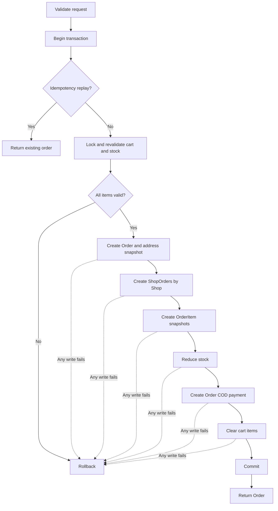

# Business rules

> PHASE 6 đã thực thi Profile, Address, Shop, Category, Product/ảnh/tìm kiếm và moderation. Shopping Cart đã thực thi ở PHASE 7; checkout/payment và các module sau vẫn là thiết kế. Các ID dưới đây là đầu vào cho test. [Database](database-design.md), [API](api-design.md), [State transitions](state-transitions.md) cùng sử dụng các quyết định này.

## Tài khoản, Shop, Category

| ID | Rule kiểm thử được |
|---|---|
| BR-USER-001 | role ∈ USER, ADMIN; Buyer/Seller không phải role. User chỉ sửa profile cho phép; email normalized lowercase/trim unique, không nhận role/status/password_hash từ profile input |
| BR-USER-002 | User ACTIVE, chưa soft-delete mới mutation; SUSPENDED không login/mutation. Admin không tự khóa/xóa/hạ quyền mình hoặc admin ACTIVE cuối cùng. User bị khóa vẫn giữ lịch sử |
| BR-SHOP-001 | owner_id unique: mỗi User tối đa một Shop kể cả soft-deleted. Shop mới ACTIVE ngay (từ 2026-10-14, không duyệt trước; admin khoá SUSPENDED khi bị báo cáo nhiều). Không chuyển owner_id qua API. Mở rộng nhiều shop bằng bỏ unique và đổi UI/query sau này |
| BR-SHOP-002 | Product có thể tạo DRAFT khi Shop PENDING/ACTIVE; chỉ Shop ACTIVE, owner ACTIVE mới submit/publish/bán. SUSPENDED/REJECTED không sửa hàng; owner được sửa thông tin và gửi lại Shop REJECTED |
| BR-SHOP-003 | Shop/User bị suspend không tự sửa trạng thái đơn đang mở; admin tiếp tục xử lý nghĩa vụ hợp lệ. Product public và checkout đều xét trạng thái Shop + owner |
| BR-CATEGORY-001 | parent_id nullable, không self-parent hoặc cycle; depth MVP tối đa 3. Cả category và mọi ancestor phải ACTIVE để bán; cấm gán Product vào category INACTIVE |
| BR-CATEGORY-002 | Admin chỉ hard-delete category không có children/products. Khi ẩn parent, descendants không public dù status riêng vẫn ACTIVE; transaction khóa thay đổi cây để ngăn tạo cycle đồng thời |

## Product, ảnh, tìm kiếm

| ID | Rule kiểm thử được |
|---|---|
| BR-PRODUCT-001 | price là chuỗi DECIMAL(15,2) > 0, nhận tối đa 2 số lẻ (PHASE 6), serialize luôn 2 số lẻ; stock_quantity ≥ 0; condition ∈ LIKE_NEW, GOOD, FAIR, POOR mô tả vật lý. Không thêm NEW vì đề tài tập trung đồ đã sử dụng; status là vòng đời nghiệp vụ riêng |
| BR-PRODUCT-002 | Public chỉ thấy Product ACTIVE, stock > 0, deleted_at null, Shop ACTIVE chưa xóa, owner ACTIVE chưa xóa, category/ancestors ACTIVE. Direct public URL của record không public trả 404 |
| BR-PRODUCT-003 | Owner chỉ sửa Product qua Shop mình. Shop/category/price/quantity không nhận tự do từ buyer. Slug global unique ổn định sau tạo; đổi tên không đổi slug tự động, soft-deleted slug không tái sử dụng |
| BR-PRODUCT-004 | Create luôn DRAFT. Submit ("Đăng bán") cần price, stock > 0, category hợp lệ, ít nhất một ảnh và đúng một ảnh chính, rồi ACTIVE ngay, không duyệt trước. Sửa nội dung/ảnh/giá không đổi trạng thái. Admin gỡ tin vi phạm thành REJECTED kèm lý do; người bán sửa rồi "Yêu cầu mở lại" (REJECTED → PENDING), admin quyết định. Không sửa snapshot đơn |
| BR-PRODUCT-005 | SOLD do hệ thống khi stock xuống 0 từ ACTIVE. Seller không tự đặt SOLD hoặc tùy ý ACTIVE. Product có thể soft-delete/ẩn sau mua; dữ liệu đơn vẫn nguyên. Thêm stock là giá trị tồn khả dụng mới, khóa Product và validate; SOLD thêm stock → ACTIVE nếu shop/owner/category còn bán được, không thì HIDDEN |
| BR-IMAGE-001 | Tối đa 8 ảnh/Product, ≤5 MiB và ≤20MP mỗi ảnh; JPEG/PNG/WebP xác minh MIME/decode, tên server sinh, không binary DB. Có ảnh thì đúng một ảnh primary; đổi primary/sort trong transaction khóa Product |
| BR-IMAGE-002 | OrderItem.product_image snapshot tham chiếu đường dẫn ảnh bất biến. Không xóa file còn được OrderItem tham chiếu; xóa ảnh listing chỉ xóa reference listing và chờ cleanup kiểm tra references. Ảnh thay thế dùng path mới |
| BR-SEARCH-001 | search trim ≤100 ký tự (keyword là alias tương thích; không gửi cả hai), LIKE binding và escape wildcard người dùng; category bao gồm descendants; filter condition/price/shop; sort whitelist và tie-break id. MVP chưa full-text, đo tải trước tối ưu |

Từ 2026-10-14 (đăng không cần duyệt) các rule duyệt trước dưới đây chỉ còn là lịch sử; xem [state transitions](state-transitions.md) và BR-REPORT-AUTO. PHASE 6 giữ rule Shop chặt hơn của PHASE 2/5: Shop PENDING/ACTIVE được tạo DRAFT và sửa hàng; Shop SUSPENDED/REJECTED chỉ xem dữ liệu Seller. Submit cần Shop ACTIVE. REJECTED dùng `revise` về DRAFT rồi submit; PENDING có thể sửa hoặc withdraw theo state table. Stock-only ACTIVE đổi sang số dương vẫn PENDING theo thiết kế cũ, về 0 thì SOLD; SOLD restock dương thì PENDING. Mọi stock PATCH cần expected_updated_at; không thay đổi slug.

Ảnh lưu public disk tại `products/{id}/{uuid}.{jpg|png|webp}` sau decode/re-encode bằng GD; DB chỉ giữ image_path. Upload đầu tự primary; xóa primary chọn sort_order/id nhỏ nhất, renumber 0..n−1. Reorder yêu cầu toàn bộ image_ids, mỗi ID đúng một lần và cùng Product. Lỗi DB/audit cleanup file mới; delete cleanup sau commit, giữ file còn ProductImage/OrderItem tham chiếu. Lỗi cleanup được log để xử lý sau; không có background retry trong PHASE 6. Decode có chặn bộ nhớ ngoài giới hạn 20MP. Public resource không chứa moderation_reason.

## Cart và checkout

| ID | Rule kiểm thử được |
|---|---|
| BR-CART-001 | carts.user_id unique; cart_items(cart_id,product_id) unique; quantity nguyên 1–99 và không quá stock lúc thêm/sửa. POST tăng quantity dòng hiện có; PATCH đặt quantity tuyệt đối. Cart không reserve stock |
| BR-CART-002 | Không mua Product thuộc Shop mình. Cart có thể chứa nhiều Shop; product mất khả dụng sau đó được đánh dấu unavailable khi GET cart, không tự xóa. Sửa/xóa chỉ item cart của user hiện tại |
| BR-CART-003 | PHASE 7: giá và totals là chuỗi decimal lấy từ Product hiện tại, không persisted vào CartItem. Tổng toàn giỏ gồm unavailable; available_subtotal loại unavailable. Availability dùng ProductQuery chung, gồm owner/category ancestors; stock thay đổi không tự giảm quantity trong cart. Clear chỉ xóa items của current User, giữ Cart |
| BR-ORDER-001 | Giá lấy từ Product mới nhất dưới row lock trong checkout, không dùng frontend price/total. Snapshot tên/ảnh/giá và address phải bất biến sau checkout; resource không lấy giá hiện tại để render đơn cũ |
| BR-ORDER-002 | Checkout toàn Cart: một Order, một ShopOrder mỗi Shop, một OrderItem mỗi Product. Bất kỳ dòng không hợp lệ → rollback toàn bộ; không tự checkout phần còn lại |
| BR-ORDER-003 | Trừ stock ngay trong transaction, không reservation riêng. Lock Product bằng SELECT FOR UPDATE, đọc lại stock/status sau lock và validate quantity. Hai buyers tranh stock=1: chỉ một commit, người còn lại 409 và không có đơn/payment dở dang |
| BR-ORDER-004 | Snapshot address gồm recipient_name, phone, address_line, ward, district nullable, province, country_code. Order không phụ thuộc FK address hiện tại. Địa chỉ phải thuộc buyer tại lúc checkout; không sửa địa chỉ Order sau tạo |
| BR-ORDER-005 | Idempotency-Key UUID bắt buộc; unique (buyer_id,checkout_key), lưu SHA-256 payload chuẩn hóa {address_id,payment_method}. Replay cùng key/payload trả Order cũ 200 trước kiểm tra cart; key khác payload 409; lần đầu 201. Khóa buyer/cart ngăn hai requests khác key tạo lại cùng Cart |
| BR-ORDER-006 | Tiền DECIMAL(15,2), giữ tối đa hai số lẻ như Product/Cart PHASE 6–7, API trả chuỗi hai số lẻ; dùng BCMath với kiểm tra overflow, không float hoặc tự làm tròn. item.subtotal = price × quantity; ShopOrder.subtotal = SUM(items); total = subtotal + shipping_fee − discount_amount; Order là tổng snapshots của các ShopOrder |
| BR-ORDER-007 | MVP shipping_fee = discount_amount = 0.00, không tax/commission. Kiểm tra từng tổng không vượt DECIMAL(15,2). Totals gốc của Order/ShopOrder không sửa khi hủy; payable_amount được suy ra từ các phần không CANCELLED |
| BR-ORDER-008 | Buyer hủy ShopOrder PENDING/CONFIRMED; seller hủy PENDING/CONFIRMED/PROCESSING khi hết hàng/hư hỏng/không giao được, bắt buộc lý do. Sau SHIPPING chỉ admin ngoại lệ theo state doc, không buyer/seller tự hủy |
| BR-ORDER-009 | Cancel khóa Order/ShopOrder, payments, stocks theo thứ tự thống nhất; chuyển CANCELLED + stock_restored_at + trả stock + đối chiếu/thay attempt COD Order theo BR-PAYMENT-005 + audit trong một transaction. Replay cancel không trả stock lần hai. Restore quantity kể cả Product hidden/soft-deleted; không tự unhide hay undelete |
| BR-ORDER-010 | Product SOLD được restore >0 chỉ tự ACTIVE nếu chưa bị chỉnh/moderate và Shop/owner/category vẫn hợp lệ; nếu không thì HIDDEN. Product DRAFT/PENDING/HIDDEN/REJECTED hoặc deleted_at khác null giữ nguyên visibility/status. Vì vậy hủy không vượt qua moderation |
| BR-ORDER-011 | Seller chỉ đổi trạng thái ShopOrder sở hữu, không đổi Order tổng hoặc ShopOrder khác. Order overall_status là derived từ ShopOrders, không có endpoint PATCH Order status |
| BR-ORDER-012 | Expected status bắt buộc trong request chuyển trạng thái. Dưới lock: nếu đã ở target do cùng action hợp lệ thì trả hiện trạng không side effect; nếu current không khớp expected hoặc transition trái phép → 409 |

## Payment, review, doanh thu và audit

| ID | Rule kiểm thử được |
|---|---|
| BR-PAYMENT-001 | Payment là attempt toàn Order; order_id bắt buộc, không shop_order_id. Checkout COD hoặc ZALOPAY tạo PENDING, attempt_number=1, amount=Order.total_amount từ DB. UNIQUE(order_id,attempt_number), transaction_reference server sinh unique. ZaloPay dùng app_trans_id bắt đầu YYMMDD theo Asia/Ho_Chi_Minh và số tiền VND nguyên dương; không làm tròn giá lẻ để gửi gateway. |
| BR-PAYMENT-002 | COD complete xác nhận đã giao và thu đủ phần ShopOrder. Khóa Order và các phần liên quan; chỉ khi mọi phần không CANCELLED đã COMPLETED và thu đủ payable_amount mới chuyển attempt Order PENDING→PAID/paid_at. Seller không được đánh dấu toàn Order PAID trực tiếp. |
| BR-PAYMENT-003 | Tối đa một PENDING và một PAID chưa refunded trên Order do service khóa Order trước tạo/cập nhật attempts. Retry tạo row mới với attempt_number tăng; không sửa lại attempt terminal hoặc cho client PATCH status/amount. |
| BR-PAYMENT-004 | Trạng thái payment của Order theo attempt toàn checkout: PENDING trong khi còn phần COD chưa hoàn tất, PAID khi tổng hợp đủ, CANCELLED nếu mọi phần hủy. Không dùng PARTIALLY_PAID cho Payment. cod_collected_amount suy ra từ total_amount của ShopOrders COMPLETED; amount_due=payable_amount−cod_collected_amount. Đây là số theo dõi COD, không phải ledger đối soát. |
| BR-PAYMENT-005 | COD khi hủy một phần giữ amount attempt bất biến: cancel attempt PENDING cũ và tạo attempt mới cho payable còn lại; mọi phần hủy thì không tạo mới; các phần còn lại đều COMPLETED thì chốt attempt mới PAID cùng transaction. ZaloPay thu toàn Order; FAILED được retry bằng attempt mới khi mọi ShopOrder còn PENDING và chưa PAID/reconciliation. Retry không trừ stock. Hết hạn attempt không tự hủy Order/hoàn stock: Buyer/Seller phải hủy phần đơn theo workflow hiện có. Hủy một phần online chưa trả tiền vô hiệu hóa attempt toàn Order; các phần còn lại cần hủy riêng và đặt lại nếu muốn mua. Online đã PAID/reconciliation không được hủy vì refund ngoài scope. |
| BR-PAYMENT-006 | Không lưu thông tin thẻ, chữ ký/secret/raw callback vào response hoặc audit. Mỗi gateway_transaction_id unique trong method, callback verify chữ ký, amount, currency, reference và idempotency phía backend |
| BR-PAYMENT-007 | ZaloPay V2 create/query dùng HMAC SHA256 Key1 từ env/config; callback dùng Key2 trên chuỗi data nguyên bản, kiểm tra app_id/app_trans_id/app_user/app_time, amount và gateway transaction ID. Chỉ kết quả gateway đã xác minh được chốt PENDING→PAID. Browser redirect không phải bằng chứng thanh toán. Query là server HTTPS tới gateway cố định, gắn reference DB; không nhận amount/status từ client. |
| BR-PAYMENT-008 | Checkout/retry UUID idempotency giữ lịch sử attempts; HTTP gateway ở ngoài DB transaction, một attempt chỉ claim create một lần. Timeout, duplicate create hoặc trạng thái chưa rõ/thiếu tiền vẫn PENDING, không tạo attempt khác có thể thu trùng. Create bị từ chối rõ ràng hoặc query xác nhận hết hạn/không tồn tại sau expiry+grace mới cho FAILED/retry. Order lock serialize callback/query/hủy; callback trễ sau trạng thái terminal chỉ ghi reconciliation, không hồi sinh đơn hoặc hoàn/trừ stock lần nữa. |
| BR-REVIEW-001 | Buyer của OrderItem, ShopOrder COMPLETED mới tạo Review; unique order_item_id kể cả review HIDDEN. user_id/product_id suy ra server từ OrderItem, không lấy từ body. Rating nguyên 1–5, comment nullable≤2000. Cấm review Product thuộc Shop mình |
| BR-REVIEW-002 | Chỉ chủ review sửa rating/comment; không đổi liên kết Item. Review mới PUBLISHED; admin có thể HIDDEN/PUBLISHED kèm lý do. Buyer sửa review HIDDEN không làm nó tự PUBLISHED. Seller không xóa/sửa review của Buyer |
| BR-REVENUE-001 | Doanh thu Seller = SUM(shop_orders.subtotal) chỉ status COMPLETED, nhóm theo completed_at quy đổi Asia/Ho_Chi_Minh. Không gồm shipping, cancelled, pending; chưa commission. Dashboard không cộng nhiều payment attempts để tính doanh thu |
| BR-REPORT-AUTO | Khi `moderation.auto_hide_reports` (mặc định 3) người dùng khác nhau có báo cáo PENDING/IN_REVIEW trên một tin ACTIVE, tin tự chuyển PENDING ("tạm ẩn, chờ quản trị viên") trong cùng transaction tạo báo cáo, có audit `product.auto_hidden` và thông báo cho người bán sau commit. Báo cáo đã DISMISSED không tính; tin đang bị phiên đấu giá giữ không tự ẩn. Admin mở lại (ACTIVE) hoặc gỡ (REJECTED) |
| BR-AUDIT-001 | Audit append-only cùng transaction cho role/status User, Shop/Product/Category/Review moderation, ShopOrder/Payment transition và thao tác admin ngoại lệ. Actor, entity, action, from/to, reason, request_id, created_at; không chứa password/PII/payment secrets |
| BR-DELETE-001 | Users/Shops/Products soft-delete; Orders/ShopOrders/OrderItems/Payments/Audit không có DELETE API. Hard-delete thương mại bị FK RESTRICT. Không soft-delete User khi còn ShopOrder đang mở với tư cách Buyer hoặc owner Shop; không soft-delete Shop khi có ShopOrder đang mở; Product vẫn được soft-delete nếu từng được mua, giữ reference |

## Checkout transaction chi tiết

Validation định dạng request có thể làm trước transaction; kiểm tra giá/stock/quyền sở hữu quyết định phải thực hiện lại bên trong transaction. Tránh đọc stock ngoài transaction rồi giảm bằng dữ liệu cũ.

1. Xác thực User/CSRF/rate limit, validate Idempotency-Key, address_id, payment_method=COD; reject price/total/user_id body ngoài allowlist. Đọc sơ bộ cart để lập tập account IDs của buyer và shop owners; đây chỉ là kế hoạch khóa, chưa chốt giá/stock.
2. BEGIN. Khóa tất cả account IDs dự kiến theo ID tăng dần, rồi Cart (cart mutations cũng khóa Cart). Kiểm tra lại tập items/owners; nếu tập owner đã thay đổi thì rollback/retry để lập lock set mới, không lấy thêm account lock muộn. Kiểm tra trạng thái account lại. Nếu key đã có: so payload hash; trả order cũ hoặc 409 trước khi yêu cầu Cart không rỗng.
3. Khóa Address của buyer, lấy cart_items. Cart rỗng → 422. Chuẩn bị IDs; khóa Shop theo ID tăng, Category/ancestors theo ID tăng, Product theo ID tăng. Category tree writes phải phối hợp cùng locking strategy; không chỉ khóa FK rồi tin trạng thái đã đọc trước đó.
4. Đọc lại Product/Shop/category/owner availability, giá, stock, quantity, cấm tự mua. Owner suspension phải dùng cùng account row lock như bước 2, vì vậy không thể chen vào giữa kiểm tra và commit. Không tin trạng thái lấy ngoài transaction.
5. Tính tiền server-side; tạo Order cùng key/hash/address snapshot; group theo Shop; tạo ShopOrder và OrderItem snapshots. Giảm stock, Product ACTIVE hết stock → SOLD.
6. Tạo một COD Payment PENDING thuộc Order; ghi audit tạo đơn; xóa cart_items (giữ Cart).
7. COMMIT. Chỉ phát notification/job sau commit; trả 201 Order resource. Khi mất kết nối response, client replay cùng key.
8. Bất kỳ lỗi → ROLLBACK: không còn Order/Payment dở dang, không trừ stock, không clear cart. Deadlock retry giới hạn 3 lần; hết retry → 409 retryable, dùng lại idempotency key. Không retry external charge trong transaction.

Mọi writer stock/status (checkout, cancel, seller cập nhật, moderation) phải dùng transaction, lock theo thứ tự tương thích và revalidate. Cho operations trên đơn hiện hữu: khóa Order rồi ShopOrders tăng ID để serialize tổng hợp/cancel/complete; sau đó Shop → Category → Product tăng ID → Payment. Không lấy lock Order hiện hữu trong checkout mới sau khi đã khóa Product. Tạo attempt mới khóa Order trước Payment. Tài liệu là invariant; MySQL concurrency test là cổng bắt buộc trước nghiệm thu module.

## Ví dụ nhiều Shop và thu COD một phần

A=100000.00, B=200000.00, C=300000.00: Order snapshot600000.00 có một Payment COD PENDING600000.00. A COMPLETED đã thu100000; B hủy: attempt600000 CANCELLED, tạo attempt2 PENDING400000; C SHIPPING. Order IN_PROGRESS, Payment PENDING, payable400000, cod_collected100000, amount_due300000. C hoàn tất thì attempt2 PAID400000, Order PARTIALLY_COMPLETED. Totals gốc không sửa; doanh thu A100000/B0/C300000. Không có Payment thuộc ShopOrder.

## Chi tiết thực thi PHASE 5

- Profile lưu trực tiếp trong users; chỉ name/phone editable, email/password và đường dẫn avatar giữ read-only trong scope này.
- AddressService khóa row User trước mọi create/update/setDefault/delete, rồi recheck account và ownership. Có địa chỉ thì luôn đúng1 default: address đầu tiên true bất kể input; chọn default mới unset các row khác trong cùng transaction; xóa default chọn ID nhỏ nhất còn lại. Nếu PATCH false làm mất default cuối cùng, normalize chọn ID nhỏ nhất. Không thay snapshot Order khi sửa/xóa địa chỉ.
- Seller là User sở hữu Shop, không thêm role. Unique owner_id áp dụng cả shop soft-deleted. New shop PENDING; owner sửa name/description khi PENDING/ACTIVE/REJECTED; SUSPENDED chỉ đọc. Đổi tên không đổi slug.
- ShopService khóa User trước Shop; moderation khóa actor/owner theo ID tăng rồi khóa Shop, recheck quyền và expected_status. Audit cùng transaction; lỗi ghi audit rollback status. Slug collision retry bounded trong transaction mới, bao gồm slug archived.
- CategoryService khóa actor và toàn bộ cây danh mục nhỏ của MVP theo ID trước validate/update/delete. Kiểm tra chuỗi ancestor của toàn bộ cây dự kiến, nên di chuyển subtree cũng không vượt3 cấp hoặc tạo cycle. Writers tương lai phải dùng cùng locking convention. Ẩn parent không sửa status descendants nhưng làm chúng mất public visibility.
- Category delete kiểm tra cả Product soft-deleted và children; FK RESTRICT là lớp bảo vệ cuối. Mọi admin Category mutation cần reason và audit nguyên tử. Không tạo Product API trong PHASE 5.
- Category tree lock phù hợp catalog nhỏ; chưa có benchmark throughput hoặc kiểm thử tải đồng thời nhiều process. Test hiện tại kiểm tra rollback transaction, ownership, transitions, cycle/depth và HTTP cookie thật; concurrency checkout là cổng của module checkout sau này.

### Checkout implementation PHASE 8

Checkout toàn Cart dùng transaction và khóa accounts theo ID → Cart/Address/items → Shop → toàn bộ cây Category nhỏ → Product theo ID. Availability được kiểm lại bằng các row vừa khóa (gồm owner và ancestors), không dựa trên consistent-read snapshot cũ. Nếu owner lock set thay đổi so với kế hoạch, rollback/replan tối đa3 lần; DB deadlock retry tối đa3 lần, hết retry trả409. Giá lấy mới, BCMath kiểm tra mỗi subtotal/tổng ≤9999999999999.99; phí giao hàng/giảm giá0.00. Snapshot và stock/payment/audit/clear Cart cùng commit.

Hủy/fulfillment khóa accounts → Order → toàn bộ ShopOrders theo ID → Shop → Category → Product → Payment. stock_restored_at và state guard ngăn hoàn tồn lặp. Audit `product.checkout_sold` lưu revision updated_at (microseconds) khi checkout làm SOLD; chỉ revision còn khớp và Shop/owner/category hợp lệ mới restore SOLD→ACTIVE. Thiếu bằng chứng hoặc có chỉnh sửa →HIDDEN; trạng thái khác và soft-delete giữ nguyên. Không cần cột mới. Hủy một phần giữ totals gốc, thay COD attempt PENDING theo payable; không thay amount của attempt cũ.

### Review implementation PHASE 9

Review create/edit khóa accounts theo ID →Order→ShopOrder→Shop→Product (withTrashed)→OrderItem→Review, recheck actor/ownership/COMPLETED/reference dưới lock, giữ unique(order_item_id). Chỉ rating/comment qua allowlist; create derive liên kết và PUBLISHED, edit giữ HIDDEN. Không DELETE để không vượt invariant một review/OrderItem. Không yêu cầu Product còn bán/public khi review lịch sử mua đã hoàn tất.

Public list và Product COUNT/AVG cùng điều kiện PUBLISHED + OrderItem/Product reference đúng + Order Buyer đúng + ShopOrder COMPLETED + không tự mua. Product phải public theo catalog; Review và Order history không mất khi Product soft-delete. Author đã xóa được ẩn tên, review hợp lệ vẫn tính vào aggregate. Không audit nội dung nhận xét; moderation status audit/API đã có từ PHASE11. Eager load authors và reviews trên Buyer OrderItems; không load private reviews vào Seller OrderResource.

### Seller/Revenue implementation PHASE 10

- Giữ BR-REVENUE-001: doanh thu = SUM(shop_orders.subtotal), chỉ COMPLETED, lọc/nhóm completed_at theo Asia/Ho_Chi_Minh. Không cộng shipping hoặc Payment attempts; chưa commission/payout. COMPLETED thiếu completed_at bị loại khỏi doanh thu, không lấy created_at thay thế.
- Seller đọc Shop mình, gồm Shop PENDING/SUSPENDED/REJECTED nếu tài khoản vẫn ACTIVE; Shop soft-delete/chưa có Shop404. Admin không có quyền vượt ownership qua Seller endpoint.
- Phạm vi UI/API: Products là tồn hiện tại không soft-delete; order counts/recent theo created_at trong kỳ; revenue/completed_in_range theo completed_at trong kỳ. Đơn cũ hoàn tất trong kỳ vẫn có doanh thu, không phải đơn mới của kỳ.
- Khoảng mặc định30 ngày Việt Nam gồm hôm nay; from/to bao gồm hai đầu, tối đa366 ngày, cùng có/cùng bỏ, từ2000-01-01 đến9998-12-31. Nhóm day/month, lấp kỳ rỗng bằng0; tháng lẻ chỉ tính phần trong range.
- MySQL SUM giữ DECIMAL, JSON tiền là chuỗi2 số lẻ, không lưu revenue table/cache/aggregate trên Shop. Chart.js đổi sang number chỉ để vẽ tọa độ; cards, tooltip và bảng vẫn format decimal string gốc.

### Admin implementation PHASE 11

- User status chỉ ACTIVE↔SUSPENDED; expected_status+reason bắt buộc. Không email/password/role/soft-delete/restore archive endpoint. Admin không tự đổi status; actor/target account locks theo ID và recheck quyền bảo vệ admin ACTIVE cuối cùng, kể cả identity cũ. Archived User chỉ đọc. Suspend giữ nguyên Order/Review history, không cascade statuses; auth ACTIVE middleware/login rule hiện có được tái sử dụng.
- Review PUBLISHED↔HIDDEN theo expected_status+reason, không thay rating/comment/reference. Row lock + recheck Admin và audit cùng transaction; audit lỗi rollback. HIDDEN không public/count/average; unhide vẫn phải pass predicate purchase hợp lệ hiện có. Buyer sửa HIDDEN không republish.
- Dashboard toàn thời gian: current nondeleted User/Shop/Product counts; Order counts theo overall status, không đếm từng ShopOrder như Order. Doanh thu hàng hóa = SQL SUM ShopOrder.subtotal chỉ COMPLETED, gồm cả phần hoàn tất của đơn nhiều Shop chưa hoàn tất toàn bộ; không fee/Payment attempts/commission. Không áp dụng điều kiện Shop/User/Product còn ACTIVE cho doanh thu lịch sử.
- Admin Order overview chỉ đọc snapshot và trạng thái, không Buyer/Seller action hoặc Payment management. SQL filters/pagination và eager loading; không N+1, không load toàn bộ Order vào PHP để cộng thống kê. Không làm ngoại lệ xử lý fulfillment/refund trong PHASE11.
