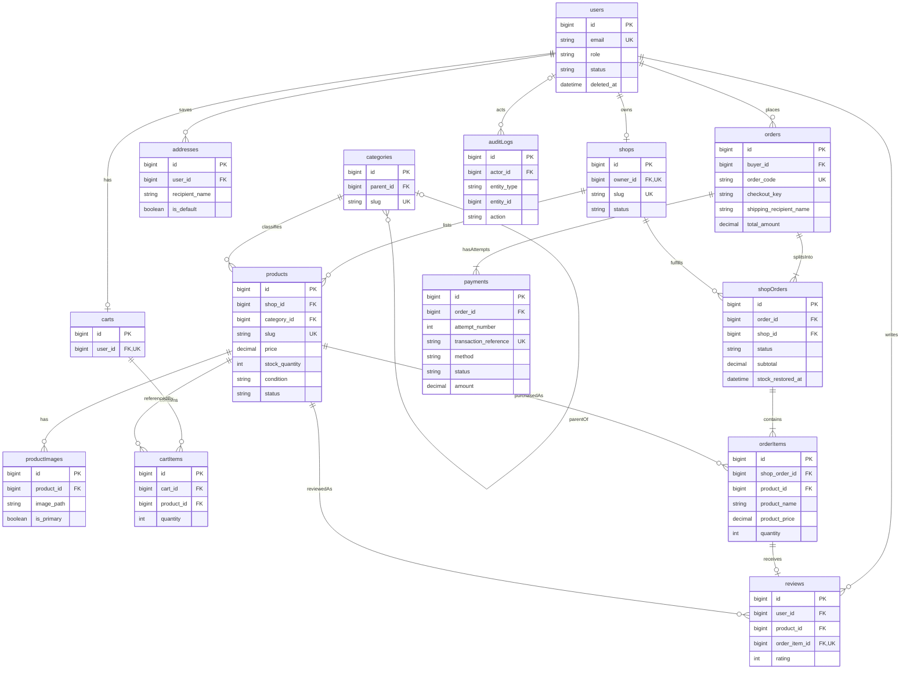

# Database design

> Thiết kế logic/định hướng kiểu dữ liệu, không phải migration đã triển khai. 13 bảng nghiệp vụ bắt buộc + 1 bảng audit dùng chung. [Rules](business-rules.md) quyết định các invariant nhiều bảng; [States](state-transitions.md) quyết định chuyển trạng thái.

## 1. Quy ước

MySQL/InnoDB, utf8mb4, timestamps UTC (DATETIME(6)); PK `id BIGINT UNSIGNED` tự tăng, FK cùng type/sign. Mọi bảng MVP có `created_at`, `updated_at` NOT NULL trừ audit_logs chỉ created_at. Dưới đây `?` nghĩa nullable; các cột không có `?` là NOT NULL. Các cột timestamps chung không lặp lại trong từng bảng. Mặc định tiền `DECIMAL(15,2)` (ký hiệu Money); Product PHASE 6 nhận tối đa2 số lẻ và serialize fixed decimal, không FLOAT. Order/Payment chưa triển khai API. ID trên API serialize string để tránh giới hạn số nguyên JavaScript.

Status/condition/role dùng VARCHAR có PHP backed Enum + DB CHECK whitelist ở phase triển khai; không dùng MySQL ENUM để dễ mở rộng. Amount CHECK ≥0 (price >0), quantity/stock CHECK phù hợp. CHECK chỉ kiểm tra cùng row; quan hệ owner, tổng tiền liên bảng, một primary image, một default address và một payment active phải enforce bằng Service transaction/lock + test. Không giả định CHECK có thể thay thế policy hoặc truy vấn nhiều bảng.

Foreign keys áp dụng ON UPDATE RESTRICT vì ID không đổi. ON DELETE được chỉ rõ bên dưới. Soft delete là UPDATE deleted_at, không kích hoạt FK delete action. FK/check implementation phải được xác minh trên MySQL thật ở PHASE 3. Tham khảo [MySQL foreign keys](https://dev.mysql.com/doc/refman/8.4/en/create-table-foreign-keys.html) và [CHECK constraints](https://dev.mysql.com/doc/refman/8.4/en/create-table-check-constraints.html).

## 2. ERD MVP

Tên camelCase trong Mermaid tương ứng snake_case trong schema; ví dụ shopOrders = shop_orders, orderItems = order_items. Cardinality mô tả quan hệ tồn tại, không biểu diễn tất cả CHECK/UNIQUE. Payment chỉ FK Order; ShopOrder không có quan hệ payments.

## 3. Entities và cột

### users — danh tính và quyền hệ thống

| Columns | Type/default | Purpose |
|---|---|---|
| id | PK | User identity |
| name | VARCHAR(100) | Tên hiển thị |
| email | VARCHAR(254), UNIQUE | Trim/lowercase trước lưu, unique cả soft-deleted |
| password | VARCHAR(255) | Hash, không plaintext |
| phone | VARCHAR(20)? | Không unique, không dùng làm login MVP |
| avatar_path | VARCHAR(512)? | File reference |
| role | VARCHAR(16), USER | USER/ADMIN |
| status | VARCHAR(16), ACTIVE | ACTIVE/SUSPENDED |
| email_verified_at | DATETIME(6)? | Giữ tương thích scaffold, chưa yêu cầu verify ở MVP |
| remember_token | VARCHAR(100)? | Tương thích Laravel, không expose |
| deleted_at | DATETIME(6)? | Soft delete |

FK không có. Unique email; index `(status,created_at,id)` cho admin list. Quan hệ 0..1 Shop/Cart, nhiều Addresses/Orders/Reviews. Không hard-delete User có order/shop/review; không khóa admin cuối cùng. Auth/query phải loại deleted/suspended.

### addresses — sổ địa chỉ User

| Columns | Type/default | Purpose |
|---|---|---|
| id; user_id | PK; FK users.id | Chủ địa chỉ |
| recipient_name | VARCHAR(100) | Người nhận |
| phone | VARCHAR(20) | Số liên lạc, không numeric |
| address_line | VARCHAR(255) | Số nhà/đường |
| ward; province | VARCHAR(100) mỗi cột | Tên địa bàn, không tích hợp API địa giới ở MVP |
| district | VARCHAR(100)? | Tùy địa chỉ, không bắt buộc cấu trúc hành chính cũ |
| country_code | CHAR(2), VN | MVP chỉ VN |
| is_default | BOOLEAN, false | Tối đa một default/user |

Index `(user_id,is_default,id)`; không unique toàn bộ address. User row lock khi đổi default/CRUD; địa chỉ đầu mặc định, xóa default chọn địa chỉ còn lại có id nhỏ nhất trong transaction. ON DELETE user CASCADE chỉ dữ liệu sổ địa chỉ; User thực tế soft-delete, chưa có API hard-delete. Order không FK tới Address nên history độc lập.

### shops — gian hàng

| Columns | Type/default | Purpose |
|---|---|---|
| id; owner_id | PK; FK users.id, UNIQUE | 1 User tối đa 1 Shop |
| name; slug | VARCHAR(150); VARCHAR(180) UNIQUE | Slug global, không tái sử dụng sau xóa mềm |
| description | TEXT? | Giới thiệu |
| logo_path | VARCHAR(512)? | Logo reference (API có thể trả logo_url) |
| status | VARCHAR(16), PENDING | PENDING/ACTIVE/SUSPENDED/REJECTED |
| moderation_reason | VARCHAR(1000)? | Lý do gần nhất, audit giữ lịch sử |
| deleted_at | DATETIME(6)? | Soft delete |

Index `(status,created_at,id)`; owner unique thay index owner đơn. ON DELETE owner RESTRICT. Shop có nhiều Products và ShopOrders. Không soft-delete nếu còn ShopOrder chưa terminal. Sau này bỏ UNIQUE owner_id, giữ index/FK và sửa business rule để nhiều Shop/User; Product/ShopOrder không phải đổi ownership key.

### categories — cây danh mục

| Columns | Type/default | Purpose |
|---|---|---|
| id; parent_id | PK; FK categories.id? | Root có parent null |
| name; slug | VARCHAR(100); VARCHAR(150) UNIQUE | Slug global |
| description | TEXT? | Mô tả |
| status | VARCHAR(16), ACTIVE | ACTIVE/INACTIVE |

Index `(parent_id,status,id)` cho cây; ON DELETE parent RESTRICT. Không soft-delete; category có references chuyển INACTIVE. Service phải kiểm tra parent_id khác id, cycle/depth và trạng thái ancestors; FK không phát hiện cycle. PHASE 3 chưa triển khai service này và không đặt CHECK tham chiếu cột id AUTO_INCREMENT.

### products — hàng thanh lý

| Columns | Type/default | Purpose |
|---|---|---|
| id; shop_id; category_id | PK; FK shops.id; FK categories.id | Shop không đổi sau tạo |
| name; slug | VARCHAR(200); VARCHAR(240) UNIQUE | Global slug đơn giản hóa URL public; retry suffix khi collision |
| description | TEXT | Văn bản thuần, frontend escape, không render HTML không sanitize |
| price | Money | >0, tối đa2 số lẻ theo contract Product PHASE 6; không đổi schema |
| stock_quantity | INT UNSIGNED, 0 | Tồn có thể bán, không phải tổng đã nhập |
| condition | VARCHAR(16) | LIKE_NEW/GOOD/FAIR/POOR |
| status | VARCHAR(16), DRAFT | DRAFT/PENDING/ACTIVE/SOLD/HIDDEN/REJECTED |
| moderation_reason | VARCHAR(1000)? | Lý do kiểm duyệt gần nhất |
| deleted_at | DATETIME(6)? | Soft delete |

ON DELETE shop/category RESTRICT. CHECK stock≥0, price>0 và enum whitelist. Index theo query ở §4. Condition FAIR là sử dụng rõ rệt nhưng còn hoạt động; POOR là hư hao/cần sửa đã mô tả rõ, không được mô tả đánh lừa. Sold không đồng nghĩa Product bị delete. Product không có seller_id dư thừa, owner đi qua Shop.

### product_images — metadata ảnh

| Columns | Type/default | Purpose |
|---|---|---|
| id; product_id | PK; FK products.id | Chủ ảnh |
| image_path | VARCHAR(512) | Immutable storage-relative key, không arbitrary external URL |
| is_primary | BOOLEAN, false | Một ảnh chính nếu còn ảnh |
| sort_order | SMALLINT UNSIGNED, 0 | Thứ tự; tie-break id |

Index `(product_id,sort_order,id)`; không cần sort_order unique. ON DELETE product CASCADE chỉ khi thật sự hard-delete product chưa có history. Service khóa Product khi upload/change-primary/delete; không UNIQUE(product_id,is_primary) vì sẽ cấm nhiều ảnh phụ. Dữ liệu DB và file không atomic: upload temp → persist/reference trong transaction → cleanup sau commit; không xóa blob đang dùng trong snapshot đơn.

### carts — một giỏ/User

| Columns | Type/default | Purpose |
|---|---|---|
| id; user_id | PK; FK users.id UNIQUE | Tạo lazy bằng upsert/race-safe |

ON DELETE user CASCADE. Cart được giữ khi checkout; không lưu giá/tổng tiền hoặc status vô ích. user unique đủ index lookup.

### cart_items — dòng giỏ

| Columns | Type/default | Purpose |
|---|---|---|
| id; cart_id; product_id | PK; FK carts.id; FK products.id | Dòng product trong cart |
| quantity | SMALLINT UNSIGNED | CHECK 1..99 |

UNIQUE(cart_id,product_id), index product_id cho FK; ON DELETE cart CASCADE, product CASCADE vì đây không phải history. Soft-delete Product không cascade: GET cart báo unavailable. Mọi mutate cart lock Cart row để serialize với checkout; giá hiển thị join Product hiện tại.

### orders — lần checkout tổng

| Columns | Type/default | Purpose |
|---|---|---|
| id; buyer_id | PK; FK users.id | Buyer |
| order_code | VARCHAR(32) UNIQUE | Mã server sinh, không dùng làm authorization |
| checkout_key | CHAR(36) | UUID do client gửi, unique trong buyer |
| request_hash | CHAR(64) | SHA-256 payload canonical để phát hiện key reuse khác payload |
| shipping_recipient_name; shipping_phone | VARCHAR(100); VARCHAR(20) | Snapshot |
| shipping_address_line; shipping_ward | VARCHAR(255); VARCHAR(100) | Snapshot |
| shipping_district | VARCHAR(100)? | Snapshot optional |
| shipping_province; shipping_country_code | VARCHAR(100); CHAR(2) | Snapshot, VN |
| subtotal; shipping_fee; discount_amount; total_amount | Money mỗi cột; fee/discount default 0 | Tổng snapshots bất biến |
| currency | CHAR(3), VND | Đơn vị |
| payment_method | VARCHAR(16), COD | COD ở MVP, VNPAY future; thống nhất mọi phần trong checkout |

UNIQUE(buyer_id,checkout_key); index `(buyer_id,created_at,id)` cho buyer history, `(created_at,id)` cho admin overview. ON DELETE buyer RESTRICT. Không address_id FK, không OrderAddress table: một địa chỉ cho mọi ShopOrder trong checkout, snapshot columns đơn giản và ổn định. Không lưu status/payment_status tổng để tránh lệch; resource tính từ child rows. Không deleted_at, không hard-delete. CHECK total formula và tiền không âm; sum child so với parent do service transaction + test.

### shop_orders — đơn giao/thu tiền riêng của từng Shop

| Columns | Type/default | Purpose |
|---|---|---|
| id; order_id; shop_id | PK; FK orders.id; FK shops.id | Một phần mỗi shop |
| status | VARCHAR(16), PENDING | PENDING/CONFIRMED/PROCESSING/SHIPPING/COMPLETED/CANCELLED |
| subtotal; shipping_fee; discount_amount; total_amount | Money; fee/discount 0 | Snapshot phần Shop, formula như Order |
| confirmed_at; processing_at; shipping_at; completed_at; cancelled_at | DATETIME(6)? mỗi cột | Chỉ set khi đạt state; không xóa mốc đã có |
| cancellation_reason | VARCHAR(1000)? | Bắt buộc khi cancel |
| stock_restored_at | DATETIME(6)? | Chốt hoàn stock duy nhất cho cancel |

UNIQUE(order_id,shop_id) cho group; index `(shop_id,status,created_at,id)` cho seller, `(shop_id,status,completed_at)` cho revenue, `(status,created_at,id)` cho admin hàng chờ. Không index order_id đơn dư thừa vì prefix unique đã có. Cả FK ON DELETE RESTRICT. Completed/cancelled terminal; không hard/soft delete. COMPLETED COD xác nhận đã thu phần ShopOrder; Payment Order có thể vẫn PENDING khi phần khác chưa giao, CANCELLED phải có stock_restored_at; service enforce liên bảng.

### order_items — snapshot dòng mua

| Columns | Type/default | Purpose |
|---|---|---|
| id; shop_order_id; product_id | PK; FK shop_orders.id; FK products.id | Tham chiếu lịch sử ổn định |
| product_name | VARCHAR(200) | Snapshot tên |
| product_image | VARCHAR(512) | Snapshot path primary đã kiểm tra checkout |
| product_price | Money | Snapshot giá >0 |
| quantity | SMALLINT UNSIGNED | CHECK 1..99 |
| subtotal | Money | CHECK product_price × quantity |

UNIQUE(shop_order_id,product_id); index product_id. Cả FK ON DELETE RESTRICT. Product soft-deleted vẫn còn row; không cần nullable product_id/SET NULL vì MVP không hard-delete Product đã mua. Histories luôn dùng snapshot, join Product tùy chọn vớiTrashed chỉ cho thông tin liên quan. Không sửa/xóa OrderItem. Service kiểm Product.shop_id = ShopOrder.shop_id lúc tạo, không cho đổi shop của Product về sau.

### payments — payment attempts của toàn Order

| Columns | Type/default | Purpose |
|---|---|---|
| id; order_id | PK; FK orders.id RESTRICT | Một attempt cho toàn checkout, không shop_order_id |
| attempt_number | INT UNSIGNED | >=1; UNIQUE(order_id,attempt_number) |
| method | VARCHAR(16), COD | COD/VNPAY, chưa triển khai gateway |
| amount; currency | Money; CHAR(3), VND | Snapshot số phải thu của Order tại attempt, >0 |
| status | VARCHAR(16), PENDING | PENDING/PAID/FAILED/CANCELLED/REFUNDED |
| transaction_reference | VARCHAR(64) UNIQUE | Mã server sinh |
| gateway_transaction_id | VARCHAR(100)? | UNIQUE(method,gateway_transaction_id), COD null |
| paid_at; failed_at | DATETIME(6)? mỗi cột | Thời điểm kết quả, paid_at giữ khi refund |
| failure_code | VARCHAR(100)? | Mã lỗi đã sanitize |

Index(order_id,created_at,id), index(status,created_at,id); không metadata chưa cần, không dữ liệu thẻ. Attempt_number phân bổ dưới Order row lock ở service phase sau. Amount bất biến: COD khi hủy một phần tạo replacement attempt bằng payable mới; xem BR-PAYMENT-005. Một attempt PENDING toàn Order, không PAID cho từng ShopOrder. Không xóa lịch sử. PAID tổng hợp theo các ShopOrder COMPLETED; revenue tính ShopOrder subtotal, không SUM payment attempts. Eloquent Order::payments / Payment::order.

### reviews — Product review từ giao dịch thật

| Columns | Type/default | Purpose |
|---|---|---|
| id; user_id; product_id; order_item_id | PK; FK users.id; FK products.id; FK order_items.id UNIQUE | Truy vết người mua và dòng mua |
| rating | TINYINT UNSIGNED | CHECK BETWEEN 1 AND 5 |
| comment | TEXT? | Tối đa 2000 ký tự bởi validation |
| status | VARCHAR(16), PUBLISHED | PUBLISHED/HIDDEN |
| moderation_reason | VARCHAR(1000)? | Admin reason |

Index user_id; `(product_id,status,created_at,id)` cho review public/rating; UNIQUE order_item_id. Cả ba FK RESTRICT. Service suy ra user/product từ OrderItem và buyer Order, ShopOrder COMPLETED; không nhận hai FK đó từ client. Không soft-delete: status moderation đủ, giữ unique sau ẩn. Buyer chỉ sửa rating/comment; rating public chỉ tính PUBLISHED của product còn public.

### audit_logs — một bảng bổ sung có lý do

Cần lưu transition/moderation/admin exception bền vững cùng transaction mà không tạo mỗi entity một bảng history. Đây là bảng hỗ trợ thứ 14, không thêm event-sourcing framework.

| Columns | Type/default | Purpose |
|---|---|---|
| id | PK | Audit event |
| actor_id | FK users.id? | null cho system jobs |
| entity_type; entity_id | VARCHAR(40); BIGINT UNSIGNED | Whitelist entity, polymorphic reference không FK tổng quát |
| action | VARCHAR(80) | Ví dụ shop_order.completed |
| from_status; to_status | VARCHAR(32)? mỗi cột | Optional với create/update không đổi status |
| reason | VARCHAR(1000)? | Bắt buộc cho admin moderation/exception |
| request_id | CHAR(36)? | Correlation, không phải secret |
| created_at | DATETIME(6) | Không updated_at; append-only |

Index `(entity_type,entity_id,created_at,id)` và `(actor_id,created_at)`. FK actor ON DELETE RESTRICT; actor null là system, không erase dấu vết bằng SET NULL. Không sửa/xóa qua API. Target là reference logic, phải tồn tại khi append; không chứa giá/địa chỉ hay toàn bộ object. Hạn chế write access audit ở application boundary; backup bảo vệ log. Category có thể bị xóa hợp lệ nhưng audit target ID vẫn giữ.

## 4. Indexes dựa trên query thực tế

| Query | Index dự kiến | Lý do / giới hạn |
|---|---|---|
| Public newest | products(status,deleted_at,created_at,id) | Active live ordered; shop/owner/category availability vẫn phải join/filter |
| Category newest | products(category_id,status,deleted_at,created_at,id) | Filter category/descendants, không thêm category_id đơn |
| Shop inventory | products(shop_id,status,deleted_at,created_at,id) | Seller status list, FK prefix shop_id |
| Public price sort/range | products(status,deleted_at,price,id) | Price filter/sort; không thêm price riêng nếu plan dùng được |
| Category tree | categories(parent_id,status,id) | Load children / ancestor validation |
| Cart lookup | carts UNIQUE(user_id), cart_items UNIQUE(cart_id,product_id) | Không nhân đôi dòng, cart lock lookup |
| Buyer orders | orders(buyer_id,created_at,id) | Pagination history |
| Seller orders / revenue | shop_orders indexes ở entity | Filter/status/newest và completed_at là hai access paths khác nhau |
| Order components / attempts | unique shop_orders(order_id,shop_id), unique order_items(shop_order_id,product_id), payments(order_id,created_at,id) | Eager load theo parent |

Không tạo mọi tổ hợp filter, không index condition riêng (độ chọn lọc thấp), không tuyên bố B-tree tăng tốc LIKE %keyword%. Dùng binding/escape wildcard, đo EXPLAIN với seed data trước thêm FULLTEXT. Index order_id/status/created_at đơn không cần nếu composite có prefix phù hợp; các truy vấn admin aggregate theo ngày phải benchmark, chưa cache/materialized view ở MVP.

## 5. Delete behavior đầy đủ

| FK / quan hệ | ON DELETE | Quyết định |
|---|---|---|
| addresses.user_id → users | CASCADE | Sổ địa chỉ không phải lịch sử; User thực tế soft-delete |
| shops.owner_id → users | RESTRICT | Giữ người sở hữu lịch sử |
| categories.parent_id → categories | RESTRICT | Không orphan subtree |
| products.shop_id/category_id → shops/categories | RESTRICT | Không xóa nguồn hàng đã tồn tại |
| product_images.product_id → products | CASCADE | Chỉ metadata listing, file cleanup phải xét snapshots |
| carts.user_id → users | CASCADE | Giỏ tạm |
| cart_items.cart_id/product_id → carts/products | CASCADE | Giỏ tạm, không ảnh hưởng Order |
| orders.buyer_id → users | RESTRICT | Giữ history Buyer |
| shop_orders.order_id/shop_id → orders/shops | RESTRICT | Không cascade lịch sử fulfillment |
| order_items.shop_order_id/product_id → shop_orders/products | RESTRICT | Product đã mua không hard-delete |
| payments.order_id → orders | RESTRICT | Không mất history/attempt |
| reviews.user_id/product_id/order_item_id | RESTRICT | Provenance review và unique giao dịch |
| audit_logs.actor_id → users | RESTRICT | Giữ actor audit |

SET NULL không dùng trong MVP FK vì các reference lịch sử có thể giữ bằng soft delete. Address snapshot không cần SET NULL: không có FK Address. SET NULL phù hợp future optional product context trong conversation nếu chính sách xóa cho phép; không áp dụng đại trà để che mất lịch sử.

Soft-delete chỉ users, shops, products. Categories/reviews dùng status; Address/cart_items/product_images xóa vật lý khi hợp lệ; Cart giữ lâu dài sau checkout. Orders/shop_orders/order_items/payments/audit_logs không có deleted_at và không có API DELETE. Restore User/Shop/Product là thao tác admin có audit, không tự active; các unique email/slug/owner vẫn giữ trong record mềm.

## 6. Migration plan MVP — chỉ là kế hoạch

Đọc migrations scaffold PHASE 1 trước khi thêm/alter users; không tạo lại bảng users hay chạy migrate:fresh. Thứ tự dự kiến: users extension → addresses/shops/categories/carts → products → product_images/cart_items → orders → shop_orders → order_items → payments/reviews → audit_logs. Existing session/cache/jobs/Sanctum infrastructure tables không phải business entities và chưa bị sửa. Chỉ tạo các bảng được giai đoạn triển khai cần đến; future dưới đây không nằm trong kế hoạch MVP. PHASE 2 không thực thi migration nào.

## 7. Future — ngoài MVP

| Entity | Thiết kế dự kiến | Keys/quan hệ/invariant |
|---|---|---|
| notifications | id UUID PK, notifiable_type/id, type, data JSON đã lọc, read_at?, timestamps | Index recipient/read_at; private notification, không lưu secret trong payload; Laravel Notification sau commit |
| conversations | id PK, buyer_id FK users, shop_id FK shops, product_id? FK products, timestamps | Direct Buyer↔Shop; UNIQUE(buyer_id,shop_id) để một thread/shop, context Product đầu cuộc nói chuyện optional; buyer khác owner |
| messages | id PK, conversation_id FK, sender_id FK users, body TEXT, read_at?, timestamps | Index(conversation_id,id); backend chỉ buyer hoặc shop owner gửi/đọc; không cần participants table cho 2 bên cố định |
| auctions | id PK, product_id FK UNIQUE trong bản đầu, seller thông qua Shop, start_price/current_price/minimum_increment Money, start_at/end_at UTC, status, winner_user_id? FK users, winning_bid_id? FK bids, timestamps | SCHEDULED/ACTIVE/ENDED/CANCELLED; product stock=1; minimum_increment>0; end_at>start_at; winner/price chỉ server chốt |
| bids | id PK, auction_id FK, user_id FK, amount Money, created_at | Index(auction_id,amount,id), (user_id,created_at); append-only; khóa Auction để compare+insert+update current_price nguyên tử |

Future FKs: messages.conversation_id RESTRICT để không mất history chat, sender/buyer/shop RESTRICT; conversation.product_id có thể SET NULL nếu chính sách hard-delete sản phẩm chưa giao dịch cho phép, phải nullable. auctions.product_id/bids.auction_id/bids.user_id/winner_user_id RESTRICT; winner nullable khi chưa chốt hoặc không có bid. winning_bid_id bổ sung FK sau bids và kiểm bid.auction_id đúng Auction trong service.

Auction: thêm products.sale_mode FIXED_PRICE/AUCTION khi tới phase đó; mọi cart/checkout phải từ chối AUCTION. Không thêm field/migration này ngay. Không cho đổi về FIXED_PRICE khi auction SCHEDULED/ACTIVE; kết thúc cần settlement server-side có khóa, winner payment deadline, quy tắc xử lý không thanh toán được chốt trước triển khai. Job chốt theo end_at, bid hợp lệ không nhận ở đúng end_at; API không dựa vào đồng hồ client. Realtime event gửi sau commit qua private channel đã authorize.

VNPay: attempts thuộc Order ngay từ MVP, hỗ trợ một lần thanh toán cả checkout. Deadline, callback idempotency, receipt và partial refund/reconciliation sẽ bổ sung ở phase gateway; không tạo Payment theo ShopOrder.

## Chi tiết triển khai PHASE 3

Products bổ sung published_at nullable và ProductImages bổ sung alt_text nullable theo prompt PHASE 3. Các CHECK cùng row áp dụng MySQL; cycle category/default address/primary image/transition/one active payment cần services ở phase sau. Chưa có Order.status cột; OrderStatus enum mô tả aggregate tương lai. Framework migrations giữ nguyên ngoài mở rộng users chưa từng migrate; migrate:fresh chỉ được phép trên đúng DB development mới đã kiểm tra theo yêu cầu PHASE 3.
