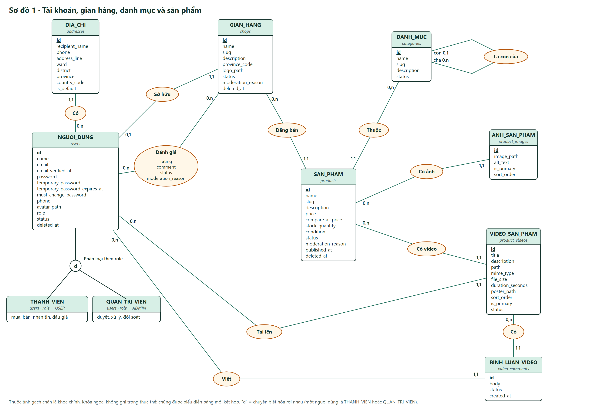
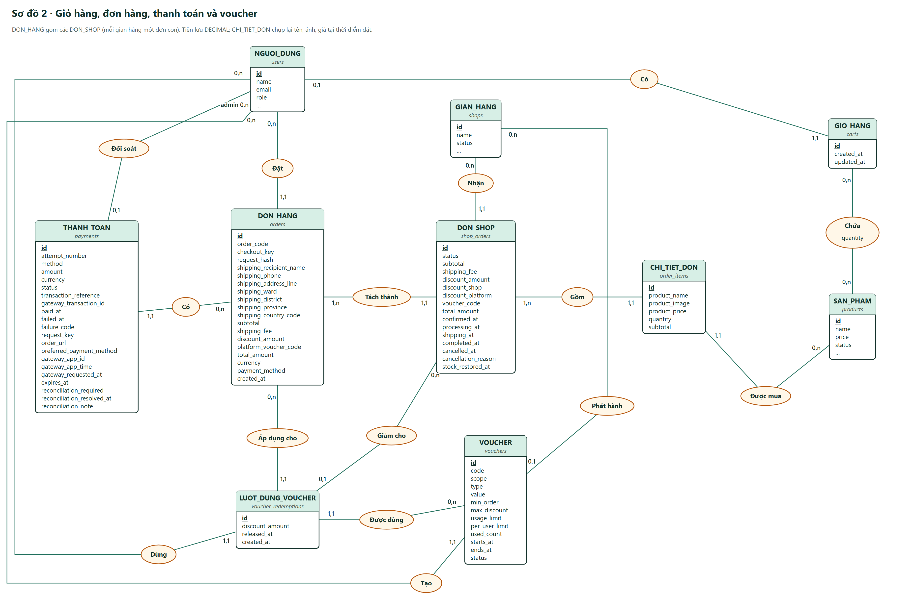
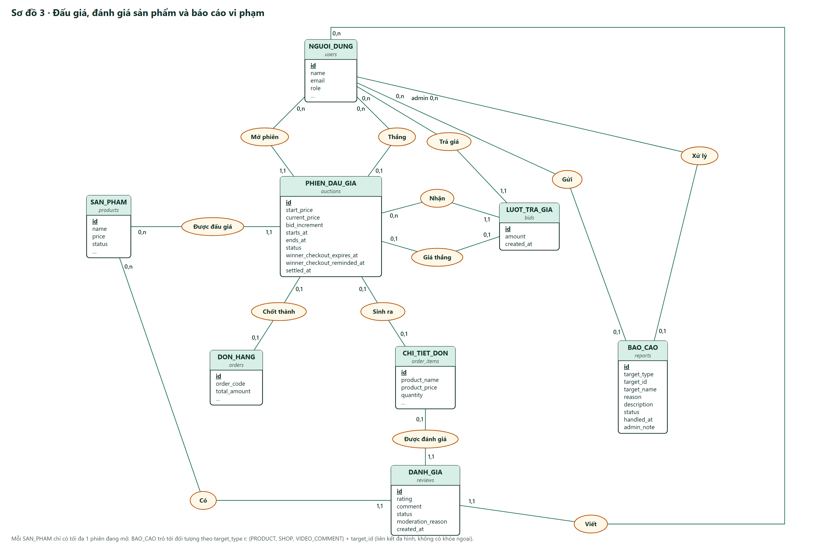
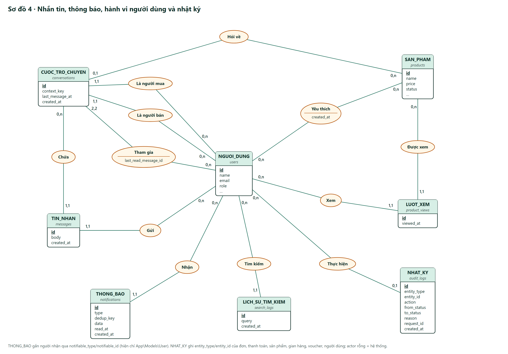

# Passdi — mô hình dữ liệu mức khái niệm (ký hiệu Chen / Merise)

Vẽ từ cấu trúc thật của CSDL `secondhand_marketplace` (đọc `information_schema` ngày 2026-10-21). Bản Mermaid theo bảng vật lý vẫn nằm ở `docs/final-erd.md`.

## Cách đọc

- **Hình chữ nhật** là thực thể: tên tiếng Việt, tên bảng (in nghiêng), danh sách thuộc tính. Thuộc tính **gạch chân** là khóa chính.
- **Khóa ngoại không ghi trong thực thể.** Mỗi khóa ngoại được vẽ thành một **mối kết hợp** (hình bầu dục, tên là động từ).
- **Bản số `min,max`** ghi sát thực thể: số lần một thể hiện của thực thể đó tham gia mối kết hợp. Ví dụ `NGUOI_DUNG 0,1 — Sở hữu — 1,1 GIAN_HANG` nghĩa là:
  - mỗi người dùng có không hoặc một gian hàng;
  - mỗi gian hàng thuộc đúng một người dùng.
- **Mối kết hợp có thuộc tính** (bầu dục có vạch ngang) là bảng nối n–n: `cart_items`, `shop_reviews`, `wishlists`, `conversation_participants`.
- **Vòng tròn `d`** là chuyên biệt hóa rời nhau: `NGUOI_DUNG` chia thành `THANH_VIEN` và `QUAN_TRI_VIEN` theo cột `role`. Đây vẫn là một bảng; người bán là thành viên có gian hàng.
- Thực thể xuất hiện ở nhiều sơ đồ (NGUOI_DUNG, SAN_PHAM, …) chỉ ghi đủ thuộc tính ở sơ đồ chính; các sơ đồ khác ghi tắt bằng `…`.

## Sơ đồ

| # | Nội dung | Ảnh |
| --- | --- | --- |
| 1 | Tài khoản, gian hàng, danh mục, sản phẩm, ảnh/video, bình luận video | `1-tai-khoan-san-pham.png` |
| 2 | Giỏ hàng, đơn hàng, đơn theo shop, chi tiết đơn, thanh toán, voucher | `2-don-hang-thanh-toan.png` |
| 3 | Đấu giá, lượt trả giá, đánh giá sản phẩm, báo cáo vi phạm | `3-dau-gia-danh-gia.png` |
| 4 | Nhắn tin, thông báo, lượt xem, tìm kiếm, yêu thích, nhật ký kiểm toán | `4-tin-nhan-hanh-vi.png` |






## 29 bảng nghiệp vụ → 25 thực thể + 4 mối kết hợp có thuộc tính

| Thực thể | Bảng | Thực thể | Bảng |
| --- | --- | --- | --- |
| NGUOI_DUNG | users | THANH_TOAN | payments |
| DIA_CHI | addresses | VOUCHER | vouchers |
| GIAN_HANG | shops | LUOT_DUNG_VOUCHER | voucher_redemptions |
| DANH_MUC | categories | PHIEN_DAU_GIA | auctions |
| SAN_PHAM | products | LUOT_TRA_GIA | bids |
| ANH_SAN_PHAM | product_images | DANH_GIA | reviews |
| VIDEO_SAN_PHAM | product_videos | BAO_CAO | reports |
| BINH_LUAN_VIDEO | video_comments | CUOC_TRO_CHUYEN | conversations |
| GIO_HANG | carts | TIN_NHAN | messages |
| DON_HANG | orders | THONG_BAO | notifications |
| DON_SHOP | shop_orders | LUOT_XEM | product_views |
| CHI_TIET_DON | order_items | LICH_SU_TIM_KIEM | search_logs |
| NHAT_KY | audit_logs | | |

Bốn bảng còn lại được vẽ thành mối kết hợp có thuộc tính:

| Mối kết hợp | Bảng | Hai đầu | Thuộc tính |
| --- | --- | --- | --- |
| Chứa | cart_items | GIO_HANG – SAN_PHAM | quantity |
| Đánh giá | shop_reviews | NGUOI_DUNG – GIAN_HANG | rating, comment, status, moderation_reason |
| Yêu thích | wishlists | NGUOI_DUNG – SAN_PHAM | created_at |
| Tham gia | conversation_participants | NGUOI_DUNG – CUOC_TRO_CHUYEN | last_read_message_id |

Không vẽ 9 bảng hạ tầng của Laravel: `cache`, `cache_locks`, `jobs`, `job_batches`, `failed_jobs`, `migrations`, `sessions`, `password_reset_tokens`, `personal_access_tokens`.

Cũng không vẽ các cột kỹ thuật chỉ dùng để ép ràng buộc duy nhất:
- `auctions.active_product_id`: mỗi sản phẩm chỉ có một phiên đang mở;
- `product_videos.primary_product_id`: mỗi sản phẩm chỉ có một video chính;
- `reports.open_slot`: mỗi người chỉ có một báo cáo đang mở cho cùng một đối tượng.

## Liên kết đa hình (không có khóa ngoại)

Ba bảng trỏ tới đối tượng qua cặp cột loại/mã thay vì khóa ngoại, nên sơ đồ không vẽ đường nối cho các liên kết này:

| Bảng | Cặp cột | Trỏ tới |
| --- | --- | --- |
| `reports` | `target_type`, `target_id` | `PRODUCT`, `SHOP`, `VIDEO_COMMENT` |
| `notifications` | `notifiable_type`, `notifiable_id` | hiện chỉ `User` (vẽ thành mối kết hợp "Nhận") |
| `audit_logs` | `entity_type`, `entity_id` | đơn, thanh toán, sản phẩm, gian hàng, voucher, người dùng |

## Đặc tả bằng văn bản

Mô tả đầy đủ thực thể, kiểu dữ liệu, giá trị enum và 51 mối kết hợp (kèm bản số và khóa ngoại) nằm ở `erd-spec.md`, dùng để vẽ lại bằng công cụ khác.

## Vẽ lại

Sửa toạ độ hoặc thuộc tính trong `generate.py`, rồi chạy `python generate.py .` trong thư mục này để sinh lại file SVG. Để xuất PNG, chụp file SVG bằng Edge headless:

```
msedge --headless=new --force-device-scale-factor=2 --window-size=<W>,<H> --screenshot=<file>.png file:///<đường dẫn>/<file>.svg
```

`W` và `H` là kích thước ghi trong thẻ `<svg>`.
