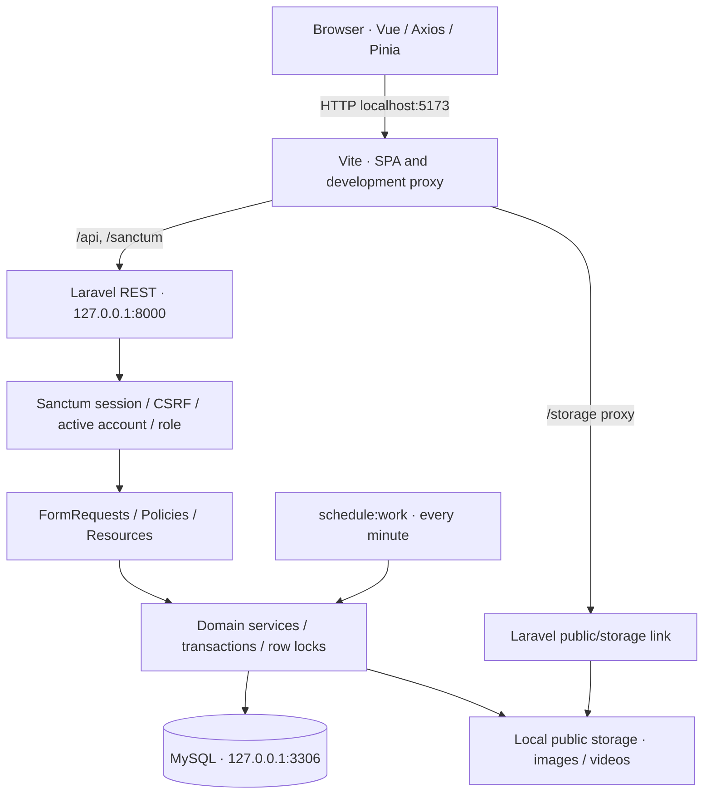
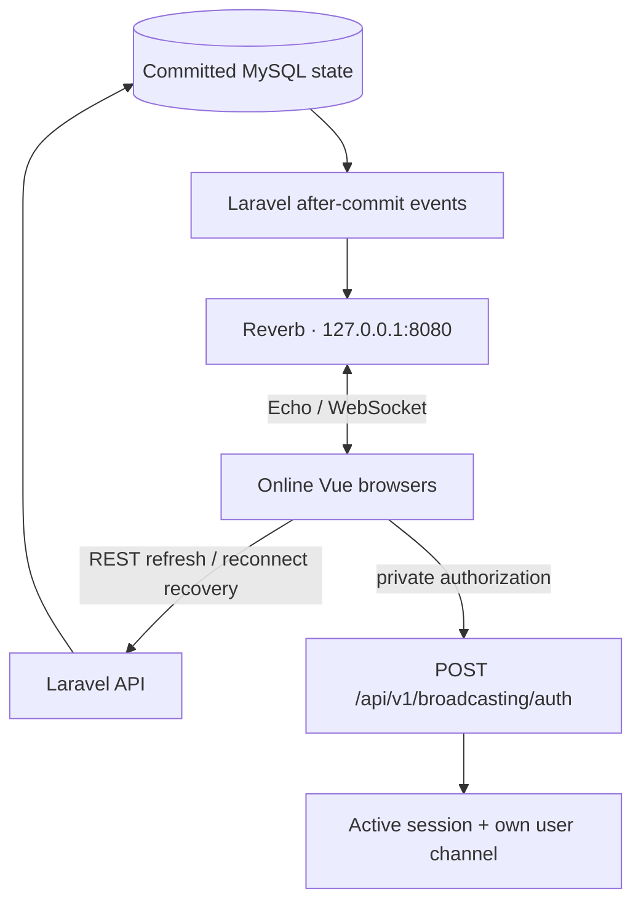
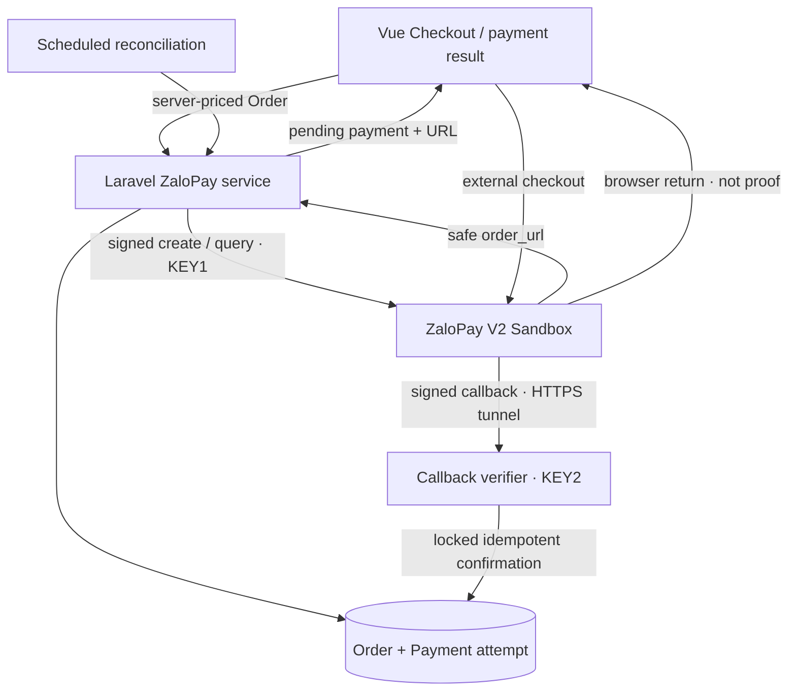

# Final architecture

## REST and local runtime

Controllers coordinate validation and services; frontend cannot authoritatively set money, winners, moderation or fulfillment. REST returns persisted resources/server time. SQL constraints complement service guards. Checkout snapshots product/address details. Current sessions are file-based despite the sessions table existing in migrations. Production output has no Vite development proxy.

## Realtime delivery

Public `auction.{id}` and `video.{id}` channels carry safe event data. Private `user.{id}` carries OUTBID/Notification events and requires own-user authorization. Notifications persist before broadcast. Public event guards recheck visibility. Events dispatch after commit and rescue broadcast failures; outage cannot invalidate a committed bid/comment/notification. Current broadcasts run synchronously after commit without a required queue worker. Messaging signals `MessageSent`/`ConversationRead` on private `user.{id}`; clients refetch through REST and fall back to 4 s polling while the channel is not subscribed.

## External payment boundary

External create/query HTTP runs outside DB transactions/deadlock retries. Callback is exempt from browser CSRF because the provider has no SPA session; MAC plus reference/app/user/time/amount checks establish authenticity. Verified money after cancellation/terminal conflict requires manual reconciliation rather than resurrecting fulfillment. C1 verified Sandbox creation/gateway reachability, not completed payment/paid callback.

## Scheduler and storage

`auctions:sync --limit=100` starts due eligible auctions, finalizes elapsed auctions and sends one configured checkout-expiry reminder. Expiry is derived from time; there is no settlement-status column to mutate. Unavailable activations may be deferred. `zalopay:reconcile --limit=100` queries eligible pending attempts. Both run every minute with withoutOverlapping, backed by domain locks/idempotency.

Images/videos live in `storage/app/public`; DB stores paths/metadata. `storage:link` exposes that disk. Images are re-encoded; videos are validated but not transcoded. Preserve files alongside DB backups. Public static URLs are not revocable signed media access. Local storage/file sessions/development proxy are single-machine assumptions.

Sources: [bootstrap](../backend/bootstrap/app.php), [services](../backend/app/Services), [events](../backend/app/Events), [channels](../backend/routes/channels.php), [scheduler](../backend/routes/console.php). See [sequences](final-sequences.md).
