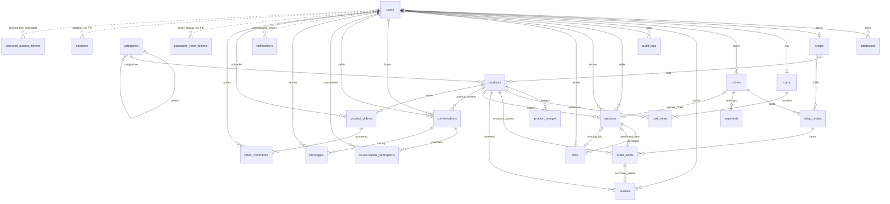
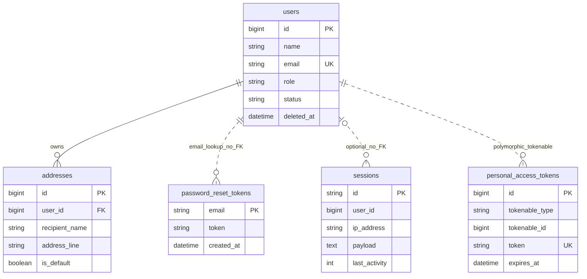
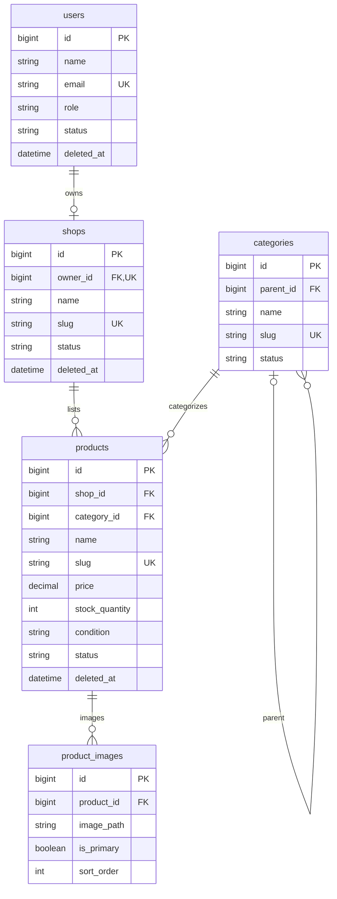
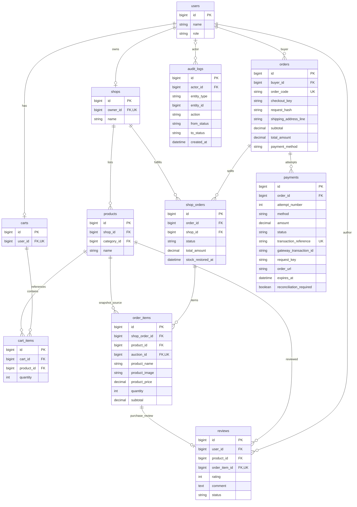
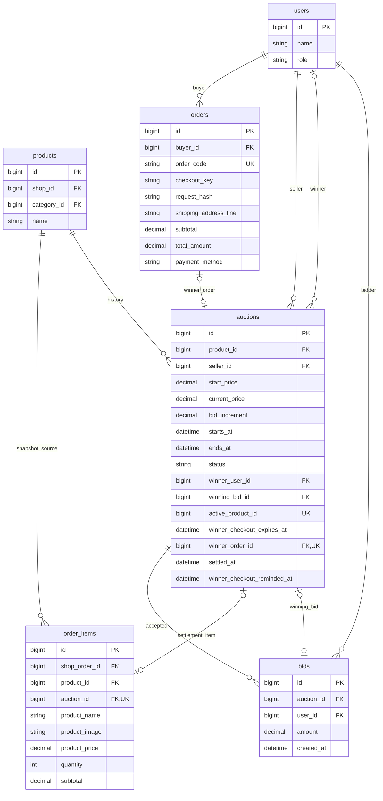
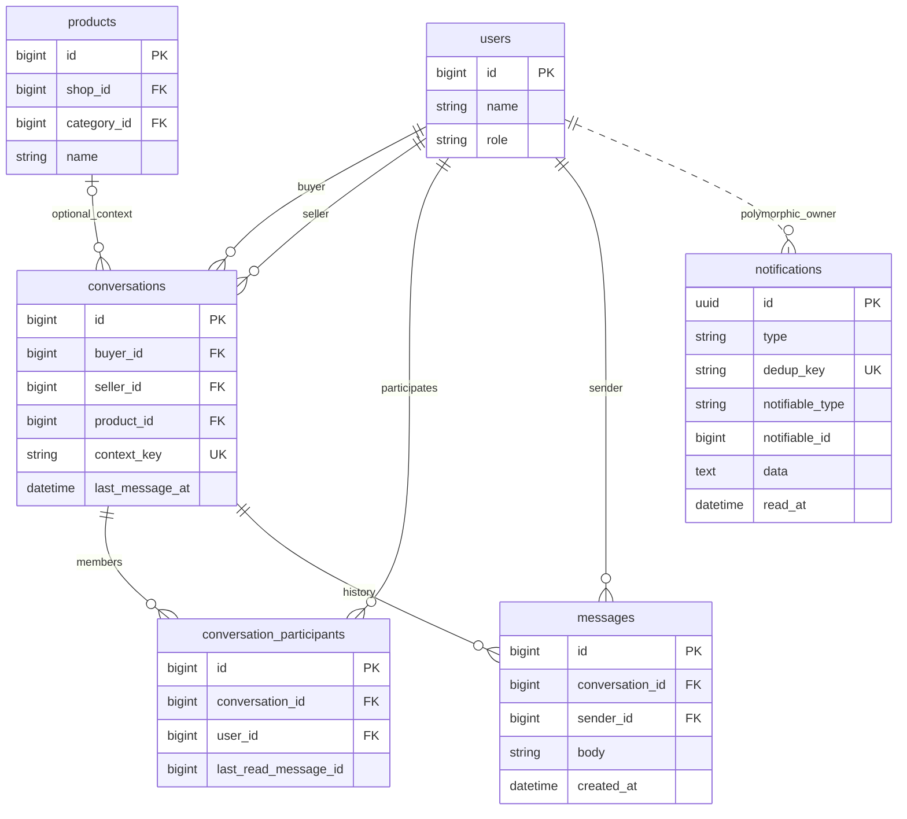
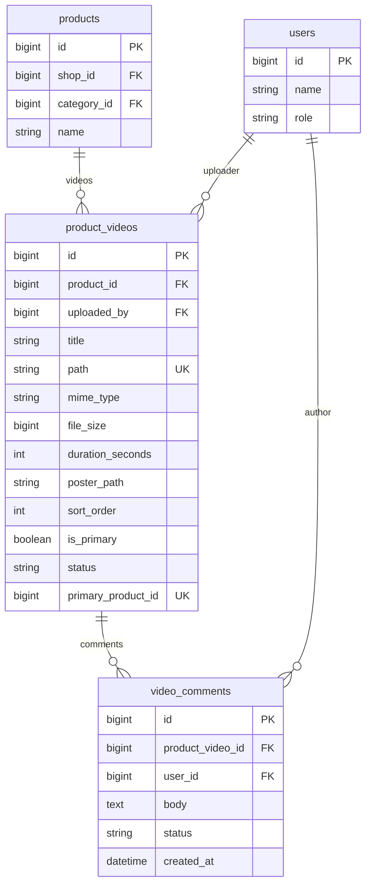

# Final database ERD

Source of truth: all applied [migrations](../backend/database/migrations) and current [models](../backend/app/Models), including additive ZaloPay/Auction/Video migrations. Attribute blocks show **selected actual columns**, not every timestamp/address field or a replacement DDL. DECIMAL money is (15,2). Optionality includes historical zero-child rows; domain services enforce valid transaction composition.

Solid lines denote declared FK relationships; dotted lines are logical/polymorphic links without SQL FKs. Generated active_product_id/primary_product_id are unique projections, not separate parent references. PK/FK/UK annotate individual keys; composite keys are explained below. No products.sku, orders.status or auctions.settlement_status column is invented.

## Whole business relationship map

Reference-only overview: this cyclic cross-domain graph is intentionally dense and should be opened at native size with pan/zoom. For defense/projector use, show the six domain diagrams below, not a fit-to-page thumbnail of the full map. Cross-domain reference entities show only a few identifiers in those views.

## Identity

## Marketplace

## Transactions

## Auctions

## Communication

## Video and content

## Constraints and schema interpretation

- Shop owner and Cart user are unique. Category parent is nullable; service enforces maximum three levels/cycle prevention. Address default is serialized by account locking, not a unique is_default index.
- Products require positive price and enum condition/status. Image primary is normalized by locked services, not a generated unique-image column. Soft deletes apply to Users, Shops and Products; transaction FKs preserve references.
- Composite uniqueness: cart_items(cart_id, product_id), orders(buyer_id, checkout_key), shop_orders(order_id, shop_id), order_items(shop_order_id, product_id), payments(order_id, attempt_number), payments(order_id, request_key), payments(method, gateway_transaction_id), conversation_participants(conversation_id, user_id). A nullable gateway transaction or request key is not globally unique by itself.
- Order has shipping/item/payment snapshots; fulfillment status lives in ShopOrders and payment status in Payments. Fees/discount fields exist with current zero defaults; no coupon feature implied. VNPAY and REFUNDED schema values persist historically; runtime delivers COD/ZALOPAY, not VNPAY/refund processing.
- Auction active_product_id is generated only for SCHEDULED/LIVE and uniquely blocks another unfinished auction. Unexpired winner claims additionally block creation/fixed buying through service predicates. Winning-bid FK is composite `(auctions.id, winning_bid_id) → bids(auction_id, id)`, so another auction's bid cannot be selected. winner_order_id and order_items.auction_id are nullable unique links. Settlement state is derived; there is no settlement enum column.
- Notifications use notifiable_type/notifiable_id polymorphism to User, unique dedup_key and serialized data. Audit entity_type/entity_id is a logical entity reference, not a universal FK. Participant last_read_message_id is a validated monotonic cursor (0 initially), not an FK to Messages.
- Video primary_product_id is generated only for READY primary and unique. PROCESSING/FAILED enum support does not mean transcoding exists. Comment status is PUBLISHED/HIDDEN.
- password_reset_tokens identifies email without a User FK. sessions.user_id is indexed but not constrained. Personal access tokens are framework schema support, not issued by current SPA auth. Local sessions use files, not the sessions table.
- Framework migrations also contain cache, cache_locks, jobs, job_batches, failed_jobs and migrations bookkeeping. They are infrastructure rather than marketplace business relationships and are omitted from the business ERDs. Current after-commit broadcasts do not require a queue worker.

[Architecture](final-architecture.md) explains runtime use; [auction states](auction-state-machines.md) distinguishes derived state from persisted fields.
