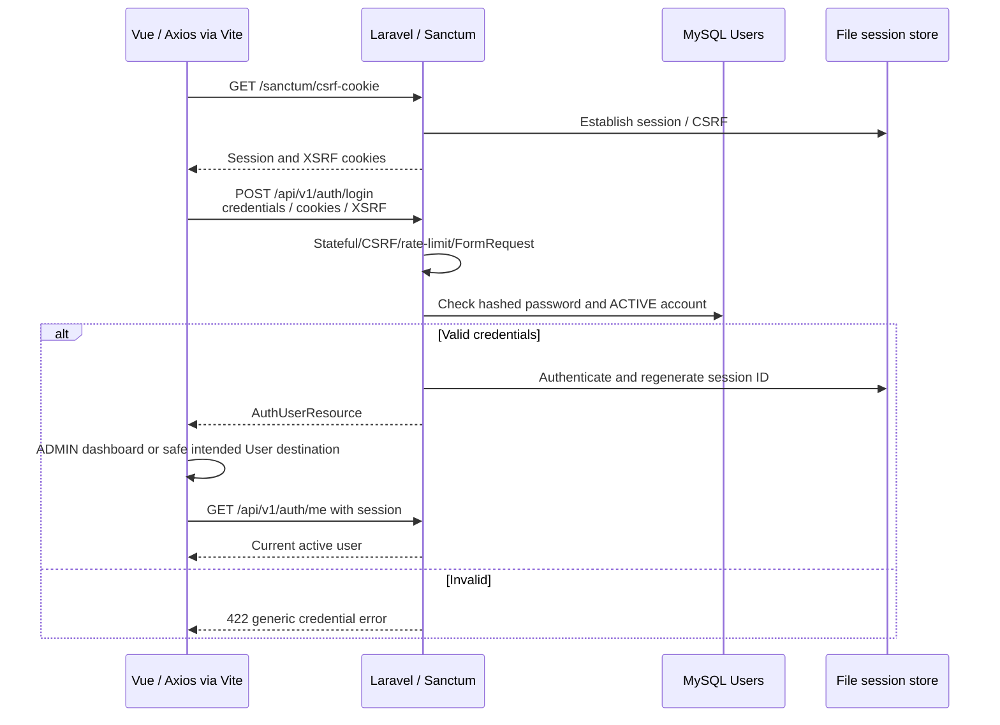
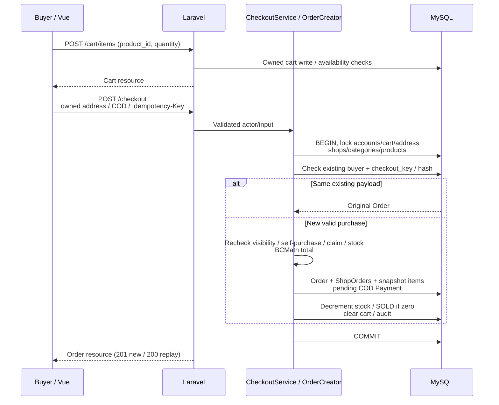
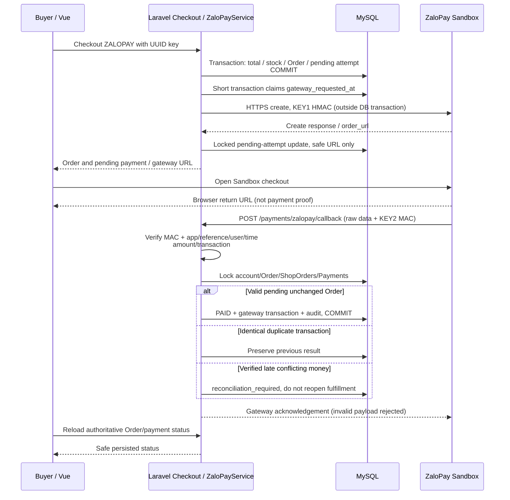
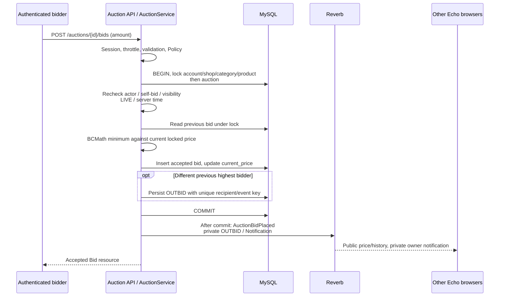
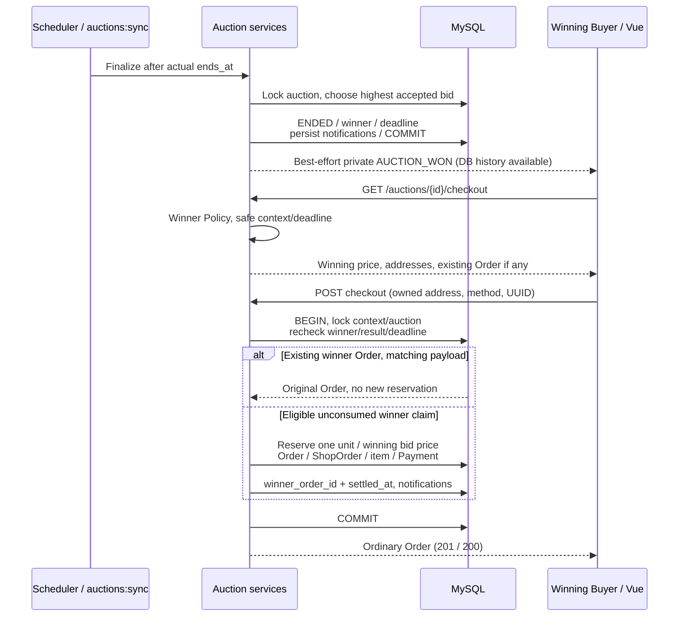
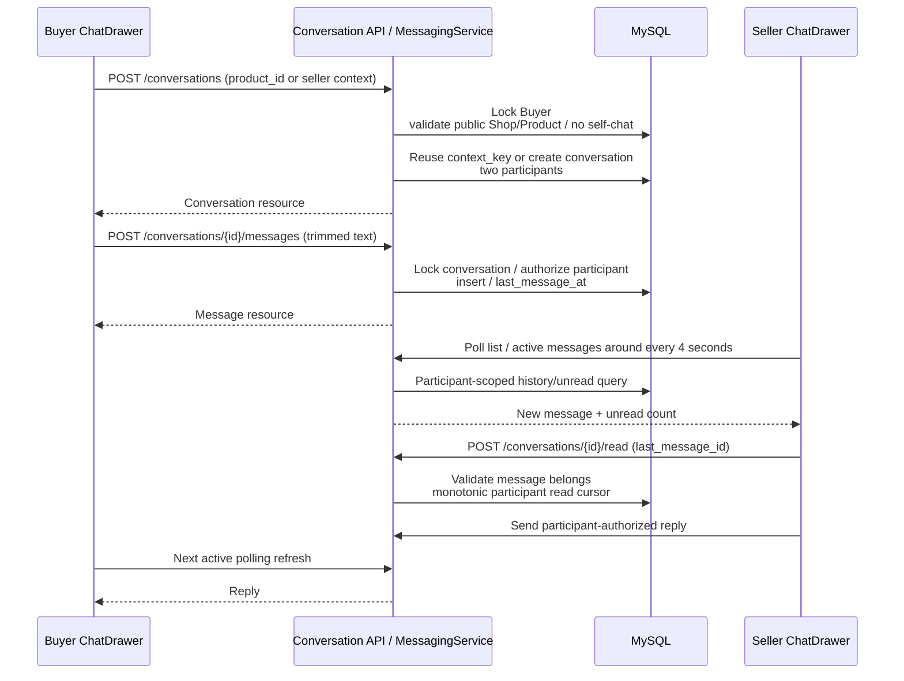
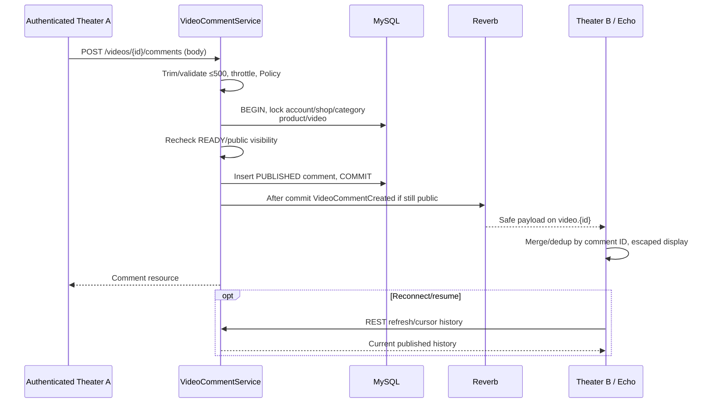

# Final sequence diagrams

Paths are `/api/v1` unless explicitly `/sanctum`. Simplified happy paths plus important rejection/commit boundaries; source: [controllers](../backend/app/Http/Controllers/Api/V1), [services](../backend/app/Services), [events](../backend/app/Events). Locks/Policies remain required beyond the steps drawn.

## A. Login / Sanctum

Role routing is UX; Admin APIs independently enforce ADMIN. Laravel 13 may validate trusted same-origin Fetch Metadata before token fallback. Logout invalidates session and regenerates CSRF token; no bearer token is issued by this flow.

## B. Cart → Checkout → COD

Invalid state/stock/claim rejects without partial reservation; reused key with different payload returns 409. COD remains pending until Seller completion confirms collection under normal fulfillment rules.

## C. ZaloPay creation / callback

Scheduler/explicit query signs an HTTPS query request with KEY1 outside DB locks, then applies verified amount/transaction fields through the same locked confirmation. Callback transport requires public HTTPS tunnel locally. C1 manually verified creation/gateway only, not this external paid callback.

## D. Auction bid / lock / realtime

A concurrent bid waits and recalculates against the new price; insufficient/stale/end-time bids reject. Reverb outage is rescued; DB write stays authoritative.

## E. Winner → checkout → Order

New checkout fails after deadline or unavailable stock/context; another user is forbidden. ZaloPay starts after the Order transaction. Lifecycle ENDED is independent of Order/payment status; no fallback winner.

## F. Buyer/Seller messaging

No WebSocket messaging. Timers pause when page is inactive and clean up on unmount. Conversation survives product unavailability; unsafe current product context is omitted.

## G. Video comment → DB → Reverb

Author/owning Seller/Admin hide follows locked Policy + audit and committed VideoCommentHidden; clients remove by ID. Hidden Product/Video blocks public history/new comments; public channels never contain private email/session data.
