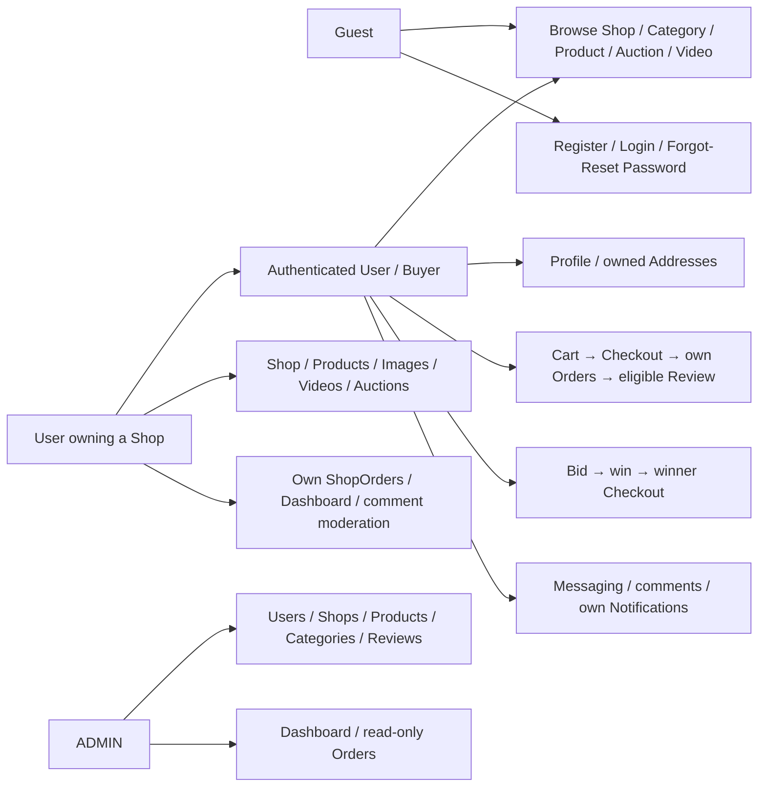
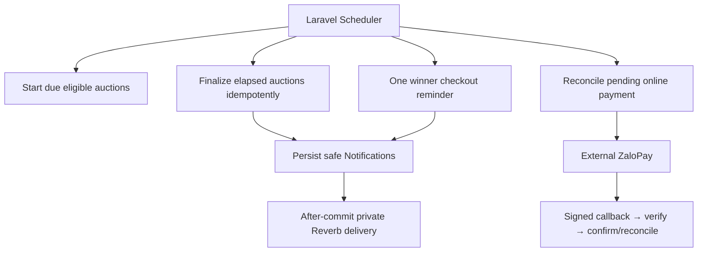

# Final use cases

Seller is a **User owning a Shop**. ADMIN is the other stored role. External ZaloPay and Scheduler are supporting actors, not human accounts.

## Actor model

Seller → Buyer denotes capabilities, not a stored role inheritance. Ownership/state conditions remain backend-enforced; Admin is not a bypass for another owner's transaction.

## Human use cases

| Use case | Preconditions | Result / boundary |
| --- | --- | --- |
| Account access | Valid credentials; ACTIVE for protected use | Rotated session, safe role/intended destination; non-ADMIN Admin denied |
| Maintain address | Authenticated owner | Owned CRUD/default; foreign ID denied; checkout snapshots address |
| Publish listing | Own Shop; current moderation conditions | Draft/images/video → submit → approval; hidden/inactive item not purchasable by URL |
| Fixed purchase | Available unreserved item from another Shop; owned address | Server-price/stock transaction and Shop splits; original payload/key retry |
| Fulfill/cancel | Seller/Buyer within allowed transitions | expected_status enforced; stock restored once; Admin read-only |
| Review | Matching Buyer/item and completed ShopOrder | One review/item, no own-Shop review, publish/hide moderation |
| Messaging | Active participants; no self-chat | Context reuse, text/history/read; unavailable context omitted, history retained |
| Bid/settle | LIVE before end; eligible minimum bid | Locked bid, highest accepted winner, winner-only Order before deadline |
| Notifications | Owner | Persisted history/unread/read-all; online private delivery, offline history |
| Video/Theater | READY + public Product/Shop | Playback/Product or Arena CTA; User comments; author/permitted Seller/Admin hides |

## Supporting system use cases

Browser countdown/provider return cannot set winner/PAID. Expired claims release fixed-price exclusivity without fallback winner. See [states](auction-state-machines.md), [sequences](final-sequences.md), [demo](demo-script.md).
