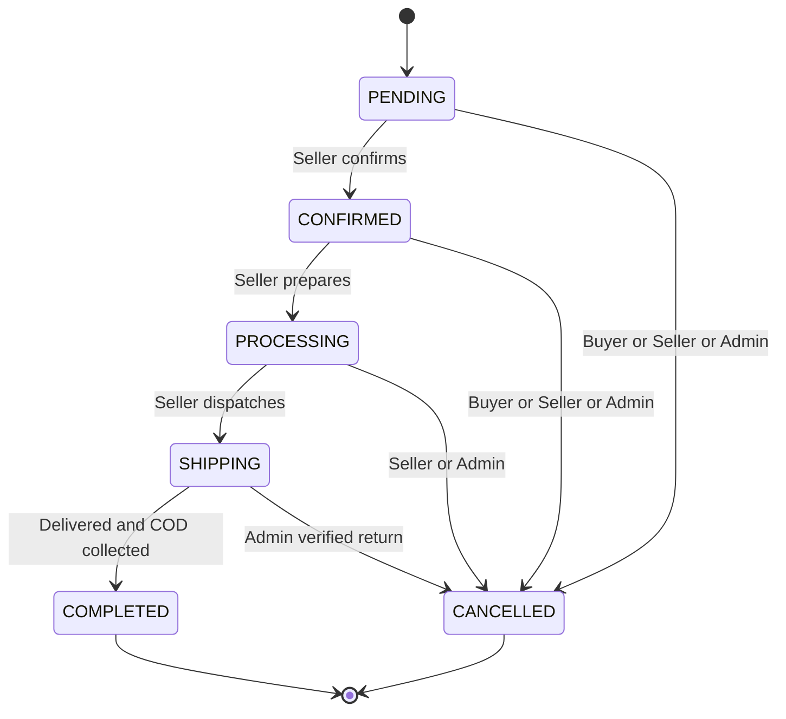

# State transitions

> PHASE 9 đã thực thi Shop/Category/Product, checkout/cancel và ShopOrder/COD từ PHASE8; thêm Review create PUBLISHED và author edit giữ nguyên trạng thái. Review Admin moderation cùng các ngoại lệ Admin vẫn future. Transition ngoài bảng bị từ chối409 sau policy authorization; unauthorized object403. State và audit theo transaction hiện có.

## 1. Shop

Từ 2026-10-14: gian hàng hoạt động ngay khi tạo, không còn bước duyệt. Admin chỉ khoá gian hàng (thường khi bị báo cáo nhiều) và mở lại sau khi xử lý. PENDING/REJECTED chỉ còn ở dữ liệu tạo trước thay đổi này; các bước duyệt cũ vẫn chạy được cho chúng.

| From → To | Actor | Guard / side effect |
|---|---|---|
| Không có → ACTIVE | User ACTIVE | Chưa có Shop kể cả soft-deleted |
| ACTIVE → SUSPENDED | Admin | Reason, ngừng nhận đơn/public listing ngay; không tự hủy đơn mở |
| SUSPENDED → ACTIVE | Admin | Đã xử lý vi phạm, owner ACTIVE, reason |
| PENDING → ACTIVE / REJECTED | Admin | Chỉ cho gian hàng cũ còn PENDING |
| REJECTED → PENDING | Owner | Chỉ cho gian hàng cũ bị từ chối |

Soft-delete tách khỏi status: admin chỉ archive khi không còn ShopOrder nonterminal; không delete history. Không khoá/mở Shop của chính admin đang thao tác.

## 2. Product

Từ 2026-10-14: tin lên ngay khi người bán đăng (không duyệt trước). Cộng đồng báo cáo, admin xử lý sau. PENDING nghĩa là "chờ quản trị viên xem xét" (tin bị gỡ xin mở lại, hoặc tin tự tạm ẩn vì nhiều báo cáo); REJECTED nghĩa là "bị gỡ".

Condition LIKE_NEW/GOOD/FAIR/POOR không nằm trong state machine.

| From → To | Actor | Guard / side effect |
|---|---|---|
| Không có → DRAFT | Owner | Shop PENDING/ACTIVE, tạo từ allowlisted input |
| DRAFT/HIDDEN → ACTIVE | Owner submit ("Đăng bán") | Shop/owner/category ACTIVE, stock>0, price>0, ảnh primary hợp lệ; published_at giữ lần đăng đầu |
| ACTIVE → HIDDEN | Owner | Tạm ẩn; đăng lại bằng submit |
| ACTIVE/SOLD → REJECTED | Admin ("Gỡ tin") | Reason bắt buộc, người bán thấy; phiên đấu giá đang chạy phải hủy trước (409 kèm auction_id); người thắng chờ thanh toán được báo |
| REJECTED → PENDING | Owner reopen ("Yêu cầu mở lại") | Kiểm tra đủ điều kiện đăng; không có đường REJECTED → DRAFT → ACTIVE vượt qua admin |
| ACTIVE → PENDING | System (báo cáo) | Đủ `moderation.auto_hide_reports` (mặc định 3) người dùng khác nhau có báo cáo đang mở; bỏ qua tin đang bị phiên đấu giá giữ; audit `product.auto_hidden`, thông báo PRODUCT_HIDDEN cho chủ gian hàng sau commit |
| PENDING → ACTIVE / REJECTED | Admin | Reason; không xử lý tin của gian hàng mình |
| ACTIVE → SOLD | System checkout hoặc owner stock=0 | Stock trở thành 0 trong transaction, có audit |
| SOLD → ACTIVE | Owner bổ sung stock | Shop/owner/category còn bán được; nếu không thì SOLD → HIDDEN |
| SOLD → HIDDEN | Owner hide, hoặc hệ thống khi restock/hủy đơn mà không đủ điều kiện bán | — |
| SOLD → ACTIVE / HIDDEN | System cancel | Restore stock>0 theo BR-ORDER-010 |
| mọi state → cùng state | Owner edit nội dung/ảnh/giá | Không đổi trạng thái; snapshot đơn cũ giữ nguyên |

Mọi chỉnh tồn kho cần expected_updated_at, mismatch dưới lock → 409. Admin dùng expected_status và reason bắt buộc, stale → 409; mở lại kiểm tra availability/stock/images dưới lock. `withdraw`/`revise` đã bỏ (404); `reopen` là action riêng, không nhận status từ CRUD.

Admin không sửa nội dung/giá thay owner; admin moderate ACTIVE→HIDDEN, PENDING→ACTIVE/REJECTED. Xóa mềm là orthogonal: không thay snapshot/reference, không auto restore khi đơn cancel. Product bị soft-delete không được chuyển trạng thái qua seller API cho đến admin restore về DRAFT, có audit.

## 3. ShopOrder

| From → To | Actor | Guard / side effect |
|---|---|---|
| Không có → PENDING | Checkout service | Order/items/payment/stock cùng transaction |
| PENDING → CONFIRMED | Owner; admin xử lý thay | Hàng nhận xử lý, expected_status khớp |
| CONFIRMED → PROCESSING | Owner; admin xử lý thay | Bắt đầu chuẩn bị |
| PROCESSING → SHIPPING | Owner; admin xử lý thay | Đã bàn giao giao hàng; MVP không bắt buộc tracking carrier |
| SHIPPING → COMPLETED | Owner; admin xử lý thay | Xác nhận đã giao và thu đủ COD; chỉ tổng hợp Payment Order PAID khi tất cả phần chưa hủy COMPLETED trong cùng transaction |
| PENDING/CONFIRMED → CANCELLED | Buyer sở hữu Order | Reason; chưa paid; trả stock đúng một lần |
| PENDING/CONFIRMED/PROCESSING → CANCELLED | Owner | Không thể fulfill: OUT_OF_STOCK/DAMAGED/UNFULFILLABLE + chi tiết reason; chưa paid |
| PENDING/CONFIRMED/PROCESSING → CANCELLED | Admin | Ngoại lệ có reason, chưa paid, audit; không bypass stock restore |
| SHIPPING → CANCELLED | Chỉ Admin | Có xác nhận hàng đã quay lại và còn bán được, COD chưa thu, lý do/bằng chứng tham chiếu trong reason; restore stock + đối chiếu COD attempt toàn Order |

Admin xử lý thay chỉ có endpoint riêng và reason, giữ cùng transition/guard. Seller/User bị khóa, Shop suspended không dùng seller mutation; admin xử lý obligations. Hàng đã mất/hỏng trên đường hoặc tranh chấp COD cần workflow return/loss tương lai, chưa tự cancel/restore khi chưa kiểm chứng. COMPLETED và CANCELLED terminal, không quay ngược. Không hủy một phần quantity; muốn hủy cả Order thì buyer gửi hủy từng ShopOrder đủ điều kiện, không có action all-or-nothing toàn Order trong MVP.

Race cancel-vs-confirm: serialized bởi lock. Nếu Buyer gửi expected PENDING nhưng đã CONFIRMED thì 409 và reload trước request mới; không dùng quyền cancel CONFIRMED để bỏ qua optimistic guard. Repeat cùng target sau thành công trả hiện trạng, không đổi timestamps/audit/stock lần nữa.

## 4. Order tổng — trạng thái suy ra

Không có Order.status lưu DB hoặc transition API riêng. Với tập ShopOrders không rỗng:

1. Tất cả CANCELLED → CANCELLED.
2. Tất cả COMPLETED → COMPLETED.
3. Tất cả terminal, có cả COMPLETED và CANCELLED → PARTIALLY_COMPLETED.
4. Tất cả PENDING → PENDING.
5. Các tổ hợp còn lại → IN_PROGRESS (kể cả PENDING + CANCELLED).

Order có ít nhất một ShopOrder tại commit checkout. UI hiển thị rõ trạng thái từng phần và tổng tiền gốc, payable/paid/amount_due riêng; không giả rằng một Seller quyết định toàn Order. Admin filtering theo overall_status là derived query trên children, không filter cột không tồn tại.

## 5. Payment attempt

| From → To | Actor | Điều kiện |
|---|---|---|
| Không có → PENDING | Checkout service COD; future payment service VNPay | amount payable Order, khóa Order, không attempt PENDING/PAID khác |
| PENDING → PAID | COD complete service được seller/admin gọi | Sau complete/cancel cuối, mọi phần chưa hủy đã COMPLETED và thu đủ payable Order; paid_at set |
| PENDING → CANCELLED | Cancel service | Toàn Order hủy hoặc thay attempt sau partial cancellation; không xóa tiền đã thu theo completion |
| PENDING → PAID | Future verified VNPay callback | Chữ ký/reference/currency/amount hợp lệ; đơn còn đủ điều kiện, unique gateway transaction |
| PENDING → FAILED | Future verified gateway kết luận failure | Không tự hoàn stock; có thể tạo attempt mới nếu chưa hết hạn |
| PENDING → CANCELLED | Future timeout/cancel service | Hủy session/attempt theo quy tắc expiry; serialize với callback |
| PAID → REFUNDED | Future refund service | Có chứng cứ gateway hoàn toàn bộ khoản attempt; audit/refund record; không restore stock tự động |

PAID không chuyển FAILED/CANCELLED; FAILED/CANCELLED không chuyển lại PENDING/PAID. Retry là row mới. Callback thanh toán trễ cho attempt terminal đi reconciliation, không bỏ qua kiểm tra để hồi sinh đơn. REFUNDED terminal. COD không có refund endpoint MVP; admin không được toggle Payment trực tiếp.

Payment status là attempt của toàn Order; đang thu COD một phần vẫn PENDING, cod_collected_amount suy ra ShopOrders COMPLETED. PAID khi thu đủ các phần chưa hủy. BR-PAYMENT-004/005 quy định replacement attempt khi payable thay đổi. Refund thuộc future.

## 6. Các trạng thái phụ

User ACTIVE↔SUSPENDED chỉ Admin, không tự thao tác admin cuối cùng; Category ACTIVE↔INACTIVE chỉ Admin; Review PUBLISHED↔HIDDEN chỉ Admin có reason. Buyer edit review không tự bỏ HIDDEN. Cả ba được audit. Shop moderation của chính admin sở hữu phải do admin khác.

## 7. Auction — future only

| From → To | Actor | Guard |
|---|---|---|
| Không có → SCHEDULED | Owner qua auction service | Product đủ điều kiện, stock=1, sale_mode=AUCTION, giá/times hợp lệ |
| SCHEDULED → ACTIVE | Scheduler/service | Server now >= start_at và now < end_at, không cancelled |
| SCHEDULED → CANCELLED | Owner hoặc Admin | Chưa có bid, reason |
| ACTIVE → CANCELLED | Admin | Vi phạm nghiêm trọng, reason/audit, không âm thầm xóa bids |
| ACTIVE → ENDED | Closing service/job | now >= end_at, lock Auction, chọn highest valid bid; winner null nếu không bid |
| SCHEDULED → ENDED | Catch-up job | Scheduler bị dừng đến sau end_at; không nhận bid bù |

ENDED/CANCELLED terminal. Bid yêu cầu auction ACTIVE, start_at <= server now < end_at, user ACTIVE không phải owner; bid đầu >= start_price, các bid sau >= current_price + minimum_increment. Lock Auction cho compare/insert/update; job đóng và bid dùng cùng lock, kiểm lại giờ sau lock; backend quyết định winner, WebSocket chỉ notify sau commit. winning_bid_id phải thuộc Auction, giá thắng bằng amount bid. Chưa triển khai settlement/re-auction/payment window; phải thiết kế trước PHASE Auction, không chặn schema MVP.

## Thực thi PHASE 5

Shop transitions ở mục1 được áp dụng bởi ShopService. Moderation yêu cầu expected_status trùng trạng thái dưới lock và transition trong bảng; request stale, repeat target hoặc đường không hợp lệ trả409, không ghi audit. Owner resubmit chỉ REJECTED→PENDING qua action riêng, không nhận status body. SUSPENDED owner không sửa/submit nhưng vẫn xem own shop nếu account ACTIVE. Lý do kiểm duyệt gần nhất vẫn được hiển thị ở private resource; public không nhận trường này.

Category ACTIVE↔INACTIVE do ADMIN qua PATCH category có reason/audit. Inactive parent ẩn descendants qua public query, không cascade đổi status. Không có trạng thái mới, không thêm soft-delete Category. Archive/restore Shop và thay đổi trạng thái đơn không thuộc PHASE 5.

### Phạm vi thực thi PHASE 8

Buyer và Seller ShopOrder transitions trên đây đã có API, với expected_status bắt buộc; valid same-target replay không đổi stock/timestamps/audit. Seller mutation cần Shop ACTIVE; Buyer vẫn được hủy phần đơn đủ điều kiện nếu Shop đã suspended. Các ngoại lệ Admin là future, không có controller/route ở phase này. COD hoàn tất bắt buộc cod_collected=true; aggregate trên các phần chưa hủy quyết định PAID. Cancel cuối có thể tạo replacement attempt PAID khi phần còn lại đều COMPLETED. Toàn bộ phần hủy →payment CANCELLED. SOLD restoration dùng revision audit như BR-ORDER-010/Checkout implementation; không vượt moderation.
