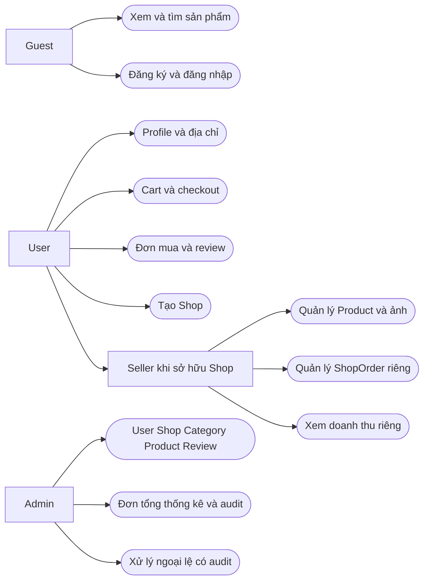

# Use cases

> Thiết kế cho các phase sau. Tiền điều kiện chung: dịch vụ sẵn sàng; mutation cần account ACTIVE, CSRF hợp lệ, validation và policy. Success không bypass business rules. Mermaid flowchart dưới đây là bản đồ actor–use case, không giả định Mermaid hỗ trợ UML use-case native.

## 1. Guest

| ID / Use case | Tiền điều kiện | Luồng chính / hậu điều kiện | Ngoại lệ |
|---|---|---|---|
| UC-G01 Đăng ký | Chưa login | Lấy CSRF cookie → nhập name/email/password+confirmation → validate, hash → tạo USER ACTIVE, session login; 201 User | Email đã dùng kể cả soft-deleted →422; weak/mismatch password →422; rate limit →429 |
| UC-G02 Đăng nhập | Chưa login | CSRF → email/password → xác thực, regenerate session →200 User | Credential sai →422 chung; suspended/deleted không tạo session; 429 quá số lần |
| UC-G03 Xem danh sách Product | Không cần login | GET products mặc định newest → paginated public products | Không có kết quả trả data=[]; không public hàng hidden/pending |
| UC-G04 Tìm kiếm/filter/sort | Không cần login | Nhập keyword/category/condition/price/shop/sort → validate whitelist → query + pagination | min>max hoặc sort sai →422; hết kết quả →200 rỗng |
| UC-G05 Xem chi tiết Product | Product public | GET bằng global slug → ảnh theo primary/sort, thông tin condition/stock, review public và Shop | Product ẩn/xóa/không khả dụng →404; không hiển thị dữ liệu draft |
| UC-G06 Xem Shop | Shop ACTIVE, owner ACTIVE | GET Shop slug → hồ sơ public; listing products lọc shop | Suspended/deleted →404; Shop public chưa có hàng →200 rỗng |

## 2. User / Buyer

| ID / Use case | Tiền điều kiện | Luồng chính / hậu điều kiện | Ngoại lệ |
|---|---|---|---|
| UC-B01 Profile/me/logout | Đã login | GET me; PATCH name/phone/avatar hợp lệ; POST logout hủy session →204 | Cấm role/status/email/password qua profile →422; session hết hạn →401 |
| UC-B02 Quản lý Address | Đã login | List/create/update/delete; đổi default khóa User; tối đa một mặc định | Address người khác →403; thiếu recipient/phone/location →422; đơn cũ không thay đổi |
| UC-B03 Quản lý Cart | Đã login | GET cart; POST tăng dòng/quantity; PATCH quantity tuyệt đối; DELETE dòng →204 | Product không active/self-owned/hết stock →409 hoặc403 tự mua; quá quantity →422; cart item người khác →403 |
| UC-B04 Checkout | Cart không rỗng, có Address của mình | Gửi address_id,COD,Idempotency-Key → transaction tạo Order/ShopOrders/items/payments, trừ stock/clear cart →201 | Stock/status thay đổi →409 rollback; replay →200 đơn cũ; address người khác →403; no address/cart →422 |
| UC-B05 Xem đơn mua | Đã login | GET orders phân trang, GET order detail snapshots, state từng ShopOrder và payment aggregate | Order người khác →403; Product/Address đã thay đổi không ảnh hưởng history |
| UC-B06 Hủy phần đơn | ShopOrder thuộc Order mình, PENDING/CONFIRMED | Gửi expected_status+reason → cancel/restore stock/payment cùng transaction →200 ShopOrder | PROCESSING/SHIPPING/COMPLETED →409; race state →409; replay không restore lần hai |
| UC-B07 Review | Own OrderItem, ShopOrder COMPLETED | POST rating/comment; service suy ra User/Product →201; PATCH own review rating/comment | Chưa mua →403, chưa completed →409, trùng item →409, rating sai →422; HIDDEN sửa vẫn hidden |

## 3. User / Seller

| ID / Use case | Tiền điều kiện | Luồng chính / hậu điều kiện | Ngoại lệ |
|---|---|---|---|
| UC-S01 Tạo Shop | User chưa có Shop | Nhập name/description/logo →PENDING; chờ admin approve | owner_id/status giả mạo →422; đã có kể cả archived →409 |
| UC-S02 Quản lý Shop | Own Shop | Đọc/sửa hồ sơ; Shop REJECTED sửa và submit →PENDING | Không owner →403; không tự ACTIVE; Shop suspended không publish Product |
| UC-S03 CRUD Product | Own Shop PENDING/ACTIVE; write guards | Create DRAFT, list/detail riêng, edit, submit, hide, soft-delete → trạng thái đúng state doc | Shop/Product người khác →403; invalid category/price/stock →422; status conflict →409; không hard-delete hàng đã mua |
| UC-S04 Quản lý ảnh | Own Product editable | Upload MIME/size hợp lệ, chọn primary, reorder/delete; lock Product giữ một primary | Sai MIME/giới hạn →422; request quá lớn →413; ảnh snapshot đơn không bị xóa vật lý |
| UC-S05 Xem ShopOrder | Own Shop, account ACTIVE | GET seller/orders list/detail → chỉ phần Shop mình + shipping snapshot cần giao | Seller A đọc B →403; không expose ShopOrders còn lại |
| UC-S06 Cập nhật trạng thái | Own ShopOrder, Shop/account ACTIVE | expected_status+target → forward hoặc cancel hợp lệ; complete kèm COD collected confirmation | Backward/skip/mismatch →409; complete chưa thu tiền →422; cancel SHIPPING →409 qua seller endpoint |
| UC-S07 Dashboard doanh thu | Own Shop | Đếm tổng/live product, số orders, doanh thu COMPLETED, biểu đồ và recent ShopOrders | Không tính đơn pending/cancelled; khoảng ngày >366 →422; không suy doanh thu từ số attempts |

## 4. Admin

| ID / Use case | Tiền điều kiện | Luồng chính / hậu điều kiện | Ngoại lệ |
|---|---|---|---|
| UC-A01 Quản lý User | ADMIN ACTIVE | List/detail; đổi role/status, archive/restore có reason/audit | Không tự hạ quyền/khóa/xóa hoặc làm mất admin cuối →409; open obligations cản archive |
| UC-A02 Quản lý Shop | ADMIN, không tự duyệt Shop mình | Xem hàng chờ, approve/reject/suspend/reactivate; archive/restore có audit | Không xóa lịch sử; archive khi open orders →409; reason trống →422 |
| UC-A03 Quản lý Category | ADMIN | Tạo/sửa tên/parent/status, xóa category trống; chống cycle | Parent cycle/depth →422; có children/products không delete →409 |
| UC-A04 Moderate Product | ADMIN, không tự duyệt Product mình | Xem pending; approve/reject/hide; archive/restore có reason | Không sửa order snapshot/giá thay seller; approve stock=0 →409 |
| UC-A05 Moderate Review | ADMIN | Đọc review, chuyển PUBLISHED/HIDDEN có reason | Không sửa nội dung/rating hay tạo review thay buyer |
| UC-A06 Order overview/ngoại lệ | ADMIN | List Order, drill-down ShopOrders/Payments; thực hiện transition thay có reason/audit | Không delete history, không quay ngược terminal, không giả lập PAID qua CRUD; shipping cancel cần bằng chứng return |
| UC-A07 Dashboard/audit | ADMIN | Tổng User/Shop/Product/Order, nhóm status, GMV completed và audit paginated | Buyer/seller không truy cập toàn hệ thống; không gọi GMV là doanh thu hoa hồng |

## 5. UC-B04 chi tiết — nhiều shop trong một checkout

Actor chính Buyer; seller chưa cần trực tuyến. Tiền điều kiện Address thuộc Buyer; tất cả cart items có Shop/Product hợp lệ. Guard quyết định được kiểm lại dưới lock, không dựa kết quả UI.

1. Buyer kiểm tra Cart, chọn Address và COD; frontend sinh một Idempotency-Key và giữ lại khi retry cùng checkout.
2. Backend validate payload, xác thực/authorize; BEGIN và khóa tập accounts/cart/địa chỉ/catalog theo [BR-ORDER](business-rules.md).
3. Replay key cùng payload trả đơn cũ; request mới đọc lại từng Product, chặn self-purchase, quantity/stock/status không hợp lệ.
4. Tạo Order với địa chỉ và totals snapshots. Nếu cart gồm Shop A/B/C thì tạo chính xác ba ShopOrders, gắn mỗi item vào đúng ShopOrder.
5. Tạo OrderItems chứa tên/ảnh/giá/quantity/subtotal snapshot; trừ stock; tạo một COD Payment PENDING thuộc Order; clear cart; commit.
6. Buyer nhận Order tổng và ba trạng thái phần đơn. Seller A chỉ thấy phần A; B/C hoạt động độc lập.

Failure tại bất cứ ghi DB nào rollback toàn bộ; không clear cart và không giữ trừ stock nửa chừng. Retry request do timeout không tạo đơn mới nhờ unique buyer/key và cart locking. Sau commit mới gửi notifications; failure gửi notification không rollback đơn đã commit. Chưa triển khai thông báo ở MVP phase hiện tại.

## 6. Acceptance scenarios cho phase triển khai

| Scenario | Given / When | Then / invariant |
|---|---|---|
| A | Một Buyer checkout một Product của một Shop | 1 Order, 1 ShopOrder, 1 Item, 1 COD Payment; giá server, trừ stock, clear cart |
| B | Cart có hàng từ 3 Shops | 1 Order, 3 ShopOrders, một Payment thuộc Order; từng Seller chỉ xử lý phần mình |
| C | Seller đổi price sau checkout | Product mới đổi; OrderItem.product_price/subtotal và tổng snapshots cũ giữ nguyên |
| D | Product đã mua bị soft-delete | Public 404; Buyer vẫn đọc tên/giá/ảnh snapshot và review provenance; FK còn nguyên |
| E | Buyer sửa/xóa Address | Shipping snapshot đơn không thay đổi; seller vẫn nhận đúng địa chỉ lúc checkout |
| F | Seller A PATCH ShopOrder của B | 403 trước business transition; DB/status/stock/payment không đổi |
| G | Buyer POST review cho item người khác/chưa mua | 403; item của mình chưa completed →409; không có review row |
| H | Stock=1; hai Buyers checkout đồng thời | Lock cùng Product; 1 commit, 1 trả409; stock=0, không âm, không có order dở dang |
| I | Client retry checkout cùng key sau timeout | 200 existing Order, không charge/trừ stock/clear cart lần hai |
| J | Cancel và complete cạnh tranh | Lock serialize; chỉ transition hợp lệ từ state hiện tại, không vừa PAID vừa restore stock |
| K | Một ShopOrder completed/đã thu COD, một cancelled, một shipping | Order IN_PROGRESS, Payment PENDING; totals gốc giữ; revenue chỉ phần completed |
| L | Upload/xóa ảnh sau đặt hàng | OrderItem.product_image vẫn chỉ file snapshot tồn tại; không broken history |

Các scenario là kiểm tra thiết kế ở PHASE 2, không phải feature test nghiệp vụ đã chạy. [Báo cáo PHASE 2](phase-2-verification.md) phân biệt rõ với regression tests PHASE 1.
